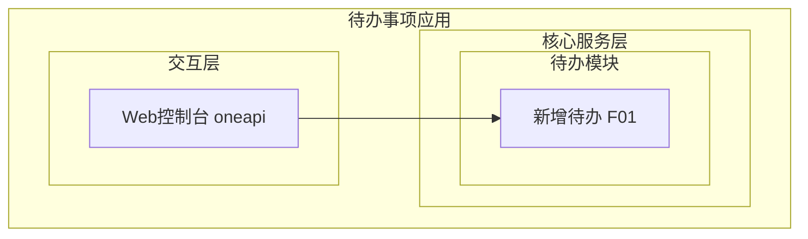
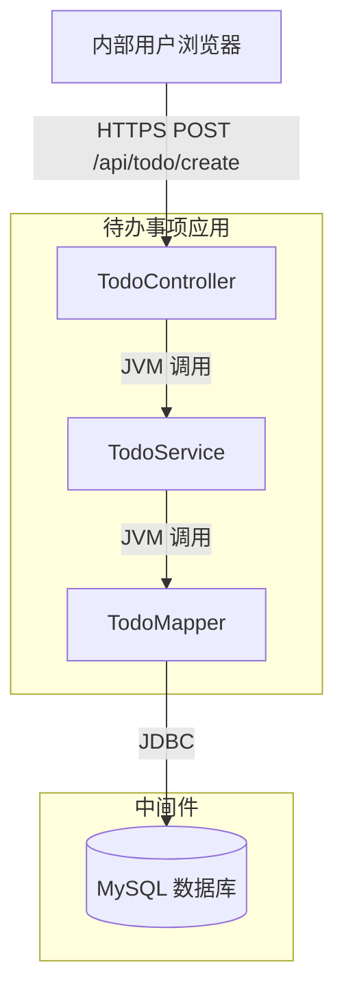
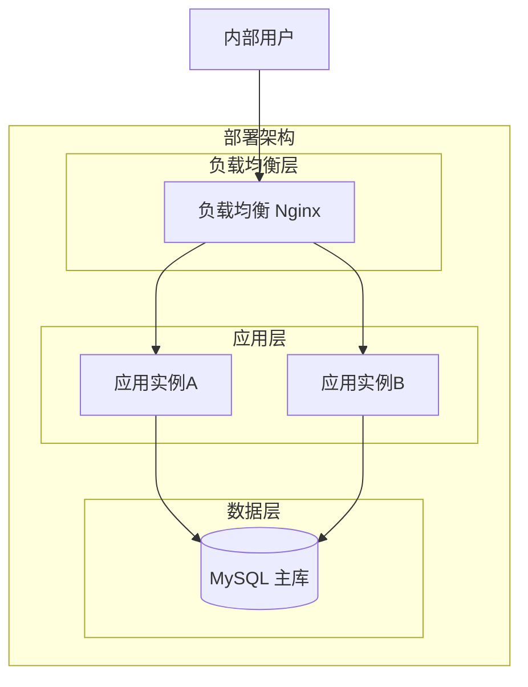
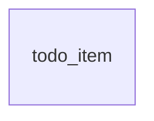
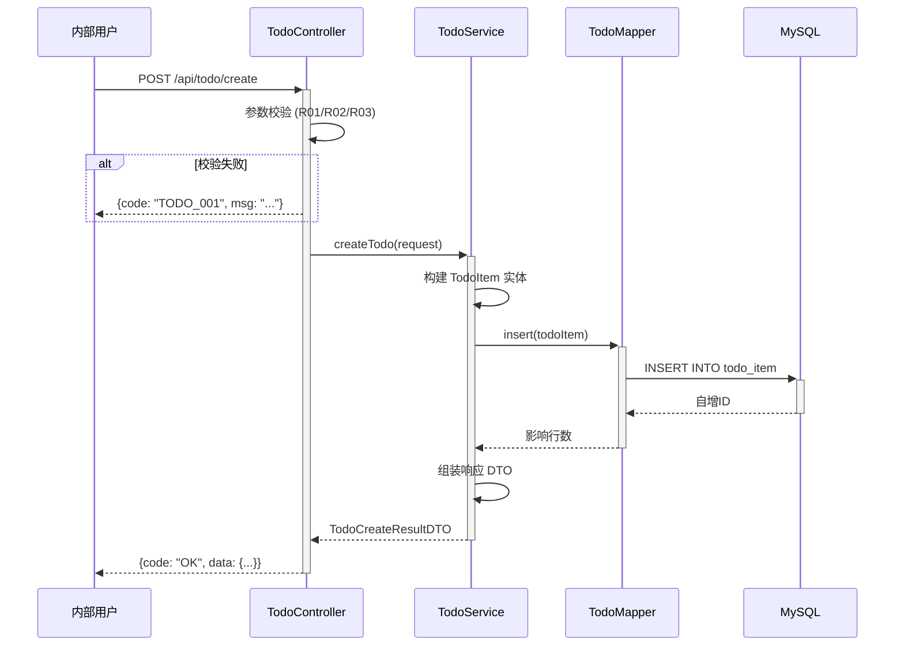
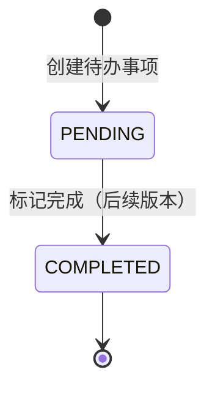

> **文档元信息**
>
> | 项目 | 内容 |
> |------|------|
> | 文档版本 | v1.0 |
> | 作者 | AiWork |
> | 创建日期 | 2026-10-13 |
> | 需求来源 | 目标：帮助用户记录日常待办事项。核心功能：新增待办事项。 |
> | 评审状态 | 待评审 |

# 待办事项管理 系分设计

## 1. 需求与范围

### 背景与目标
用户需要一个轻量级日常待办事项记录工具。当前最小闭环为「创建待办事项」，后续可扩展查询、标记完成、删除等功能。

### 核心功能
- **F01**: 新增待办事项 — 用户输入事项名称和描述，系统保存并返回创建结果

### 约束与非功能要求
- 目标用户：内部用户
- 数据持久化存储，创建后不可丢失
- 事项名称必填，描述可选
- 接口幂等性考虑（相同参数重复调用不应产生脏数据）

### 排除范围
- 不实现待办列表查询
- 不实现待办状态变更（标记完成/取消）
- 不实现待办删除
- 不实现待办修改
- 不实现用户登录/认证
- 不实现多用户/多租户
- 不实现定时提醒

### 需求功能清单与优先级

| 编号 | 功能点 | 优先级 | PRD 原始描述/章节 | 备注 |
|------|--------|--------|-------------------|------|
| F01 | 新增待办事项 | P0 | "新增待办事项。任务信息：事项名称和描述" | 最小闭环唯一功能点 |

### 假设与待确认项

| 编号 | 假设/待确认内容 | 当前假设 | 确认状态 |
|------|-----------------|----------|----------|
| A01 | 技术栈选型 | Java + Spring Boot + MySQL，基于仓库现有 HelloWorld.java | 待确认 |
| A02 | 接口形式 | RESTful API (oneapi)，供内部 Web 控制台调用 | 待确认 |
| A03 | 认证鉴权 | 最小闭环暂不实现，后续补充 | 待确认 |
| A04 | 事项名称长度限制 | 最大 200 字符 | 待确认 |
| A05 | 事项描述长度限制 | 最大 2000 字符 | 待确认 |
| A06 | 待办状态初始值 | 创建后默认为"待处理"(PENDING) | 待确认 |
| A07 | 部署形态 | 单体应用，单数据源 | 待确认 |

## 2. 架构与模块

### 功能架构



- **交互层说明**：Web 控制台通过 oneapi REST 接口访问
- **核心服务层说明**：待办模块负责待办事项的创建与持久化
- **扩展/集成层说明**：当前版本无外部集成

**模块清单**

| 模块 | 职责 | 依赖 |
|------|------|------|
| 待办模块 (todo) | 待办事项创建、持久化 | MySQL 数据库 |

### 应用集成架构



**集成关系说明：**

| 调用方 | 被调用方 | 协议 | 接口类型 | 说明 |
|--------|----------|------|----------|------|
| 内部用户浏览器 | TodoController | HTTPS | oneapi REST | 创建待办 |
| TodoService | TodoMapper | JVM | 内部接口 | 持久化操作 |
| TodoMapper | MySQL | JDBC | SQL | 数据读写 |

### 部署架构



**部署说明：**
- **负载均衡层**：Nginx 反向代理，分发到应用实例
- **应用层**：Spring Boot 单体应用，2 副本保证高可用
- **数据层**：MySQL 单主库，后续可扩展主从读写分离

## 3. 数据模型与存储

### 实体清单

| 实体名称 | 实体说明 | 所属模块 | 与其他实体的关系 |
|----------|----------|----------|-----------------|
| todo_item | 待办事项记录，存储用户创建的待办任务 | 待办模块 (todo) | 无关联实体（当前最小闭环） |

### 实体关系图



**模型说明：**
- 当前版本仅一个实体 `todo_item`，无关联关系
- 后续可扩展用户实体 (`user`) 形成多对一关联
- 无缓存/MQ 需求，直接 MySQL 持久化
- 租户隔离：当前不涉及，后续扩展时采用 `tenant_id` 字段

## 4. 接口设计

### 4.1 oneapi（Web 控制台接口）

| 编号 | 接口名称 | 方法 | 路径 | 模块 |
|------|----------|------|------|------|
| W01 | 新增待办事项 | POST | /api/todo/create | 待办模块 (todo) |

### 4.2 OpenAPI（对外接口）
本项不适用，原因：当前最小闭环仅面向内部 Web 控制台，无对外 OpenAPI 需求。

### 4.3 内部接口（Service 层）

| 编号 | 接口名称 | 类 | 方法签名 |
|------|----------|------|----------|
| S01 | 创建待办事项 | TodoService | TodoCreateResultDTO createTodo(TodoCreateRequestDTO request) |

### 4.4 集成接口（Integration 层）
本项不适用，原因：当前无外部系统集成需求。

## 5. 功能模块设计

### 全局约定

- **错误码格式**: `TODO_{SEQ}`，如 TODO_001、TODO_002
- **通用出参结构**: `{ "code": "OK", "msg": "SUCCESS", "data": {} }`

### 5.1 待办模块 (todo)

#### 5.1.1 表结构设计

##### todo_item（待办事项表）

| 字段名 | 数据类型 | 约束 | 默认值 | 说明 |
|--------|----------|------|--------|------|
| id | bigint | PK, 自增, NOT NULL | - | 系统自增主键 |
| name | varchar(200) | NOT NULL | - | 待办名称 |
| description | varchar(2000) | NULL | NULL | 待办描述 |
| status | varchar(32) | NOT NULL | 'PENDING' | 状态：PENDING-待处理, COMPLETED-已完成 |
| gmt_create | datetime | NOT NULL | CURRENT_TIMESTAMP | 创建时间 |
| gmt_modified | datetime | NOT NULL | CURRENT_TIMESTAMP | 修改时间 |

**索引：**
- PK: `pk_todo_item` (id)
- IDX: `idx_todo_item_status` (status)
- IDX: `idx_todo_item_gmt_create` (gmt_create)

**设计说明：**
- 主键使用自增 bigint，遵循规范"新增表必须有整形的单列主键"
- 引擎默认 InnoDB，事务隔离 ReadCommitted
- 字符集 utf8mb4
- 表名全小写下划线命名，长度 9 字符 < 26
- 含 id / gmt_create / gmt_modified 三个标准字段
- status 使用 varchar 而非 enum，遵循规范"禁止使用 enum 类型"

##### 枚举与常量定义

| 枚举名称 | 取值 | 含义 | 关联字段 |
|----------|------|------|----------|
| TodoStatus | PENDING | 待处理 | todo_item.status |
| TodoStatus | COMPLETED | 已完成 | todo_item.status |

#### 5.1.2 接口详细设计

##### W01 新增待办事项

- **URI**: POST /api/todo/create
- **描述**: 创建一个新的待办事项，返回创建的待办记录
- **入参**:

| 参数名称 | 类型 | 是否必填 | 描述 |
|----------|------|----------|------|
| name | String | 是 | 待办名称，最大 200 字符 |
| description | String | 否 | 待办描述，最大 2000 字符 |

- **出参**:

| 参数名称 | 类型 | 描述 |
|----------|------|------|
| code | String | 结果码，成功为 "OK" |
| msg | String | 提示信息 |
| data | Object | 业务数据，含创建的待办记录 |

- **data 结构**:

| 参数名称 | 类型 | 描述 |
|----------|------|------|
| id | Long | 待办事项 ID |
| name | String | 待办名称 |
| description | String | 待办描述 |
| status | String | 状态：PENDING |
| gmtCreate | String | 创建时间 (ISO 8601) |

- **错误码**:

| 错误码 | 说明 |
|--------|------|
| TODO_001 | 参数校验失败：事项名称不能为空 |
| TODO_002 | 参数校验失败：事项名称超过 200 字符 |
| TODO_003 | 参数校验失败：事项描述超过 2000 字符 |
| TODO_999 | 系统内部错误 |

- **业务规则**:
  - name 必填，不能为空或纯空白字符
  - name 长度 ≤ 200 字符
  - description 长度 ≤ 2000 字符
  - 创建后 status 默认为 PENDING

- **请求示例**:
```json
{
  "name": "完成系分设计文档",
  "description": "完成待办事项模块的系统分析与设计文档编写"
}
```

- **响应示例**:
```json
{
  "code": "OK",
  "msg": "SUCCESS",
  "data": {
    "id": 1,
    "name": "完成系分设计文档",
    "description": "完成待办事项模块的系统分析与设计文档编写",
    "status": "PENDING",
    "gmtCreate": "2026-10-13T10:30:00"
  }
}
```

#### 5.1.3 子功能详细设计

##### 5.1.3.1 新增待办事项（F01）

- **处理时序图**:



**业务规则：**

| 规则编号 | 规则描述 | 校验时机 | 不满足时的处理 |
|----------|----------|----------|--------------|
| R01 | name 不能为空或纯空白字符 | 创建时 Controller 层 | 返回 TODO_001，提示"事项名称不能为空" |
| R02 | name 长度 ≤ 200 字符 | 创建时 Controller 层 | 返回 TODO_002，提示"事项名称不能超过200字符" |
| R03 | description 长度 ≤ 2000 字符 | 创建时 Controller 层 | 返回 TODO_003，提示"事项描述不能超过2000字符" |

**异常场景：**

| 异常场景 | 处理方式 |
|----------|----------|
| 数据库连接失败 | 返回 TODO_999 "系统内部错误"，上层熔断降级 |
| 数据库写入超时 | 返回 TODO_999，依赖 JDBC 超时与连接池保护 |
| name 为空字符串或纯空格 | 返回 TODO_001，Controller 层 `@NotBlank` 校验 |
| 请求体格式错误（非 JSON） | Spring 框架自动返回 400 Bad Request |

**并发控制：**
- 并发场景：多用户同时创建待办，各自独立无冲突
- 控制策略：无并发风险，原因：创建操作为纯新增，不涉及共享数据竞争；主键自增由数据库保证唯一性

**状态机设计：**



**状态流转规则：**

| 当前状态 | 目标状态 | 流转条件 | 前置校验 | 触发动作 |
|----------|----------|----------|----------|----------|
| [*] | PENDING | 调用创建接口 | name 非空校验通过 | 写入数据库 |
| PENDING | COMPLETED | 调用标记完成接口（后续版本） | 待办存在 | 更新 status 字段 |

**技术选型方案对比：**

| 维度 | 方案A: Spring Boot + MyBatis | 方案B: Spring Boot + JPA | 方案C: 纯 JDBC |
|------|---------------------------|-------------------------|---------------|
| 开发效率 | 高（XML/注解 SQL） | 高（自动映射） | 低（手写 SQL） |
| SQL 可控性 | 完全可控 | 自动生成，复杂查询受限 | 完全可控 |
| 学习成本 | 低 | 中 | 低 |
| 社区生态 | 国内主流 | Spring 官方 | 基础 |
| 扩展性 | 灵活 | 受限于 JPA 抽象 | 灵活但繁琐 |

**推荐**: 方案 A（Spring Boot + MyBatis），理由：国内主流、SQL 完全可控、与现有 Java 技术栈一致。

**模块自检：**

| 检查项 | 是否覆盖 | 说明 |
|--------|----------|------|
| F01 新增待办 | ✅ | 5.1.3.1 详细设计 |
| 表结构定义 | ✅ | 5.1.1 todo_item 表 |
| 接口详细定义 | ✅ | 5.1.2 W01 |
| 枚举定义 | ✅ | TodoStatus |
| 状态机 | ✅ | PENDING → COMPLETED |
| 业务规则 | ✅ | R01/R02/R03 |
| 异常场景 | ✅ | 4 类异常覆盖 |
| 并发控制 | ✅ | 无并发风险 |
| 过度设计 | ✅ | 无多余抽象层/分布式组件/多数据源 |

## 6. 非功能性需求设计

### 6.1 高可用性
- 应用层部署 2 副本，通过 Nginx 负载均衡，单实例故障自动摘除
- 数据库单点风险：当前最小闭环暂时接受 MySQL 单主，后续可扩展主从 + 故障切换
- 接口超时设置：HTTP 请求 30s 超时，数据库连接池超时 5s

### 6.2 可扩展性
- 单体应用水平扩展：Spring Boot 无状态设计，增加实例即扩容
- 表结构预留：status 字段使用 varchar 便于后续扩展状态值；id 自增可平滑过渡到分库分表雪花 ID
- 接口版本化：后续变更通过 `/api/v1/todo/create` → `/api/v2/todo/create` 演进

### 6.3 稳定性/可靠性
- 参数校验在 Controller 层拦截，避免无效请求进入 Service 层
- 数据库写入使用事务保证原子性
- 日志记录关键操作（创建成功/失败），便于排查

### 6.4 安全性设计

#### 6.4.1 账户系统方案
本项不适用，原因：当前最小闭环仅面向内部用户，暂不实现登录认证，后续接入公司 OA/SSO。

#### 6.4.2 授权&访问控制

##### 6.4.2.1 是否实现水平权限检查
本项不适用，原因：当前为单用户视角，无多租户/多用户数据隔离需求。

##### 6.4.2.2 是否实现垂直权限检查
本项不适用，原因：当前仅一个接口，无角色/权限划分需求。

##### 6.4.2.3 是否检查登录态
本项不适用，原因：最小闭环暂不实现登录，后续通过全局拦截器统一校验。

#### 6.4.3 数据防护方案

##### 6.4.3.1 是否对敏感数据加密存储
本项不适用，原因：待办名称和描述为普通业务数据，非身份证/银行卡等敏感信息。

##### 6.4.3.2 是否对敏感数据展示进行脱敏
本项不适用，原因：无敏感数据字段。

### 6.5 监控/统计/日志/告警
- 接口调用日志：记录请求路径、耗时、结果码
- 数据库慢查询监控：超过 200ms 告警
- 应用健康检查：`/actuator/health` 端点供 Nginx 探测

## 7. 变更三板斧

### 7.1 可监控
- **服务埋点**：
  - 接口调用量：`todo.create.count`（Counter，按结果码分维度）
  - 接口耗时：`todo.create.duration`（Histogram，P50/P90/P99 分位）
  - 数据库写入耗时：`todo.db.insert.duration`
- **异常埋点**：
  - 数据库连接失败：`todo.db.connection.error`
  - 参数校验失败：`todo.create.validation.error`（按错误码分维度）

### 7.2 可灰度
本项不适用，原因：当前仅一个接口且为新增功能，无旧逻辑可对比灰度。后续多接口时可考虑按租户尾号灰度引流。

### 7.3 可应急
- **功能开关**：在配置中心（如 Nacos/Apollo）设置 `todo.create.enabled` 开关，可动态关闭创建接口返回"功能维护中"
- **回滚方案**：发布包回滚，因是纯新增功能无上下游依赖，回滚无副作用
- **数据兼容**：回滚后已创建的 todo_item 数据保留，不影响数据库