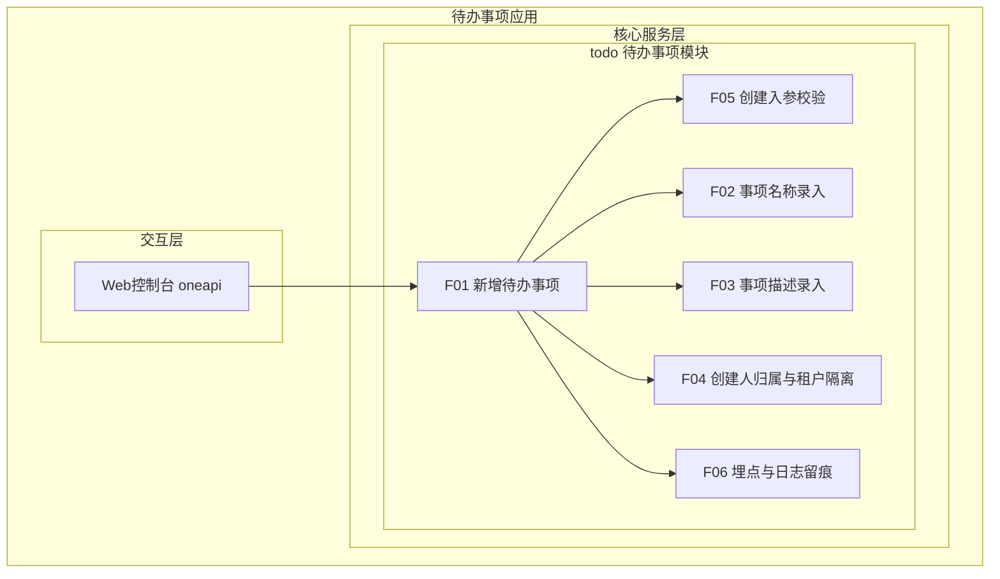
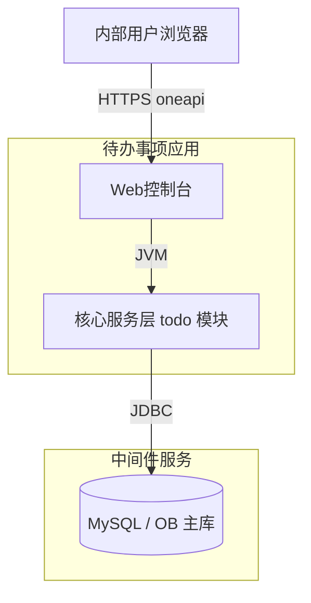
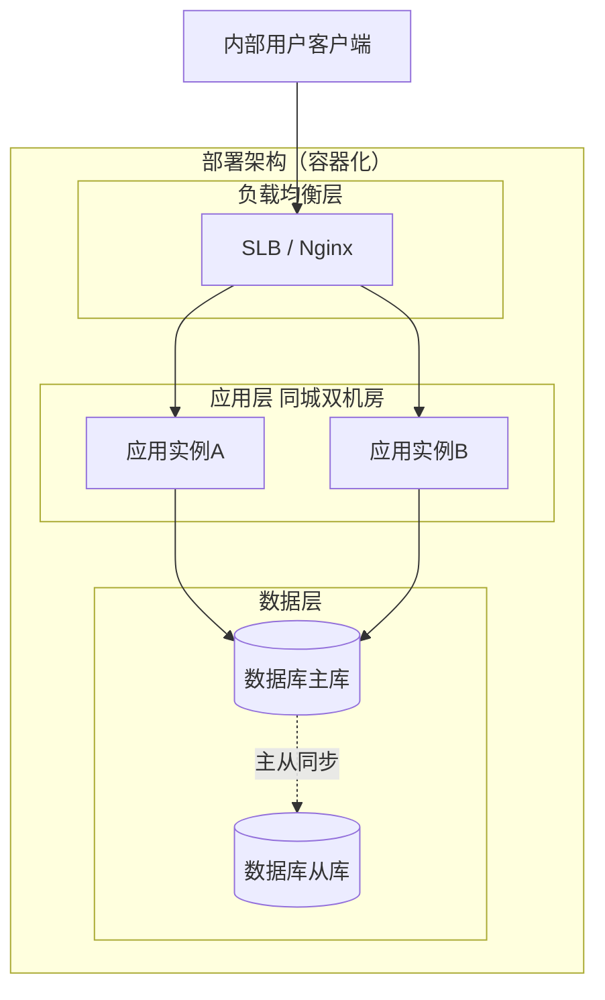
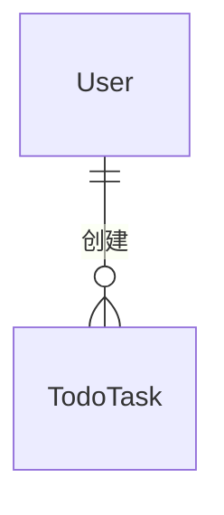
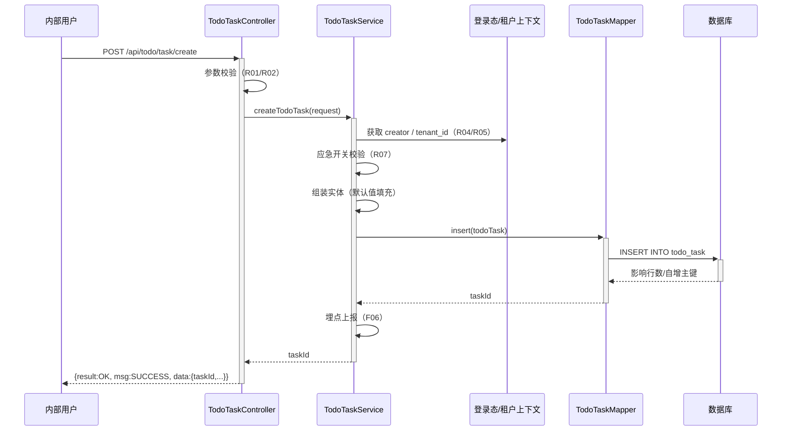
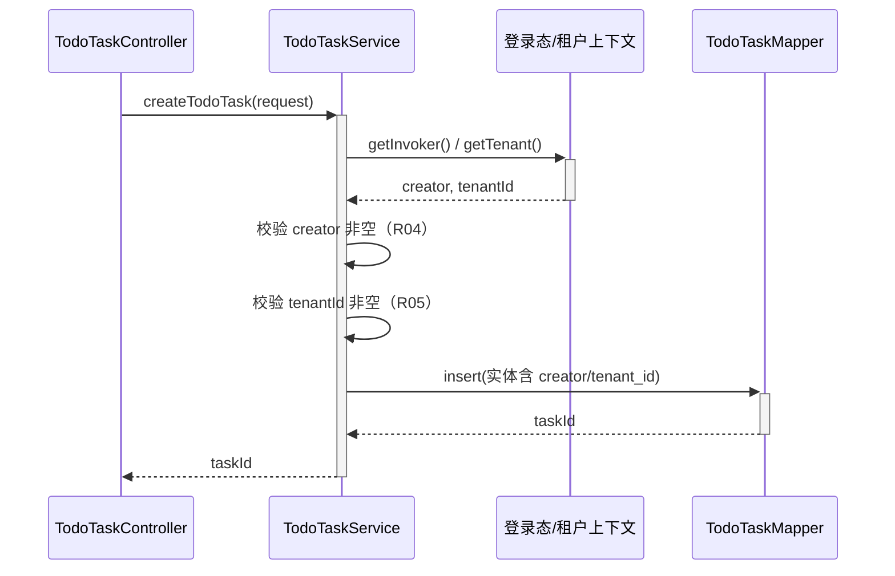
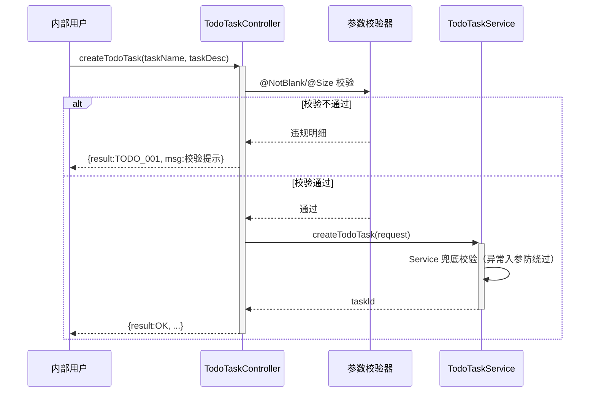

> **文档元信息**
>
> | 项目 | 内容 |
> |------|------|
> | 文档版本 | v1.0 |
> | 作者 | AiWork |
> | 创建日期 | 2026-10-13 |
> | 需求来源 | 需求描述：目标「帮助用户记录日常待办事项」；核心功能「新增待办事项」；任务信息「事项名称和描述」；目标用户「内部用户」；最小闭环「仅创建」 |
> | 评审状态 | 待评审 |

# 待办事项（Todo）新增能力 系分设计

## 1. 需求与范围

### 背景与目标
内部用户在日常工作中需要随手记录待办事项，当前缺少统一入口，事项散落在聊天记录、邮件与本地便签中，容易遗漏且无法归属到人。本期为内部用户提供「新增待办事项」能力，形成**仅创建**的最小闭环：用户录入事项名称与描述后，待办事项被持久化保存，并自动归属到创建人及其所属租户。

**目标**：
1. 提供统一的待办事项创建入口，一次提交完成一条待办事项的记录。
2. 事项名称与描述均被完整持久化，创建人、租户信息可追溯。
3. 在不引入查询/编辑/删除等能力的前提下，保证创建链路可用、可靠、可监控。

### 核心功能
1. **新增待办事项**：录入事项名称（必填）与事项描述（选填），提交后落库并返回待办事项 ID。
2. **事项名称录入**：名称必填、去首尾空白后非空、长度上限 64 字符。
3. **事项描述录入**：描述选填，长度上限 512 字符。
4. **创建人归属与租户隔离**：创建人取自登录态上下文，不由前端传入；同时写入租户标识实现数据隔离。
5. **创建入参校验**：名称为空/超长、描述超长时快速失败并返回明确错误码与提示。
6. **操作留痕（可监控）**：创建调用结果与耗时写入埋点，异常可告警。

### 约束与非功能要求
- **用户规模**：内部用户，预估日活 < 2000，创建接口峰值 < 50 QPS。
- **性能**：创建接口服务端 P99 ≤ 200ms；单次请求 DB 交互 1 次写入。
- **数据**：持久化到 MySQL（兼容 OB）；单表 1~2 年数据量 < 500w、容量 < 10G，本期无需分表。
- **安全**：必须校验登录态；租户维度隔离；SQL 参数化；描述内容不整篇打印到日志。
- **可用性**：内部工具，可用性目标 99.9%；本期仅创建链路，无定时任务。
- **合规**：遵循平台数据库设计规范（禁用 `timestamp`、`float/double`、`enum`，索引前缀 `pk_/uk_/idx_`）。

### 排除范围
- **不涉及**待办事项的查询列表、详情、编辑、删除、批量操作。
- **不涉及**状态流转（待办 → 已完成）、到期时间、优先级、提醒/通知。
- **不涉及**附件、富文本、标签分类、多端同步、分享协作。
- **不涉及**对外 OpenAPI 开放与第三方系统集成。
- **不涉及**缓存与消息队列（本期无读放大与削峰诉求）。

### 需求功能清单与优先级

| 编号 | 功能点 | 优先级 | PRD 原始描述/章节 | 备注 |
|------|--------|--------|-------------------|------|
| F01 | 新增待办事项 | P0 | 「核心功能：新增待办事项」+「最小闭环：仅创建」 | 本期唯一业务闭环 |
| F02 | 录入事项名称并持久化 | P0 | 「任务信息：事项名称和描述」 | 名称必填，≤64 字符 |
| F03 | 录入事项描述并持久化 | P0 | 「任务信息：事项名称和描述」 | 描述选填，≤512 字符 |
| F04 | 创建人归属与租户隔离 | P0 | 「目标用户：内部用户」 | 创建人取登录态，不信任入参 |
| F05 | 创建入参校验与错误提示 | P0 | 隐含需求（创建闭环可用性） | 空值/长度校验 |
| F06 | 新增操作埋点与日志留痕 | P1 | 隐含需求（变更三板斧：可监控） | 非业务字段，埋点维度 |

### 假设与待确认项

| 编号 | 假设/待确认内容 | 当前假设 | 确认状态 |
|------|-----------------|----------|----------|
| A01 | 未说明接入形态（前端页面/开放接口） | 内部用户经 Web 控制台调用 oneapi `POST /api/todo/task/create` | 待确认 |
| A02 | 未说明技术栈（仓库现仅有 `HelloWorld.java` 脚手架） | 沿用数科业务 Java（Spring Boot）标准技术栈：Controller–Service–Repository | 待确认 |
| A03 | 未说明存储介质 | MySQL/OB 单表 `todo_task`，不引入缓存与 MQ | 待确认 |
| A04 | 未说明事项名称是否唯一 | 允许同名待办（名称属用户自由文本），不做唯一约束 | 待确认 |
| A05 | 未说明是否需要截止时间/优先级/标签 | 本期不纳入，列入下期扩展 | 待确认 |
| A06 | 未说明描述是否必填 | 假设名称必填、描述选填 | 待确认 |
| A07 | 未说明多租户要求 | 按平台默认采用 `tenant_id` 隔离 | 待确认 |
| A08 | 未说明是否支持单次批量创建 | 假设单次仅创建一条待办事项 | 待确认 |
| A09 | 知识检索工具 `board-knowledge-search` 在本运行时未注册，未获取外部知识库输入 | 以仓库事实 + 平台默认规范推导设计，未使用外部知识 | 待确认 |
| A10 | 未说明待办事项是否含状态字段 | 本期不引入 `status`，避免无法闭环的孤岛状态；下期随「完成/查询」需求设计 | 待确认 |

## 2. 架构与模块

### 功能架构



- **交互层**：Web 控制台经 oneapi（`/api` 前缀）调用创建接口，承载内部用户操作入口。
- **核心服务层**：本期仅 `todo` 一个业务模块，职责单一，集中处理创建受理、校验、归属与持久化。
- **扩展/集成层**：本期不适用，原因：无外部系统集成、无独立扩展子域；下期的提醒/通知能力再引入该层。

**模块清单**

| 模块 | 职责 | 依赖 |
|------|------|------|
| todo（待办事项模块） | 待办事项创建受理、入参校验、创建人与租户归属、持久化、埋点留痕 | 数据库（JDBC）；平台登录态与租户上下文（进程内） |

模块依赖检查：`todo` 为唯一业务模块，不存在模块间循环依赖；无功能点占比超 50% 的模块（模块内 F01 承载主干，其余为横向能力）。

### 应用集成架构

本期无外部系统集成，集成形态明确，故功能/集成/部署三部分合并说明。



**集成关系说明：**

| 调用方 | 被调用方 | 协议 | 接口类型 | 说明 |
|--------|----------|------|----------|------|
| 内部用户浏览器 | 应用 Web 控制台 | HTTPS | oneapi REST | 承载创建入口，`POST /api/todo/task/create` |
| Web 控制台 | 核心服务层 todo 模块 | JVM | 内部调用 | Controller → Service |
| 核心服务层 todo 模块 | 数据库 | JDBC | SQL | 单条 INSERT 写入 `todo_task` |

下游依赖异常时的可用性：本期写路径唯一外部依赖为数据库，且为**强依赖**（创建必须落库），无自动降级路径；DB 不可用时快速失败并返回 `TODO_004`，不阻塞线程、不产生脏数据。登录态/租户上下文为进程内上下文，非远程调用，不构成外部依赖。

### 部署架构



**部署说明：**
- **负载均衡层**：SLB/Nginx 承载流量分发与健康检查，双机房同城部署，无单点。
- **应用层**：应用无状态（不持有会话与本地状态），多副本部署，支持横向扩容与滚动发布。
- **数据层**：MySQL/OB 主从架构，主库承接写；从库承接后续读流量（下期查询能力），故障时可由高可用组件切换。
- **单点检查**：负载均衡、应用、数据库三层均无单点；本期无定时任务，不存在任务单点问题。

## 3. 数据模型与存储

### 实体清单

| 实体名称 | 实体说明 | 所属模块 | 与其他实体的关系 |
|----------|----------|----------|-----------------|
| todo_task | 待办事项，记录事项名称、事项描述、创建人、租户及审计时间 | todo | 与外部账号体系 User 多对一（一名用户可创建多条待办）；本期无同库关联实体 |

### 实体关系图



> 说明：`User` 为外部登录态提供方（账号体系），本系统不建表、不建外键（遵循「禁止使用外键」规范），仅在 `todo_task.creator` 记录创建人标识。字段详细定义见第 5 章。

**模型说明：**
- 一名用户可创建多条待办事项（1:N）；一条待办事项仅归属一个创建人。
- 本期仅创建路径，无实体间级联更新与删除；`todo_task` 采用逻辑删除字段预留，本期创建时恒为未删除。
- 租户隔离维度为 `tenant_id`，同一租户内数据相互独立。
- 缓存/MQ 数据形态：不适用，原因：本期仅单条写入且 QPS 低，无热点读与削峰需求。

## 4. 接口设计

### 4.1 oneapi（Web 控制台接口）

| 编号 | 接口名称 | 方法 | 路径 | 模块 |
|------|----------|------|------|------|
| W01 | 新增待办事项 | POST | /api/todo/task/create | todo |

### 4.2 OpenAPI（对外接口）

本项不适用，原因：本期目标用户为内部用户，无对外/三方系统调用方，OpenAPI 通道不开通；后续如需集成，可复用同一 Service 契约（S01）新增 `/openapi` 门面，不改变业务实现。

### 4.3 内部接口（Service 层）

| 编号 | 接口名称 | 类 | 方法签名 |
|------|----------|------|----------|
| S01 | 新增待办事项 | TodoTaskService | `Long createTodoTask(TodoTaskCreateRequest request)` |

### 4.4 集成接口（Integration 层）

本项不适用，原因：本期无外部系统集成，唯一外部依赖为数据库（通过 Repository/Mapper 访问，属数据访问层而非集成层）；登录态与租户信息来自平台进程内上下文，非远程调用。

## 5. 功能模块设计

### 5.1 todo（待办事项模块）

#### 5.1.1 表结构设计

##### 5.1.1.1 todo_task（待办事项表）

| 字段名 | 数据类型 | 约束 | 默认值 | 说明 |
|--------|----------|------|--------|------|
| id | bigint | PK, 自增, NOT NULL | - | 系统自增主键，待办事项唯一标识 |
| tenant_id | varchar(32) | NOT NULL | '' | 租户标识，用于租户隔离 |
| task_name | varchar(64) | NOT NULL | '' | 事项名称，必填 |
| task_desc | varchar(512) | NOT NULL | '' | 事项描述，选填，空时存空串 |
| creator | varchar(64) | NOT NULL | '' | 创建人登录名/工号，取自登录态 |
| is_deleted | tinyint | NOT NULL | 0 | 逻辑删除标记：0-未删除，1-已删除 |
| gmt_create | datetime | NOT NULL | CURRENT_TIMESTAMP | 创建时间，代码侧维护 |
| gmt_modified | datetime | NOT NULL | CURRENT_TIMESTAMP | 修改时间，代码侧维护（创建时与创建时间一致） |

**索引：**
- PK: `pk_todo_task` (id)
- 本期不新增二级索引。原因：本期仅创建路径，无按租户/创建人的检索诉求，遵循「索引不是越多越好」；下期新增列表查询接口时，按左前缀原则新增 `idx_todo_task_tenant_creator` (tenant_id, creator)。

**建表规范符合性说明：**
- 表名 `todo_task` 全小写下划线、遵循「业务名称_表的作用」，表名与字段名长度均 < 26；不含保留字。
- 主键为整形单列自增主键；不使用联合主键、不使用外键/触发器/视图/存储过程、不指定表存储引擎。
- 时间字段使用 `datetime`（禁用 `timestamp`）；无 `float/double`（本表无小数字段）；无 `enum` 类型（`is_deleted` 使用 `tinyint`）。
- 全部被索引/参与唯一性判断的列均 NOT NULL 且设默认值；字段均带注释。
- 字段数 8 个（< 100）；表内无超长 `varchar`（最大 512），单行长度可控。

##### 5.1.1.2 枚举与常量定义

本模块无枚举字段（`todo_task` 无 `status`/`type` 类有限取值字段，见假设 A10），仅存在入参长度常量：

| 常量名称 | 取值 | 含义 | 关联字段 |
|----------|------|------|----------|
| TASK_NAME_MAX_LEN | 64 | 事项名称最大字符长度 | todo_task.task_name |
| TASK_DESC_MAX_LEN | 512 | 事项描述最大字符长度 | todo_task.task_desc |
| IS_DELETED_NO | 0 | 逻辑删除标记：未删除 | todo_task.is_deleted |
| IS_DELETED_YES | 1 | 逻辑删除标记：已删除（本期不产生该取值，为下期删除能力预留） | todo_task.is_deleted |

#### 5.1.2 接口详细设计

##### W01 新增待办事项

- **URI**: POST /api/todo/task/create
- **描述**: 内部用户提交一条待办事项的名称与描述，创建人取登录态，落库后返回待办事项 ID。
- **入参**:

| 参数名称 | 类型 | 是否必填 | 描述 |
|----------|------|----------|------|
| taskName | String | 是 | 事项名称，去除首尾空白后长度 1~64 字符 |
| taskDesc | String | 否 | 事项描述，最大 512 字符，不传或为空时按空串存储 |

- **出参**:

| 参数名称 | 类型 | 描述 |
|----------|------|------|
| result | String | 结果 code，成功为 `OK`，失败为 `TODO_xxx` |
| msg | String | 提示信息，成功为 `SUCCESS` |
| data | Object | 业务数据 |
| data.taskId | Long | 新建待办事项 ID |
| data.taskName | String | 落库后的事项名称（去空白后） |
| data.gmtCreate | String | 创建时间，格式 `yyyy-MM-dd HH:mm:ss` |

- **错误码**:

| 错误码 | 说明 |
|--------|------|
| TODO_001 | 参数校验失败（名称为空/超长、描述超长） |
| TODO_002 | 未获取到登录用户，登录态失效 |
| TODO_003 | 未获取到租户信息 |
| TODO_004 | 系统繁忙，待办事项保存失败 |
| TODO_005 | 创建功能已关闭（应急开关关闭） |

- **业务规则**: 名称为空或超长时拒绝；描述超长时拒绝；创建人/租户强制取自登录态；同名待办允许重复；单次仅创建一条。
- **请求示例**:
```json
{
  "taskName": "整理季度复盘材料",
  "taskDesc": "收集各组数据，输出复盘文档初稿"
}
```
- **响应示例**:
```json
{
  "result": "OK",
  "msg": "SUCCESS",
  "data": {
    "taskId": 1000001,
    "taskName": "整理季度复盘材料",
    "gmtCreate": "2026-10-13 10:20:30"
  }
}
```

#### 5.1.3 子功能详细设计

##### 5.1.3.1 新增待办事项（F01 / F02 / F03）

- 处理时序图


**业务规则：**
| 规则编号 | 规则描述 | 校验时机 | 不满足时的处理 |
|----------|----------|----------|--------------|
| R01 | 事项名称必填，去除首尾空白后长度 1~64 字符 | 创建时（Controller 注解 + Service 兜底） | 返回 `TODO_001`，提示「事项名称不能为空且不超过 64 字符」 |
| R02 | 事项描述选填，长度 ≤ 512 字符 | 创建时（同 R01） | 返回 `TODO_001`，提示「事项描述不能超过 512 字符」 |
| R03 | 单次请求仅创建一条待办事项 | 创建时 | 不涉及（接口仅接受单条对象） |
| R04 | 创建人取自登录态，禁止由入参传入或覆盖 | 创建前 | 返回 `TODO_002`，提示「登录态失效，请重新登录」 |
| R05 | 租户标识取自登录态上下文并写入记录 | 创建前 | 返回 `TODO_003`，提示「未获取到租户信息」 |
| R06 | 同名待办允许重复创建，不做唯一性校验 | 创建时 | 不适用（业务上允许） |
| R07 | 应急开关开启时才允许创建 | 创建前 | 返回 `TODO_005`，提示「创建功能已临时关闭」 |
| R08 | `is_deleted` 初始化为 0，`gmt_create`/`gmt_modified` 由代码赋值 | 创建时 | 由实体默认值与 DB 默认值双重保证，异常时返回 `TODO_004` |

**异常场景：**
| 异常场景 | 处理方式 |
|----------|----------|
| 名称为空或全为空白字符 | 校验失败，返回 `TODO_001`，不落库 |
| 名称/描述超长 | 校验失败，返回 `TODO_001`，不落库 |
| 登录态失效或无法解析创建人 | 返回 `TODO_002`，不落库，记录 warn 日志 |
| 无法解析租户信息 | 返回 `TODO_003`，不落库 |
| DB 连接异常/超时 | 快速失败返回 `TODO_004`，不重试（避免放大写流量），记录 error 日志并告警 |
| DB 写入被拒（如主键冲突、字段超长兜底） | 返回 `TODO_004`，记录原始错误码用于定位 |
| 重复点击造成多次提交 | 由前端提交按钮防重；服务端不做强制幂等（同名待办业务上合法），如产生重复记录可由下期删除能力清理 |
| 应急开关关闭 | 返回 `TODO_005`，不落库 |

**事务与回滚策略：** 本功能为单表单条 INSERT，无跨表/跨库写入，依赖数据库单语句原子性即可，不引入显式分布式事务；语句失败即整体失败，无中间态残留。

**并发控制（涉及数据写入）：**
- 并发场景：同一用户快速重复点击提交、同一用户多端同时创建；不同用户并发插入相互无影响（无共享行更新，主键自增无冲突）。
- 多方案对比：
  | 方案 | 说明 | 优点 | 缺点 |
  |------|------|------|------|
  | ① 不做额外处理 | 依赖业务允许重复 | 实现最简单、无误拒 | 重复点击会产生多条语义相同的待办 |
  | ② 前端防重 + 后端可选幂等键 | 按钮置灰防重；预留 `requestId` 幂等键（本期不强制） | 成本低、无额外表与索引 | 后端不强制幂等，极端绕过前端仍可能重复 |
  | ③ 幂等表/唯一索引强去重 | 对 (tenant_id, creator, request_id) 建唯一约束 | 强一致防重 | 需新增幂等表或索引，超出「仅创建」最小闭环，属过度设计 |
- 推荐方案：**方案 ②**。理由：业务上同名待办合法（R06），重复记录的危害仅为冗余而非数据错误；以最小成本规避绝大多数重复提交，同时不引入超范围的表/索引设计。本期落地：前端提交防重 + `requestId` 字段在 `TodoTaskCreateRequest` 中预留（不透传落库）。

**状态机设计（如实体存在状态字段）：**

本项不适用，原因：本期 `todo_task` 不含 `status` 状态字段（业务上未要求状态流转，创建后即为终态记录），不存在状态机与孤岛状态；下期引入「完成/取消」需求时再补充状态机设计。

##### 5.1.3.2 创建人归属与租户隔离（F04）

- 处理时序图


**业务规则：**
| 规则编号 | 规则描述 | 校验时机 | 不满足时的处理 |
|----------|----------|----------|--------------|
| R04 | 创建人取自登录态，不支持入参覆盖 | 创建前 | 返回 `TODO_002` |
| R05 | 租户标识取自登录态并写入 `tenant_id` | 创建前 | 返回 `TODO_003` |
| R09 | 查询/校验租户数据时以 `tenant_id` 为水平权限边界（本期仅写入侧保证） | 创建前 | 不适用（本期无查询） |

**异常场景：**
| 异常场景 | 处理方式 |
|----------|----------|
| 登录态缺失（未登录/票据过期） | 全局拦截器拒绝，返回 `TODO_002` |
| 登录态存在但创建人字段为空 | 返回 `TODO_002`，不落库 |
| 租户上下文缺失 | 返回 `TODO_003`，不落库 |

**并发控制：** 无并发风险，原因：本子功能仅读取请求级上下文，不涉及共享可变状态与并发写。

##### 5.1.3.3 创建入参校验与错误提示（F05）

- 处理时序图


**业务规则：**
| 规则编号 | 规则描述 | 校验时机 | 不满足时的处理 |
|----------|----------|----------|--------------|
| R01 | 名称 trim 后非空且 ≤ 64 字符 | 创建时 | 返回 `TODO_001` |
| R02 | 描述长度 ≤ 512 字符 | 创建时 | 返回 `TODO_001` |
| R10 | Service 层对 Controller 校验做兜底（防止内部调用绕过） | 创建前 | 返回 `TODO_001` |

**异常场景：**
| 异常场景 | 处理方式 |
|----------|----------|
| 入参 JSON 结构错误/字段类型不匹配 | 框架统一异常处理返回参数错误（提示 `TODO_001` 语义） |
| 名称含全角空格、不可见字符 | trim 后判空拦截，返回 `TODO_001` |
| 描述为超大文本（远大于 512） | 长度校验拦截，避免无效大报文落库 |

**并发控制：** 无并发风险，原因：纯读入参校验，无共享状态。

#### 5.1.4 技术选型方案对比

| 决策点 | 方案A | 方案B | 推荐 | 理由 |
|--------|-------|-------|------|------|
| 持久化路径 | 直连 DB 单条 INSERT | 先写 Redis/消息队列再异步落库 | **方案A** | 单次单条写入、QPS 低，方案A 一致性强且无需引入中间件，避免为未出现的性能问题付费 |
| 校验位置 | Controller 声明式校验 + Service 兜底 | 仅 Service 手写校验 | **方案A** | 声明式校验代码量小、错误提示统一；Service 兜底可防内部调用绕过 |
| 创建人来源 | 登录态上下文（Invoker） | 前端入参 creator | **方案A** | 防伪造，满足审计与水平权限要求 |
| 描述存储形态 | 与主表同表 `varchar(512)` | 独立描述表 / 大文本表 | **方案A** | 描述长度可控（≤512）、单行长度小，同表存储避免多余 join，符合「控制单行长度」前提 |
| 接入通道 | 仅 oneapi | oneapi + OpenAPI 双通道 | **方案A** | 本期无外部调用方，双通道属过度设计；后续可零成本扩展 |

#### 5.1.5 模块自检

**完备性对账表**

| 需求编号 | 设计落点 | 状态 |
|----------|----------|------|
| F01 新增待办事项 | 5.1.2 W01 / 5.1.3.1 | 已覆盖 |
| F02 录入事项名称并持久化 | 5.1.1.1 task_name / 5.1.3.1 R01 | 已覆盖 |
| F03 录入事项描述并持久化 | 5.1.1.1 task_desc / 5.1.3.1 R02 | 已覆盖 |
| F04 创建人归属与租户隔离 | 5.1.1.1 creator、tenant_id / 5.1.3.2 | 已覆盖 |
| F05 创建入参校验与错误提示 | 5.1.2 错误码 / 5.1.3.3 | 已覆盖 |
| F06 埋点与日志留痕 | 第 6.5 章 / 第 7.1 章 | 已覆盖 |

**过度设计检查**

| 检查点 | 结论 |
|--------|------|
| 是否引入本期不需要的中间件（缓存/MQ） | 否，明确不引入 |
| 是否引入超范围能力（查询/编辑/删除/状态流转/提醒） | 否，已列入排除范围 |
| 是否为未出现的性能问题做分表/分库 | 否，量级评估 < 500w 单表 |
| 是否新增无检索诉求的二级索引 | 否，本期仅主键索引，下期按需新增 |
| 是否引入冗余字段 | 否，无冗余字段（`creator` 为业务必需，非冗余） |

## 6. 非功能性需求设计

### 6.1 高可用性
- 应用无状态、多副本部署，单实例故障由负载均衡摘除，用户影响面为单请求重试。
- 上下游异常处理：唯一强依赖为数据库，异常时不自动降级（创建必须落库），采用**快速失败 + 明确错误码 `TODO_004`**，避免线程堆积与重试放大；登录态异常返回 `TODO_002`。
- 容错切换：数据库主从由平台中间件完成切换，应用无需感知；应用无本地缓存，不存在缓存与 DB 不一致问题。
- 容灾：同城双机房部署，机房级故障时流量由负载均衡切换至存活机房。

### 6.2 可扩展性
- 水平扩展：服务无状态，可随流量线性扩容。
- 垂直扩展：DB 层可通过提升规格与读从库分担后续读流量。
- 架构可扩展性：本期仅落 `todo` 单模块 + 单表，下期新增查询/编辑/删除/状态流转时，在同一模块内扩展 Controller–Service–Repository 分层即可，无需改动本期表结构（已预留 `is_deleted`、审计时间字段）。
- 插件式依赖：本期不适用（无对象存储/外部服务依赖，如 OSS ↔ MinIO 切换场景）。

### 6.3 稳定性/可靠性
- 边界场景：名称为空白、描述超长、超大报文、重复提交、并发提交等均有明确校验或处理策略（见 5.1.3 异常场景表）。
- 写入语义：单语句 INSERT，成功即持久化，失败无中间态；`is_deleted` 与审计时间由默认值与代码双重保证。
- DB 超时保护：设置合理的连接与语句超时（建议 ≤ 2s），避免慢 SQL 拖垮线程池。
- 幂等与重复提交：以前端防重为主（见 5.1.3.1 并发控制），不引入幂等表；重复记录为可接受的冗余。

### 6.4 安全性设计
#### 6.4.1 账户系统方案
公共服务：内部办公网用户统一使用平台账号体系（办公网 BUC / 内网 SSO）完成登录，本功能不自实现登录、注册、找密逻辑。创建人身份由登录票据解析，属平台统一登录方案。

#### 6.4.2 授权&访问控制
##### 6.4.2.1 是否实现水平权限检查
实现。以 `tenant_id` 作为数据隔离边界，写入侧强制从登录上下文取租户；后续查询侧须在 SQL 条件中携带 `tenant_id`（建议通过统一数据权限拦截器/注解，如平台 `@LevelAuthorizationAccess`，如无则自实现查询条件注入），防止跨租户读取。

##### 6.4.2.2 是否实现垂直权限检查
本项不适用，原因：本期仅提供「新增待办」这一基础能力，不涉及角色/功能点级权限差异，所有通过登录态校验的内部用户均可创建；如后续引入管理类接口（如批量清理），再按角色配置权限。

##### 6.4.2.3 是否检查登录态
实现。`/api/todo/**` 不在白名单内，由全局统一拦截器校验登录态，未登录或票据失效直接拒绝并返回 `TODO_002`；创建接口不接受任何前端传入的身份信息。

#### 6.4.3 数据防护方案
##### 6.4.3.1 是否对敏感数据加密存储
本项不适用，原因：本期落库数据为待办事项名称与描述，属用户自填业务文本，不含身份证、银行卡、生物特征、AK/SK 等敏感信息，故不涉及加密存储；如后续支持附件/含敏感信息的待办，再评估加密方案。
##### 6.4.3.2 是否对敏感数据展示进行脱敏
本项不适用（展示侧），原因：本期无查询/展示接口。**日志侧要求**：禁止整篇打印 `taskDesc`（可能含用户自由文本），仅打印长度或摘要；用户标识（creator）如需打印按工号脱敏规则处理。

### 6.5 监控/统计/日志/告警
- **调用埋点**：`todo.task.create` 记录调用服务、处理结果（成功/失败）、处理耗时、失败错误码。
- **指标监控**：接口 QPS、成功率、P99 耗时、DB 写入失败率；成功率或耗时超阈值触发告警。
- **日志**：INFO 记录创建成功（tenantId、creator、taskId、耗时，不打印描述全文）；WARN 记录校验失败与登录态异常；ERROR 记录 DB 异常并携带原始错误码。
- **告警点**：DB 写入失败率 > 1%（5 分钟窗口）、接口 P99 > 500ms、异常日志突增。

## 7. 变更三板斧

### 7.1 可监控
针对关键点设计埋点：
- 入口埋点：`todo.task.create`（调用服务、处理结果、处理耗时、错误码、租户维度）。
- 数据点：创建成功数量、失败数量及失败原因分布、DB 写入耗时。
- 日志与指标联动：错误码 `TODO_004` 出现即触发 DB 侧排查；`TODO_001` 突增提示前端校验异常或调用方误用。

### 7.2 可灰度
本期为**纯新增功能**，不存在旧逻辑替换，灰度目的是控制新入口放量风险。多方案对比：

| 方案 | 说明 | 优点 | 缺点 | 推荐 |
|------|------|------|------|------|
| 按租户尾号灰度 | 按 `tenant_id` 尾号分批开通创建入口 | 影响面可控、可按组织放量、易回退 | 需读取配置开关 | **推荐** |
| 按用户白名单灰度 | 指定工号白名单先行使用 | 粒度最细、风险最低 | 需维护名单，放量效率低 | 备选 |
| 不灰度直接全量 | 上线即对所有内部用户开放 | 无灰度成本 | 异常时影响全部用户 | 不推荐 |

推荐采用**按租户尾号灰度**：先开通内部试用租户（尾号 0-2），观察 1 个工作日后按尾号批次放量至全量。

### 7.3 可应急
- **功能开关**：配置项 `todo.task.create.enabled`（默认关闭，灰度批次按租户维度开启），异常时一键关闭立即止损，接口返回 `TODO_005`，不产生脏数据。
- **应急动作**：优先使用开关摘除流量，**避免回滚发布**；如确需回滚应用包，本期为新增接口无下游依赖方，回滚不产生上下游兼容问题。
- **数据影响**：本期仅新增写入，不修改存量数据；即便创建期间产生冗余记录，也不影响其他功能，无需数据回滚脚本。
- **应急演练要点**：验证开关生效时延（配置推送 ≤ 30s）与关闭后错误提示对用户的可理解性。

## 附录 A：方案检查清单结果（Step 9）

| 检查项 | 结论 | 说明 |
|------|------|------|
| 模块划分合理性检查 | 通过 | 仅 `todo` 单模块、单一职责；无循环依赖；无单模块功能点占比超 50% 的失衡 |
| 依赖关系合理性 | 通过 | 唯一外部依赖为 DB（强依赖），异常时快速失败不放大；登录态为进程内上下文 |
| 单点问题检查（部署层面） | 通过 | 负载均衡/应用/DB 三层均无单点，同城双机房多副本 |
| 表模型设计范式检查 | 通过 | `todo_task` 满足第一范式；名称/描述与主键、租户强相关，达到第三范式，无部分/传递依赖，未做冗余字段 |
| 隐私安全检查 | 通过（含标注） | 无敏感数据存储需求；日志禁止打印描述全文，用户标识按脱敏规则处理 |
| 兼容性检查（接口） | 不适用 | 本期新增接口，无旧调用方；路径与出参遵循平台约定 |
| 兼容性检查（表） | 不适用 | 本期新增表，无表结构变更 |
| 数据迁移检查 | 通过 | 新建表不需要初始化数据；无历史数据迁移；逻辑删除标记默认 0 保证新旧数据一致 |
| 一致性检查（功能点） | 通过 | F01~F06 均在 5.1 与 6/7 章有对应设计（见 5.1.5 对账表） |
| 一致性检查（表） | 通过 | 第 3 章唯一实体 `todo_task` 在 5.1.1.1 有完整字段定义 |
| 一致性检查（接口） | 通过 | 第 4 章 W01/S01 在 5.1.2 有详细定义 |
| 一致性检查（枚举） | 通过 | 本模块无枚举字段，常量表与表结构字段说明一致（长度、`is_deleted` 取值） |
| 状态机完整性检查 | 不适用 | 实体无状态字段，无孤岛状态问题（见假设 A10） |
| 并发风险检查 | 通过 | 无共享行更新；重复提交以「前端防重 + 预留幂等键」处理，方案对比见 5.1.3.1 |
| 单点问题检查（定时任务层面） | 不适用 | 本期无定时任务 |
| 非功能性设计可行性检查 | 通过 | 多副本 + 快速失败 + 埋点告警均为平台标准能力，可落地 |
| 变更三板斧设计可行性检查（可监控） | 通过 | 埋点与错误码体系可落地，指标口径明确 |
| 变更三板斧设计可行性检查（可灰度） | 通过 | 按租户尾号灰度（含方案对比与推荐）可落地 |
| 变更三板斧设计可行性检查（可应急） | 通过 | 配置开关一键关闭优先，避免回滚发布，无数据回滚依赖 |

## 附录 B：需求追溯矩阵

| 需求原文 | 设计落点 |
|----------|----------|
| 目标：帮助用户记录日常待办事项 | 1. 背景与目标；2. 功能架构 |
| 核心功能：新增待办事项 | F01；4.1 W01；5.1.2；5.1.3.1 |
| 任务信息：事项名称和描述 | F02/F03；5.1.1.1 `task_name`/`task_desc`；5.1.3.1 R01/R02 |
| 目标用户：内部用户 | 4.1 oneapi 接入；6.4.1 登录方案；6.4.2.3 登录态检查 |
| 最小闭环：仅创建 | 1. 排除范围；5.1.3 并发控制；7.3 可应急（仅有新增写入） |
