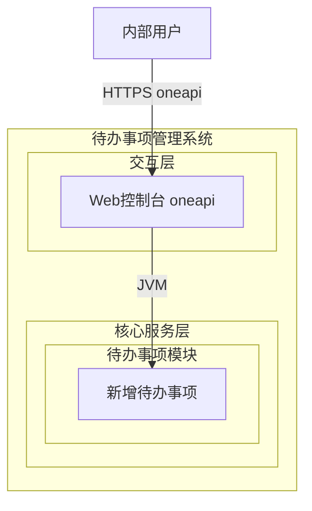
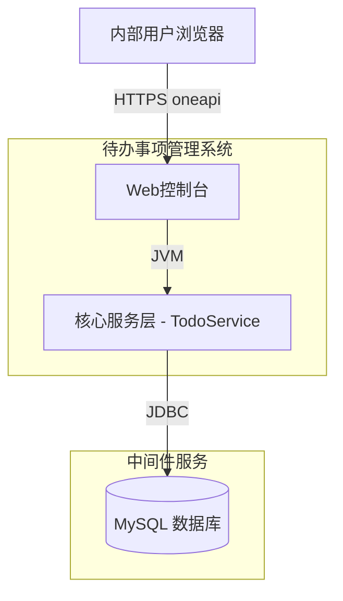
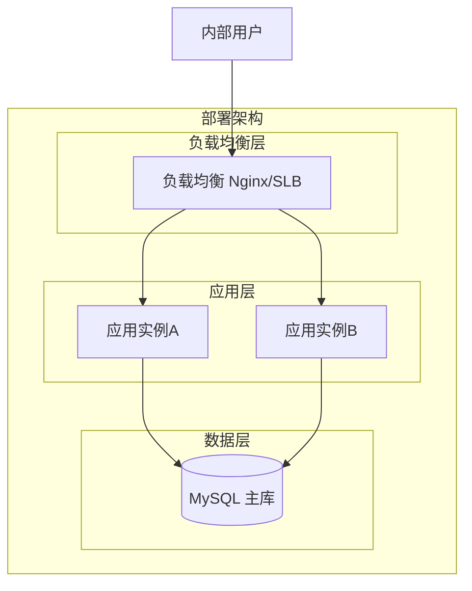
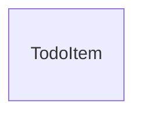
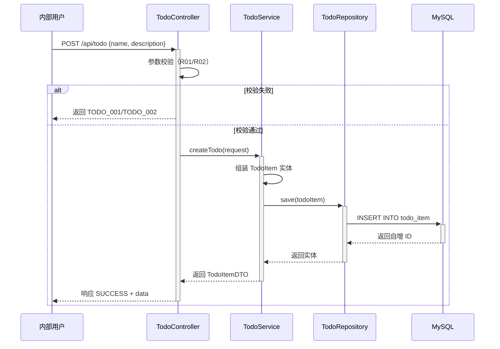

> **文档元信息**
>
> | 项目 | 内容 |
> |------|------|
> | 文档版本 | v1.0 |
> | 作者 | AiWork |
> | 创建日期 | 2026-10-14 |
> | 需求来源 | 任务输入：目标帮助用户记录日常待办事项，核心功能新增待办事项 |
> | 评审状态 | 待评审 |

# 待办事项管理系统 系分设计

## 1. 需求与范围

### 背景与目标

帮助内部用户记录日常待办事项。用户可创建待办事项，记录事项名称和描述信息。本期最小闭环仅包含「创建」功能，后续可扩展查询、更新、删除等功能。

### 核心功能

| 编号 | 功能点 | 优先级 | PRD 原始描述/章节 | 备注 |
|------|--------|--------|-------------------|------|
| F01 | 新增待办事项 | P0 | 新增待办事项，包含事项名称和描述 | 最小闭环核心 |

### 约束与非功能要求

| 类型 | 约束 | 来源 |
|------|------|------|
| 目标用户 | 内部用户 | 需求 |
| 最小闭环 | 仅创建，不含查询/更新/删除 | 需求 |
| 技术栈 | Java（仓库现状） | 仓库 |
| 性能 | 低并发，内部使用 | 假设：内部用户量小 |

### 排除范围

- 不包含待办事项的编辑/删除/查询/列表功能
- 不包含用户登录/注册（假设：复用现有内部认证体系）
- 不包含待办事项分类/标签/优先级
- 不包含截止日期/提醒/通知
- 不包含多人协作/分配

### 需求功能清单与优先级

| 编号 | 功能点 | 优先级 | PRD 原始描述/章节 | 备注 |
|------|--------|--------|-------------------|------|
| F01 | 新增待办事项 | P0 | 目标：帮助用户记录日常待办事项。核心功能：新增待办事项。任务信息：事项名称和描述。 | 创建一条待办事项记录 |

### 假设与待确认项

| 编号 | 假设/待确认内容 | 当前假设 | 确认状态 |
|------|-----------------|----------|----------|
| A01 | 用户认证方式 | 复用现有内部认证体系（如已有），本期不单独实现 | 待确认 |
| A02 | 租户隔离 | 默认采用 tenant_id 字段实现多租户隔离 | 待确认 |
| A03 | 事项名称长度限制 | 名称最长 200 字符，描述最长 2000 字符 | 待确认 |
| A04 | 待办事项是否有状态 | 默认无状态（仅记录），后续可扩展 | 待确认 |

---

## 2. 架构与模块

### 功能架构



- **交互层说明**：Web 控制台通过 oneapi（/api 前缀）接收内部用户请求。
- **核心服务层说明**：待办事项模块负责待办事项的创建，目前仅包含新增功能。

**模块清单**

| 模块 | 职责 | 依赖 |
|------|------|------|
| 待办事项模块（todo） | 待办事项的创建与管理 | MySQL 数据库 |

### 应用集成架构



**集成关系说明：**

| 调用方 | 被调用方 | 协议 | 接口类型 | 说明 |
|--------|----------|------|----------|------|
| 内部用户浏览器 | 待办事项系统 Web控制台 | HTTPS | oneapi REST | 用户创建待办事项 |
| 应用核心服务层 | MySQL 数据库 | JDBC | SQL | 持久化待办事项数据 |

### 部署架构



**部署说明：**
- **负载均衡层**：Nginx/SLB，分发用户请求到应用实例
- **应用层**：2 副本（默认），支持水平扩展
- **数据层**：MySQL 单主库，内部用户场景数据量小，无需读写分离

**架构选型：**

| 方案 | 描述 | 优势 | 劣势 |
|------|------|------|------|
| 单体 Spring Boot | 单应用，Controller-Service-Repository | 简单，部署方便，适合小规模 | 扩展性有限 |
| 微服务 Spring Cloud | 拆分为独立服务 | 独立扩展，解耦 | 过度设计，运维复杂度高 |

**推荐**：单体 Spring Boot。理由：最小闭环仅一个创建功能，无复杂业务，单体架构足够且符合"最小闭环"原则。后续可平滑演进至微服务。

---

## 3. 数据模型与存储

### 实体清单

| 实体名称 | 实体说明 | 所属模块 | 与其他实体的关系 |
|----------|----------|----------|-----------------|
| TodoItem | 待办事项记录，存储事项名称和描述 | todo | 无关联实体（当前版本） |

### 实体关系图



> 当前仅有一个实体，无实体间关系。

### 模型说明

- `TodoItem` 是待办事项的唯一实体，记录事项的基本信息（名称、描述）及系统字段（租户ID、创建时间、修改时间）。
- 当前版本无其他实体，后续可扩展用户实体（User）建立关联。
- 采用 `tenant_id` 实现租户隔离，确保不同租户数据不可见。

### 缓存/MQ

本项不适用，原因：当前最小闭环仅有创建功能，无需缓存或 MQ。后续查询功能上线时可引入 Redis 缓存。

---

## 4. 接口设计

### 4.1 oneapi（Web 控制台接口）

| 编号 | 接口名称 | 方法 | 路径 | 模块 |
|------|----------|------|------|------|
| W01 | 新增待办事项 | POST | /api/todo | 待办事项模块（todo） |

### 4.2 OpenAPI（对外接口）

本项不适用，原因：当前仅面向内部用户，通过 oneapi 即可满足需求，无需对外暴露 OpenAPI。

### 4.3 内部接口（Service 层）

| 编号 | 接口名称 | 类 | 方法签名 |
|------|----------|------|----------|
| S01 | 创建待办事项 | TodoService | TodoItemDTO createTodo(CreateTodoRequest request) |

### 4.4 集成接口（Integration 层）

本项不适用，原因：本期无外部系统集成需求。

---

## 5. 功能模块设计

### 全局约定

**错误码格式**：`{MODULE}_{SEQ}`

| 模块 | 错误码前缀 |
|------|------------|
| 待办事项模块 | TODO |

**通用出参结构**：
| 字段 | 类型 | 描述 |
|------|------|------|
| code | String | 结果码，SUCCESS 表示成功 |
| msg | String | 提示信息 |
| data | Object | 业务数据，可为 null |

### 5.1 待办事项模块（todo）

#### 5.1.1 表结构设计

##### 5.1.1.1 todo_item（待办事项表）

| 字段名 | 数据类型 | 约束 | 默认值 | 说明 |
|--------|----------|------|--------|------|
| id | bigint | PK, 自增, NOT NULL | - | 系统自增主键 |
| tenant_id | varchar(32) | NOT NULL | - | 租户 ID，用于多租户隔离 |
| name | varchar(200) | NOT NULL | - | 事项名称 |
| description | varchar(2000) | NULL | NULL | 事项描述 |
| gmt_create | datetime | NOT NULL | CURRENT_TIMESTAMP | 创建时间 |
| gmt_modified | datetime | NOT NULL | CURRENT_TIMESTAMP | 修改时间 |

**索引：**
- PK: `pk_todo_item` (id)
- IDX: `idx_todo_item_tenant_id` (tenant_id)
- IDX: `idx_todo_item_gmt_create` (gmt_create)

**设计说明：**
- 遵循 db.md 规范：全小写 + 下划线命名，采用 InnoDB 引擎
- 包含 id、gmt_create、gmt_modified 推荐字段
- tenant_id 实现租户隔离
- name 限制 200 字符，description 限制 2000 字符
- 不使用外键、存储过程、视图、触发器
- 不使用 enum 类型

##### 5.1.1.x 枚举与常量定义

本模块无枚举/常量定义。当前版本待办事项无状态字段。

#### 5.1.2 接口详细设计

##### W01 新增待办事项

- **URI**: POST /api/todo
- **描述**: 创建一个新的待办事项，记录事项名称和描述
- **入参**:

| 参数名称 | 类型 | 是否必填 | 描述 |
|----------|------|----------|------|
| name | String | 是 | 事项名称，最长 200 字符 |
| description | String | 否 | 事项描述，最长 2000 字符 |

- **出参**:

| 参数名称 | 类型 | 描述 |
|----------|------|------|
| code | String | 结果码 |
| msg | String | 提示信息 |
| data | Object | 创建的待办事项 |
| data.id | Long | 待办事项 ID |
| data.name | String | 事项名称 |
| data.description | String | 事项描述 |
| data.gmtCreate | String | 创建时间 |

- **错误码**:

| 错误码 | 说明 |
|--------|------|
| SUCCESS | 操作成功 |
| TODO_001 | 参数校验失败：事项名称为空或超长 |
| TODO_002 | 参数校验失败：描述内容超长 |
| TODO_003 | 获取租户信息失败 |
| TODO_500 | 系统内部错误 |

- **业务规则**:
  - R01: name 不能为空且长度 ≤ 200 字符
  - R02: description 长度 ≤ 2000 字符
  - R03: 创建成功后返回完整的待办事项信息

- **请求示例**:
```json
{
  "name": "完成系分设计文档",
  "description": "完成待办事项模块的系分设计并输出 design.md"
}
```

- **响应示例（成功）**:
```json
{
  "code": "SUCCESS",
  "msg": "SUCCESS",
  "data": {
    "id": 1,
    "name": "完成系分设计文档",
    "description": "完成待办事项模块的系分设计并输出 design.md",
    "gmtCreate": "2026-10-14 10:00:00"
  }
}
```

- **响应示例（参数校验失败）**:
```json
{
  "code": "TODO_001",
  "msg": "事项名称不能为空",
  "data": null
}
```

#### 5.1.3 子功能详细设计

##### 5.1.3.1 新增待办事项（F01）

- **处理时序图**



**业务规则：**

| 规则编号 | 规则描述 | 校验时机 | 不满足时的处理 |
|----------|----------|----------|--------------|
| R01 | 事项名称不能为空 | 创建时 | 返回错误码 TODO_001，提示"事项名称不能为空" |
| R02 | 事项名称长度不超过 200 字符 | 创建时 | 返回错误码 TODO_001，提示"事项名称过长" |
| R03 | 事项描述长度不超过 2000 字符 | 创建时 | 返回错误码 TODO_002，提示"事项描述过长" |
| R04 | tenant_id 必须从当前登录上下文获取 | 创建时 | 返回错误码 TODO_003，提示"获取租户信息失败" |

**异常场景：**

| 异常场景 | 处理方式 |
|----------|----------|
| 数据库连接失败 | 返回 TODO_500，提示"系统异常，请稍后重试" |
| 参数校验失败（name 为空） | 返回 TODO_001 |
| 参数校验失败（name 超长） | 返回 TODO_001 |
| 参数校验失败（description 超长） | 返回 TODO_002 |
| 未获取到租户信息 | 返回 TODO_003 |

**并发控制：**

- 并发场景：创建操作为纯写入，无并发冲突风险（每次 INSERT 均生成新记录）。
- 控制策略：无并发风险，原因：创建操作为独立 INSERT，无共享状态修改，无需锁或幂等设计。

**状态机设计：**

本项不适用，原因：当前版本待办事项无状态字段，仅记录信息，无状态流转。

**技术选型方案对比：**

| 方案 | 描述 | 优势 | 劣势 |
|------|------|------|------|
| Spring Boot + MyBatis | 使用 MyBatis 作为 ORM 框架 | 灵活控制 SQL，与公司技术栈一致 | XML 配置略繁琐 |
| Spring Boot + JPA | 使用 JPA/Hibernate 作为 ORM | 自动建表，减少样板代码 | 复杂查询性能调优成本高 |

**推荐**：Spring Boot + MyBatis。理由：与 dtazziboot 技术体系一致，SQL 可控性好，符合公司编码规范。

**模块自检：**

| 对账项 | 是否覆盖 |
|--------|----------|
| F01 新增待办事项 | ✅ 时序图 + 接口定义 + 业务规则 |
| todo_item 表结构 | ✅ 字段、索引完整 |
| 错误码定义 | ✅ TODO_001 ~ TODO_500 |
| 异常场景 | ✅ 5 个异常场景全覆盖 |
| 并发控制 | ✅ 分析结论：无风险 |

---

## 6. 非功能性需求设计

### 6.1 高可用性

- 服务多副本部署（默认 2 副本），通过负载均衡分发请求
- MySQL 故障时返回统一错误码 TODO_500，前端提示"系统异常，请稍后重试"
- 无外部系统依赖，不存在级联故障风险

### 6.2 可扩展性

- 应用层支持水平扩展：新增实例后由负载均衡自动接入
- 数据库层面：后续数据量增长可通过分库分表扩展（以 tenant_id 分片）
- 功能层面：单体架构可在后续演进为微服务，模块划分清晰、职责单一

### 6.3 稳定性/可靠性

- 创建操作为原子 INSERT，无分布式事务需求
- 边界场景：name 为空或超长 → 参数校验层拦截，不会到达数据库
- 边界场景：description 超长 → 参数校验层拦截
- 边界场景：并发创建 → 无冲突，每条记录独立 INSERT

### 6.4 安全性设计

#### 6.4.1 账户系统方案

假设：复用现有内部认证体系（如 antbuservice / buc / IAM），本期不单独实现登录/注册。

#### 6.4.2 授权与访问控制

##### 6.4.2.1 是否实现水平权限检查

全局统一拦截器从登录上下文获取 tenant_id，所有查询/写入自动带上 tenant_id，实现租户间数据隔离。

##### 6.4.2.2 是否实现垂直权限检查

本项不适用，原因：仅创建功能，无需角色权限控制。后续扩展时可按角色分配操作权限。

##### 6.4.2.3 是否检查登录态

全局统一拦截器校验登录态，未登录请求返回 401。

#### 6.4.3 数据防护方案

##### 6.4.3.1 是否对敏感数据加密存储

本项不适用，原因：待办事项的 name 和 description 为普通业务数据，非敏感信息。

##### 6.4.3.2 是否对敏感数据展示进行脱敏

本项不适用，原因：无敏感数据。

### 6.5 监控/统计/日志/告警

- 接口调用日志：记录请求参数、响应结果、处理耗时（通过 AOP 切面实现）
- 错误告警：TODO_500 出现时触发告警通知
- 慢查询监控：数据库慢查询阈值设置为 200ms

---

## 7. 变更三板斧

### 7.1 可监控

| 监控点 | 埋点内容 | 告警条件 |
|--------|----------|----------|
| 创建待办事项接口 | 调用次数、成功/失败次数、处理耗时 | 失败率 > 1% 或 P99 耗时 > 500ms |
| 数据库操作 | INSERT 耗时、异常次数 | 异常次数 > 0 或 P99 耗时 > 200ms |
| 应用健康检查 | 服务存活状态 | 实例不可用 |

### 7.2 可灰度

本项不适用，原因：当前为最小闭环，仅内部用户使用，且功能为纯新增（INSERT），不影响已有功能。无需灰度引流，可直接全量发布。

### 7.3 可应急

| 应急措施 | 触发条件 | 操作方式 | 回滚风险 |
|----------|----------|----------|----------|
| 功能开关 | 创建接口异常率过高 | 配置中心关闭创建接口（返回统一提示"功能维护中"） | 无风险，纯新增功能，关闭后不影响已有业务 |
| 发布包回滚 | 新版本出现严重缺陷 | 回滚到上一版本 | 无风险：新增表无历史数据依赖，回滚后表保留即可 |
| 数据库回滚 | 表结构错误 | 保留新表不删除（符合规范），代码回滚后不再写入新表 | 无风险：新表不影响旧代码 |