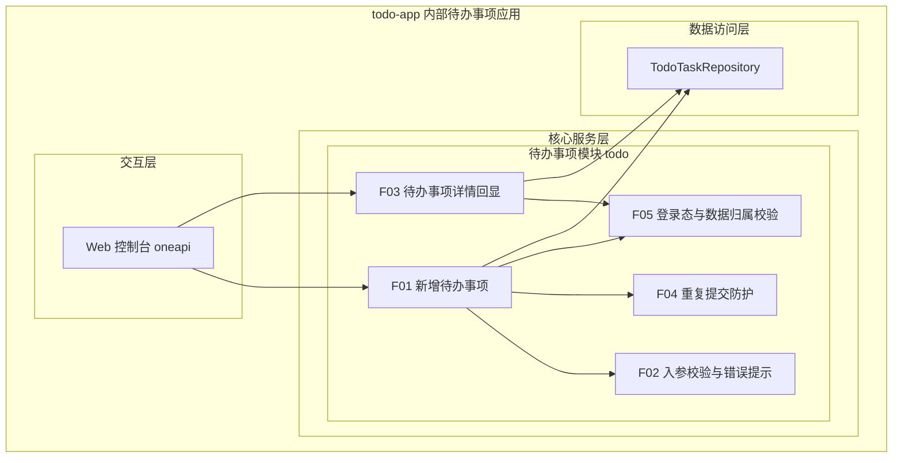
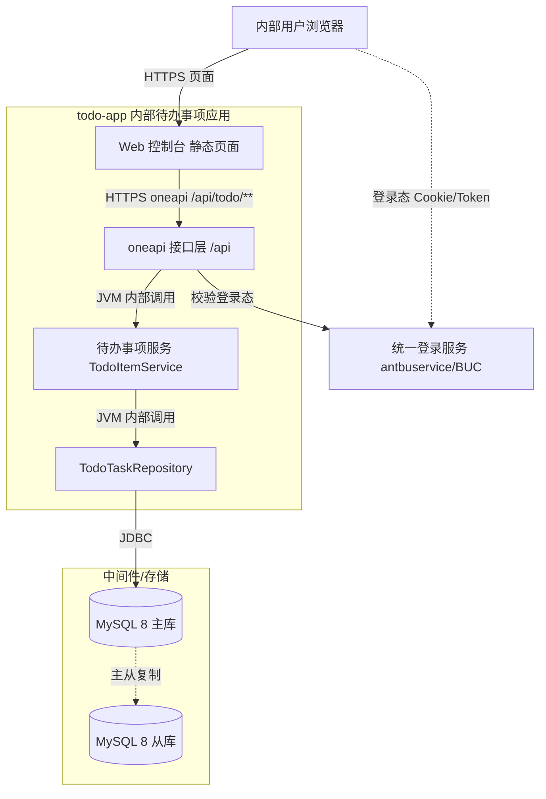
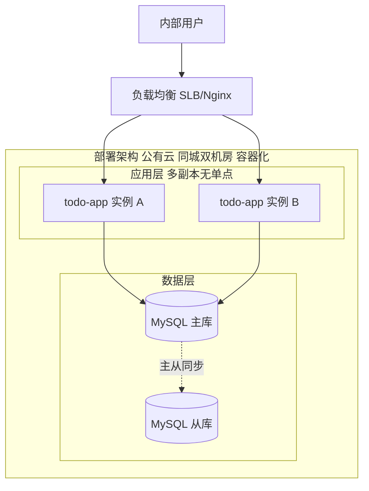
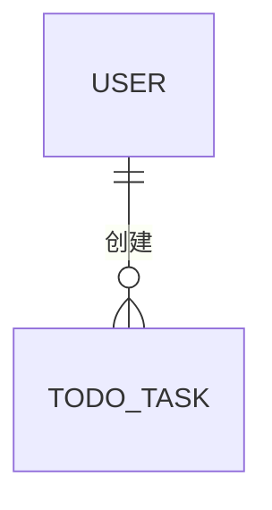
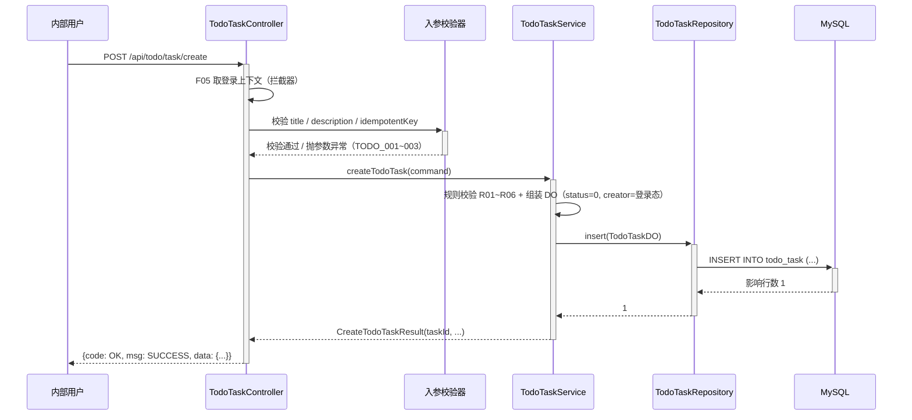
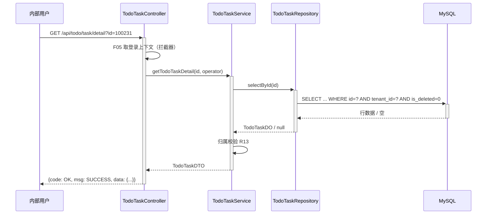
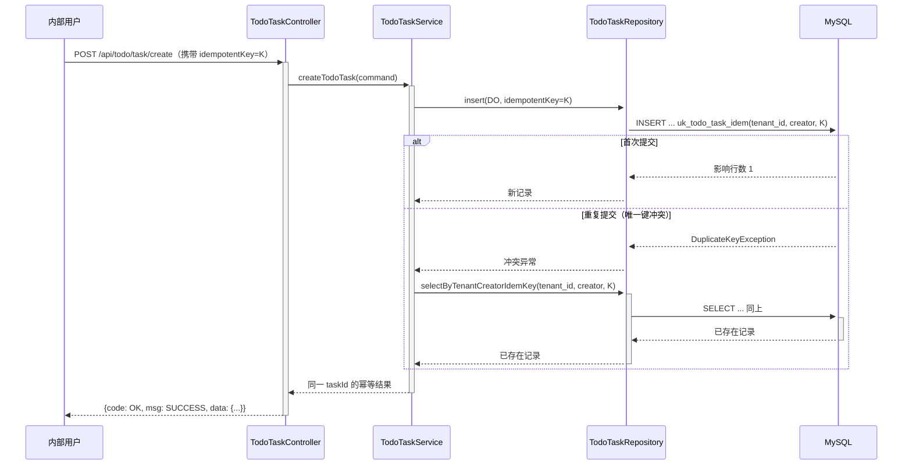
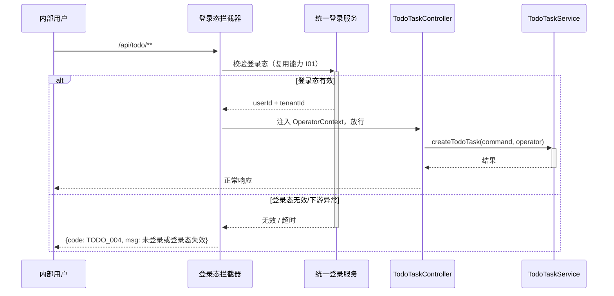
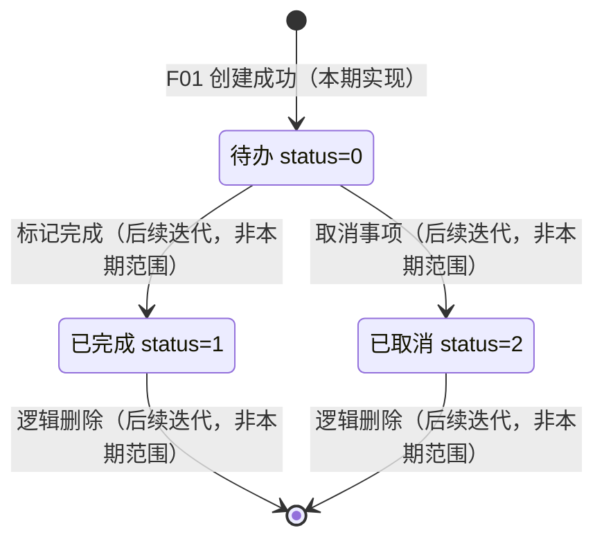

> **文档元信息**
>
> | 项目 | 内容 |
> |------|------|
> | 文档版本 | v1.0 |
> | 作者 | AiWork |
> | 创建日期 | 2026-10-14 |
> | 需求来源 | 需求描述：目标为帮助用户记录日常待办事项；核心功能为新增待办事项；任务信息为事项名称和描述；目标用户为内部用户；最小闭环仅创建 |
> | 评审状态 | 待评审 |
> | 设计模式 | 全量模式（仓库无同模块历史系分文档与架构基线） |

# 内部待办事项（新增待办）系分设计

## 1. 需求与范围

### 背景与目标

内部用户在日常工作中缺少统一的待办事项记录入口，事项散落在聊天、邮件、便签中，易遗漏。本期为待办能力的最小闭环第一步：提供**待办事项的新增记录**能力。

**目标**：内部用户可在待办应用中录入一条待办事项（含事项名称与描述），并被系统持久化保存，可被本人回显确认。

**需求原文依据**：
- 目标：帮助用户记录日常待办事项。
- 核心功能：新增待办事项。
- 任务信息：事项名称和描述。
- 目标用户：内部用户。
- 最小闭环：仅创建。

### 核心功能

1. 新增待办事项：录入事项名称（必填）与描述（选填），保存成功后系统返回该事项的唯一标识与基础信息。
2. 入参合法性校验：事项名称必填、长度受限；描述长度受限；非法入参明确报错。
3. 创建结果回显：创建后可按唯一标识查询本人创建的待办事项详情，用于确认录入结果。
4. 防重复提交：同一用户短时间内的重复提交不产生多条重复数据。

### 约束与非功能要求

| 类别 | 要求 |
|------|------|
| 技术栈约束 | 沿用仓库既有 Java 技术栈：Java 17 + Spring Boot 3 + MyBatis + MySQL 8 |
| 部署约束 | 容器化部署，应用无状态，支持多副本 |
| 性能约束 | 创建接口 P99 ≤ 200ms（单实例 200 QPS 压力下），依赖单条 INSERT，无跨服务调用 |
| 安全约束 | 待办事项为个人数据，需校验登录态与数据归属（水平权限）；不涉及身份证/人脸等强敏感数据 |
| 可用性约束 | 应用多副本无单点，任一实例故障不影响整体可用 |
| 数据约束 | 逻辑删除，保留历史数据；单表 1~2 年内数据量预估 < 500 万，暂不分表 |
| 兼容性约束 | 新增表与新增接口，无存量调用方，不涉及接口兼容改造 |

### 排除范围

- 不涉及待办的编辑、删除、状态流转（完成/取消）、列表与筛选查询（除创建结果回显详情外）。
- 不涉及提醒、通知、推送、日历集成。
- 不涉及待办分享、协作、指派给他人。
- 不涉及多端 App / 小程序，仅 Web 控制台（内部用户）。
- 不涉及对外 OpenAPI 开放。
- 不涉及自建账户与登录注册体系（复用办公网统一登录态）。
- 不涉及数据统计报表、运营看板。

### 需求功能清单与优先级

| 编号 | 功能点 | 优先级 | PRD 原始描述/章节 | 备注 |
|------|--------|--------|-------------------|------|
| F01 | 新增待办事项（名称+描述） | P0 | “核心功能：新增待办事项；任务信息：事项名称和描述” | 本期唯一核心闭环 |
| F02 | 入参校验与错误提示 | P0 | 由 F01 隐含（名称、描述为录入项） | 名称必填/长度校验 |
| F03 | 待办事项详情回显 | P1 | 由“记录日常待办事项”隐含（需确认已记录） | 假设项 A03，仅为创建结果回显 |
| F04 | 重复提交防护（幂等） | P1 | 由 F01 隐含（内部用户重复点击） | 假设项 A05 |
| F05 | 登录态与数据归属校验 | P0 | “目标用户：内部用户” | 创建人取自登录态，不支持代录 |

> 说明：需求原文仅包含“新增待办事项”与“事项名称和描述”。F03/F04/F05 为支撑 P0 闭环可验收、可安全上线的最小配套能力，均已在“假设与待确认项”标注，不引入额外业务范围。

### 假设与待确认项

| 编号 | 假设/待确认内容 | 当前假设 | 确认状态 |
|------|-----------------|----------|----------|
| A01 | 需求未指定技术栈 | 沿用仓库 Java 技术栈（Java 17 + Spring Boot 3 + MyBatis + MySQL 8），单体分层应用 | 待确认 |
| A02 | 需求未指定交付形态 | 提供 Web 控制台（内部用户 oneapi）+ 后端服务 | 待确认 |
| A03 | 需求仅要求“创建”，是否需要创建后查询回显 | 提供详情查询（F03，P1）用于回显与验收 | 待确认 |
| A04 | 事项名称/描述长度上限未指定 | 名称 ≤ 128 字符，描述 ≤ 1024 字符（UTF-8 按字符计） | 待确认 |
| A05 | 是否允许重复名称的待办 | 允许重复名称（不同事项可同名），仅做短时防重复提交（幂等） | 待确认 |
| A06 | 用户身份来源未指定 | 复用办公网统一登录态（antbuservice/BUC）取当前用户标识，作为创建人 | 待确认 |
| A07 | 状态字段是否本期需要 | 表内预留 status（默认 0=待办），本期仅使用初始值，不提供流转入口 | 待确认 |
| A08 | 多租户隔离要求未明确 | 预留 tenant_id（默认取登录上下文租户），内部单租户场景下取值固定 | 待确认 |
| A09 | 无 SSOT.md / docs/ARCHITECTURE.md 等架构基线 | 按全新设计处理（全量模式），架构图为新绘 | 待确认 |
| A10 | board-knowledge-search 检索能力在当前环境不可用 | 未获取到历史知识库上下文，设计仅基于需求原文与仓库现状 | 待确认 |
## 2. 架构与模块

### 功能架构

应用名称：内部待办事项应用（todo-app）。本期仅一个业务模块（待办事项模块），采用单体分层架构（交互层 – 核心服务层 – 数据访问层）。



- 交互层说明：Web 控制台页面通过 oneapi（`/api` 前缀）调用后端服务；本期不提供 OpenAPI 网关入口。
- 核心服务层说明：待办事项模块是本期唯一业务模块，内部按功能点划分为新增、校验、回显、幂等防护、权限校验；模块内遵循 Controller（参数校验与协议转换）→ Service（业务规则）→ Repository（数据访问）分层。
- 数据访问层说明：`TodoTaskRepository` 为待办事项表的唯一访问出口，禁止跨层直连。

**模块清单**

| 模块 | 职责 | 依赖 |
|------|------|------|
| 待办事项模块（todo） | 待办事项的创建、入参校验、详情回显、重复提交防护、数据归属校验与持久化 | 统一登录态组件（antbuservice/BUC）、MySQL（todo_task 表） |
| 基础支撑（复用，不新增） | 统一登录态校验、统一出参/异常处理、统一埋点 | 办公网统一登录服务 |

> 说明：本期不拆分独立微服务。待办模块与登录态组件为“本系统 → 外部基础服务”单向依赖，模块间无循环依赖。

### 应用集成架构



**集成关系说明：**

| 调用方 | 被调用方 | 协议 | 接口类型 | 说明 |
|--------|----------|------|----------|------|
| 内部用户浏览器 | todo-app Web 控制台 | HTTPS | oneapi 页面 | 待办录入与回显页面 |
| 内部用户浏览器 | todo-app oneapi | HTTPS | oneapi REST | 创建/查询待办事项接口调用 |
| todo-app oneapi | 统一登录服务（antbuservice/BUC） | HTTPS/RPC | 集成接口 | 校验登录态、获取当前用户与租户标识（复用，不新增能力） |
| 待办事项服务 | MySQL 8 | JDBC | SQL | 待办事项单表读写，无外键、无存储过程 |

> 下游（统一登录服务）异常时的处理：登录态校验失败即拒绝写入，直接返回 `TODO_004`（未登录或登录态失效），本系统不做匿名降级写入，保证数据归属正确；只读详情查询同样要求登录态。

### 部署架构



**部署说明：**
- **负载均衡层**：SLB/Nginx 承载 oneapi 流量，按轮询分发；应用层健康检查（HTTP 探针）摘除异常实例。
- **应用层**：应用无状态（不持有会话、不写本地磁盘），同城双机房各部署 ≥ 2 个容器副本，滚动发布，任一实例故障不影响整体可用；副本数按 CPU/RT 指标弹性伸缩。
- **数据层**：MySQL 主库承接写入（本期核心为写），主从异步复制提供读扩展与容灾；每日全量备份 + binlog 增量备份。
- **单点排查**：负载均衡层、应用层均为多副本（同一机房内跨可用区）；数据层主库为写入单点，通过“主库故障 → 从库提升（半同步/高可用组件自动切换，RTO ≤ 60s）”兜底，不引入额外依赖。

> 假设：需求未指定部署环境，按公有云同城双机房 + 云原生容器化方案设计（A01/部署默认规范）；若为私有化交付，仅将应用层替换为容器化单机房多副本，数据层形态不变。
## 3. 数据模型与存储

### 实体清单

| 实体名称 | 实体说明 | 所属模块 | 与其他实体的关系 |
|----------|----------|----------|-----------------|
| 待办事项（TodoTask） | 用户记录的一条待办事项，含事项名称、描述、创建人等 | 待办事项模块（todo） | 多对一关联用户（通过 creator 字段弱关联，不建外键） |
| 用户（User） | 内部用户身份，由办公网统一登录服务提供 | 外部基础服务（本系统不落库） | 一对多关联待办事项 |

> 本期仅新增 1 个业务实体（TodoTask）；User 为外部统一登录提供的主体，仅以 creator/tenant_id 两个字段弱关联，不在本系统建表，避免用户数据双写与一致性问题。

### 实体关系图



**模型说明：**
- 一个用户可创建多条待办事项；一条待办事项仅归属于一个创建人（不做协作/指派）。
- 待办事项与用户之间不建物理外键（遵循 db.md：禁止使用外键），由应用层保证 creator 取自登录态且不可由前端传入。
- 待办事项与“租户”为逻辑隔离关系（tenant_id），内部单租户场景下取值固定，不改变模型结构。
- 本期无实体间级联操作（无删除/流转），故不涉及级联一致性规则。

### 存储与缓存形态

| 存储/中间件 | 用途 | 数据形态 | 本期决策 |
|------------|------|----------|----------|
| MySQL 8 | 待办事项实体持久化（唯一事实来源） | 结构化单表 `todo_task` | 采用 |
| Redis | 缓存待办数据 / 幂等键 | KV | 本期不适用，原因：仅创建闭环、无热点读、无跨请求实时去重需求；重复提交防护通过表内唯一键实现（见 5.1.3.4），引入 Redis 属过度设计 |
| MQ | 创建后异步通知 | 消息 | 本期不适用，原因：需求排除提醒/通知能力 |

**租户隔离**：`todo_task` 表含 `tenant_id`，创建时由登录上下文写入，查询时强制带 `tenant_id` 条件；默认隔离方案为共享表 + 租户字段过滤。
## 4. 接口设计

### 4.1 oneapi（Web 控制台接口）

| 编号 | 接口名称 | 方法 | 路径 | 模块 |
|------|----------|------|------|------|
| W01 | 新增待办事项 | POST | /api/todo/task/create | 待办事项模块（todo） |
| W02 | 查询待办事项详情 | GET | /api/todo/task/detail | 待办事项模块（todo） |

### 4.2 OpenAPI（对外接口）

本项不适用，原因：需求目标用户为内部用户，交付形态为内部 Web 控制台（oneapi），本期不对外开放接口，避免引入外部鉴权、限流与配额等非本期范围。

### 4.3 内部接口（Service 层）

| 编号 | 接口名称 | 类 | 方法签名 | 说明 |
|------|----------|------|----------|------|
| S01 | 创建待办事项 | TodoTaskService | `CreateTodoTaskResult createTodoTask(CreateTodoTaskCommand command)` | 入参为已通过 Controller 校验的命令对象，返回含任务 ID 的结果 |
| S02 | 查询待办事项详情 | TodoTaskService | `TodoTaskDTO getTodoTaskDetail(Long id, OperatorContext operator)` | 校验归属后返回详情 DTO |
| S03 | 待办事项入库 | TodoTaskRepository | `int insert(TodoTaskDO todoTask)` | 单条 INSERT，返回影响行数 |
| S04 | 按主键查询 | TodoTaskRepository | `TodoTaskDO selectById(Long id)` | 主键查询，查询条件含 tenant_id 与 is_deleted |

### 4.4 集成接口（Integration 层）

| 编号 | 接口名称 | 类 | 方法签名 | 说明 |
|------|----------|------|----------|------|
| I01 | 获取当前登录用户上下文 | LoginContextProvider | `OperatorContext getCurrentOperator()` | 复用办公网统一登录态（antbuservice/BUC）能力，返回 userId、租户标识、登录态有效性；失败抛未登录异常，映射为 TODO_004 |

> 说明：I01 为既有基础能力的复用入口，不在本次新增开发范围；本期仅约定其返回契约与失败处理。此外无其他外部系统集成。
## 5. 功能模块设计

### 5.0 全局约定

#### 5.0.1 统一出参结构

| 字段 | 类型 | 说明 |
|------|------|------|
| code | String | 业务结果码，成功固定为 `OK`，失败为 `TODO_xxx` |
| msg | String | 提示信息，成功固定为 `SUCCESS`，失败为人类可读提示 |
| data | Object | 业务数据，失败时为 `null` |

#### 5.0.2 错误码格式

错误码格式：`{MODULE}_{SEQ}`，本模块前缀 `TODO_`，序号从 `001` 起三位递增（完整清单见 5.1.1.2）。

#### 5.0.3 模块与产物映射表

| 模块 | 表 | oneapi 接口 | 内部接口 | 中间文件 |
|------|------|------|------|------|
| 待办事项模块（todo） | todo_task | W01、W02 | S01~S04 | step5_todo.md |

#### 5.0.4 分层与调用方向约定

`Controller（协议转换 + 入参校验）→ Service（业务规则 + 事务 + 幂等）→ Repository（SQL，唯一数据访问出口）`；禁止 Controller 直连 Repository，禁止 Service 拼接 SQL。跨模块调用仅允许上层调用下层，本模块无被其他模块反向依赖，不存在循环依赖。
### 5.1 待办事项模块（todo）

模块职责：承接内部用户的待办事项录入请求，完成入参校验、归属校验、重复提交防护与持久化，并提供创建结果回显。模块内功能点：F01 新增待办事项、F02 入参校验与错误提示、F03 待办事项详情回显、F04 重复提交防护、F05 登录态与数据归属校验。

#### 5.1.1 表结构设计

##### 5.1.1.1 todo_task（待办事项表）

| 字段名 | 数据类型 | 约束 | 默认值 | 说明 |
|--------|----------|------|--------|------|
| id | bigint unsigned | PK, NOT NULL, AUTO_INCREMENT | - | 自增主键，待办事项唯一标识 |
| tenant_id | varchar(64) | NOT NULL | 'default' | 租户标识，来自登录上下文，用于逻辑隔离 |
| creator | varchar(64) | NOT NULL | - | 创建人用户标识，取自登录态，禁止前端传入 |
| title | varchar(128) | NOT NULL | - | 事项名称 |
| description | varchar(1024) | NOT NULL | '' | 事项描述，允许为空串 |
| status | tinyint | NOT NULL | 0 | 状态：0 待办、1 已完成、2 已取消（本期仅写入 0） |
| idempotent_key | varchar(64) | NOT NULL | - | 幂等键，由前端生成 UUID；缺失时服务端生成随机值 |
| is_deleted | tinyint | NOT NULL | 0 | 逻辑删除标识：0 未删除、1 已删除 |
| gmt_create | datetime | NOT NULL | CURRENT_TIMESTAMP | 创建时间，由代码逻辑维护 |
| gmt_modified | datetime | NOT NULL | CURRENT_TIMESTAMP | 修改时间，由代码逻辑维护 |

**索引：**
- PK: `pk_todo_task`（id）—— 自增整型单列主键（db.md 强制）
- UK: `uk_todo_task_idem`（tenant_id, creator, idempotent_key）—— 幂等去重，保证同一用户重复提交只落一条数据

**设计说明：**
- 表名遵循“业务名称_表的作用”，同模块表统一 `todo_` 前缀；字段名全小写+下划线，无保留字。
- 全表无外键、无存储过程/触发器/视图；时间统一 `datetime`（禁用 timestamp），无金额字段故未使用 decimal，无枚举类型字段（status 用 tinyint）。
- 参与索引的列（tenant_id、creator、idempotent_key）均为 NOT NULL 且有默认值或由服务端必填。
- 本期不建 `idx_todo_task_creator` 等列表查询索引：详情回显走主键，无按创建人列表查询需求，避免无效索引维护成本（待列表查询需求上线时再增补）。
- 单表数据量预估：内部用户量级千级，人均日创建 < 10 条，1~2 年数据量 < 500 万，暂不分表；`is_deleted=1` 的历史数据由后续离线清理任务处理。
- 逻辑删除：本期不提供删除入口，`is_deleted` 为后续删除能力预留，查询条件已按 `is_deleted = 0` 约定。

##### 5.1.1.2 枚举与常量定义

| 枚举名称 | 取值 | 含义 | 关联字段 |
|----------|------|------|----------|
| TodoStatusEnum | 0 | 待办（初始态，本期唯一写入值） | todo_task.status |
| TodoStatusEnum | 1 | 已完成（后续迭代使用） | todo_task.status |
| TodoStatusEnum | 2 | 已取消（后续迭代使用） | todo_task.status |
| DeletedEnum | 0 | 未删除 | todo_task.is_deleted |
| DeletedEnum | 1 | 已删除 | todo_task.is_deleted |
| ResultCodeEnum | OK | 成功 | 出参 code |
| ResultCodeEnum | TODO_001 | 参数校验失败（通用） | 出参 code |
| ResultCodeEnum | TODO_002 | 事项名称非法（为空、空白或超长） | 出参 code |
| ResultCodeEnum | TODO_003 | 事项描述超长 | 出参 code |
| ResultCodeEnum | TODO_004 | 未登录或登录态失效 | 出参 code |
| ResultCodeEnum | TODO_005 | 待办事项不存在或无权访问 | 出参 code |
| ResultCodeEnum | TODO_006 | 写入失败（系统繁忙，可重试） | 出参 code |
| 常量 | TITLE_MAX_LENGTH = 128 | 事项名称最大长度（字符） | title |
| 常量 | DESCRIPTION_MAX_LENGTH = 1024 | 事项描述最大长度（字符） | description |
| 常量 | DEFAULT_STATUS = 0 | 创建时默认状态 | status |
| 常量 | MAX_TITLE_SUBMIT_INTERVAL_MS = 2000 | 前端最小提交间隔（防抖，可选） | - |

#### 5.1.2 接口详细设计

##### W01 新增待办事项

- **URI**: POST /api/todo/task/create
- **描述**: 内部用户提交事项名称与描述，服务端校验后落库，返回待办事项标识与基础信息。全流程不接收也不信任前端传入的创建人与租户。
- **入参**:

| 参数名称 | 类型 | 是否必填 | 描述 |
|----------|------|----------|------|
| title | String | 是 | 事项名称，去首尾空白后长度 1~128 字符 |
| description | String | 否 | 事项描述，长度 0~1024 字符，缺省视为空串 |
| idempotentKey | String | 否 | 幂等键（建议前端生成 UUID，长度 1~64）；缺省时由服务端生成，重复提交防护能力减弱 |

- **出参**:

| 参数名称 | 类型 | 描述 |
|----------|------|------|
| code | String | 结果码，成功 `OK`，失败 `TODO_xxx` |
| msg | String | 提示信息 |
| data | Object | 业务数据，失败时 null |
| data.taskId | Long | 待办事项唯一标识 |
| data.title | String | 事项名称（回显入库值） |
| data.description | String | 事项描述（回显入库值） |
| data.status | Integer | 状态码，创建后固定为 0 |
| data.creator | String | 创建人用户标识（取自登录态） |
| data.gmtCreate | String | 创建时间，格式 yyyy-MM-dd HH:mm:ss |

- **错误码**:

| 错误码 | 说明 |
|--------|------|
| TODO_001 | 参数校验失败（如 idempotentKey 超长、类型非法） |
| TODO_002 | 事项名称非法（为空、纯空白或超长） |
| TODO_003 | 事项描述超长 |
| TODO_004 | 未登录或登录态失效 |
| TODO_006 | 写入失败，可引导用户重试 |

- **业务规则**: 见 F01/F02/F04/F05 业务规则表（R01~R12）；写操作在单一事务内完成，无跨表写入。

- **请求示例**:
```json
{
  "title": "完成系分评审",
  "description": "与产品确认待办事项字段与边界",
  "idempotentKey": "8f14e45f-ceea-467f-a1f2-1a2b3c4d5e6f"
}
```

- **响应示例**:
```json
{
  "code": "OK",
  "msg": "SUCCESS",
  "data": {
    "taskId": 100231,
    "title": "完成系分评审",
    "description": "与产品确认待办事项字段与边界",
    "status": 0,
    "creator": "zhangsan",
    "gmtCreate": "2026-10-14 09:30:12"
  }
}
```

##### W02 查询待办事项详情

- **URI**: GET /api/todo/task/detail
- **描述**: 按唯一标识查询待办事项详情，用于创建成功后回显与个人记录确认；仅创建人本人（且同租户）可见。
- **入参**:

| 参数名称 | 类型 | 是否必填 | 描述 |
|----------|------|----------|------|
| id | Long | 是 | 待办事项唯一标识，正整数 |

- **出参**:

| 参数名称 | 类型 | 描述 |
|----------|------|------|
| code | String | 结果码，成功 `OK`，失败 `TODO_xxx` |
| msg | String | 提示信息 |
| data | Object | 业务数据，失败时 null |
| data.taskId | Long | 待办事项唯一标识 |
| data.title | String | 事项名称 |
| data.description | String | 事项描述 |
| data.status | Integer | 状态码 |
| data.statusDesc | String | 状态描述（待办/已完成/已取消） |
| data.creator | String | 创建人用户标识 |
| data.gmtCreate | String | 创建时间 |
| data.gmtModified | String | 最后修改时间 |

- **错误码**:

| 错误码 | 说明 |
|--------|------|
| TODO_001 | 参数校验失败（id 缺失或非正整数） |
| TODO_004 | 未登录或登录态失效 |
| TODO_005 | 待办事项不存在或无权访问（含非本人、跨租户、已删除） |

- **业务规则**: 见 F03 业务规则表（R13~R15）；查询强制携带 tenant_id 与 creator 条件，不返回 404 与无权限的差异化信息，统一为 TODO_005，避免通过错误码探测他人数据是否存在。

- **请求示例**:
```
GET /api/todo/task/detail?id=100231
```

- **响应示例**:
```json
{
  "code": "OK",
  "msg": "SUCCESS",
  "data": {
    "taskId": 100231,
    "title": "完成系分评审",
    "description": "与产品确认待办事项字段与边界",
    "status": 0,
    "statusDesc": "待办",
    "creator": "zhangsan",
    "gmtCreate": "2026-10-14 09:30:12",
    "gmtModified": "2026-10-14 09:30:12"
  }
}
```

#### 5.1.3 子功能详细设计

##### 5.1.3.1 F01 新增待办事项（P0）

- 处理时序图



**业务规则：**

| 规则编号 | 规则描述 | 校验时机 | 不满足时的处理 |
|----------|----------|----------|--------------|
| R01 | title 去首尾空白后不可为空 | 创建时 | 返回 TODO_002，提示“事项名称不能为空” |
| R02 | title 长度（字符）≤ 128 | 创建时 | 返回 TODO_002，提示“事项名称长度不能超过 128 字符” |
| R03 | description 缺省时按空串处理，长度（字符）≤ 1024 | 创建时 | 返回 TODO_003，提示“事项描述长度不能超过 1024 字符” |
| R04 | creator 与 tenant_id 必须取自登录上下文，忽略请求体中的同名字段 | 创建时 | 请求体出现同名字段时直接忽略；登录态缺失返回 TODO_004 |
| R05 | 新记录 status 固定为 0（待办），is_deleted 固定为 0 | 创建时 | 由服务端强制赋值，不接受前端传入 |
| R06 | 允许不同待办事项名称重复（同名是合法业务场景） | 创建时 | 不做名称唯一性校验 |
| R07 | 写入必须在单一本地事务内完成，失败整体回滚 | 创建时 | 抛异常回滚，返回 TODO_006，提示“系统繁忙，请稍后重试” |
| R08 | 记录落库后返回自增 taskId | 创建后 | 若未取到主键，视为写入失败，返回 TODO_006 |

**异常场景：**

| 异常场景 | 处理方式 |
|----------|----------|
| 请求体缺失或 JSON 解析失败 | 返回 TODO_001，提示“请求参数格式错误” |
| title 为空/纯空白/超长 | 返回 TODO_002，不落库 |
| description 超长 | 返回 TODO_003，不落库 |
| 未登录、Cookie/Token 失效 | 返回 TODO_004，不落库，前端跳转登录 |
| 数据库连接超时/死锁/唯一键冲突（非幂等键场景） | 捕获后返回 TODO_006 并记录错误日志；事务回滚，不留半条数据 |
| 唯一键冲突（幂等键重复） | 不做失败处理，转为幂等成功返回（见 F04） |

**并发控制（数据写入）：**
- 并发场景：同一用户在网络重试、双击、页面重复提交下，可能在极短时间内发出多次相同请求；不同用户之间无共享写入对象，不存在更新冲突。
- 控制策略：采用**唯一索引幂等键**方案，由数据库 `uk_todo_task_idem` 兜底，不需要分布式锁；插入冲突时降级为“查询已有记录并返回”，保证同一幂等键只产生一条数据（方案对比见 5.1.3.4）。
- 事务边界：单次 INSERT，无跨表写入，事务粒度最小化，降低锁竞争。

##### 5.1.3.2 F02 入参校验与错误提示（P0）

校验在 Controller 层完成（参数级）+ Service 层复核（业务级），双层校验避免绕过接口调用时校验缺失。

**业务规则：**

| 规则编号 | 规则描述 | 校验时机 | 不满足时的处理 |
|----------|----------|----------|--------------|
| R09 | 字段类型与必填约束（title 必填；idempotentKey 若传则 1~64 字符） | 请求进入 Controller 时 | 返回 TODO_001，提示具体字段名 |
| R10 | 字符串按 Unicode 字符数计长，校验前统一 trim 首尾空白；不接受纯空白 | 请求进入 Controller 时 | 返回 TODO_002/TODO_003 |
| R11 | 错误提示面向用户可读，不返回堆栈、SQL、表名等内部信息 | 异常统一处理时 | 统一异常处理器转换为 `{code, msg}`，敏感细节仅入日志 |

**异常场景：**

| 异常场景 | 处理方式 |
|----------|----------|
| 超长文本（如 10 万字符）恶意提交 | 在框架层限制请求体大小（≤ 64KB），超限直接返回 TODO_001，不进入业务逻辑 |
| 特殊字符与 Emoji | 按 Unicode 字符计长，允许存储（utf8mb4），不做内容白名单过滤 |
| 前端未做长度限制 | 服务端校验为准，返回明确错误码与提示 |

**并发控制：** 不适用，原因：本子功能为纯读入参校验，无共享状态写入。

##### 5.1.3.3 F03 待办事项详情回显（P1）

- 处理时序图



**业务规则：**

| 规则编号 | 规则描述 | 校验时机 | 不满足时的处理 |
|----------|----------|----------|--------------|
| R12 | id 必须为正整数 | 请求进入 Controller 时 | 返回 TODO_001 |
| R13 | 记录 creator 必须与登录用户一致，tenant_id 必须与登录租户一致 | 查询到记录后 | 返回 TODO_005（不区分“不存在”与“无权限”） |
| R14 | 仅返回 is_deleted=0 的记录 | 查询时 | 已删除记录统一返回 TODO_005 |
| R15 | 详情接口只读，不修改 gmt_modified | 始终 | - |

**异常场景：**

| 异常场景 | 处理方式 |
|----------|----------|
| id 不存在 | 返回 TODO_005，提示“待办事项不存在或无权访问” |
| id 属于他人或他人租户 | 返回 TODO_005，与不存在场景响应完全一致，防止数据探测 |
| 未登录 | 返回 TODO_004 |
| 数据库查询超时 | 返回 TODO_006，记录错误日志，不影响创建链路 |

**并发控制：** 不适用，原因：只读查询，无写入竞争。

##### 5.1.3.4 F04 重复提交防护（P1）

- 处理时序图



**业务规则：**

| 规则编号 | 规则描述 | 校验时机 | 不满足时的处理 |
|----------|----------|----------|--------------|
| R16 | 幂等键由前端生成并在重试时复用同一值 | 提交/重试时 | 未传时服务端生成随机幂等键，退化为“不防重复” |
| R17 | 同一 (tenant_id, creator, idempotent_key) 只允许一条记录 | 写入时 | 唯一键冲突转幂等查询，返回已存在记录（成功语义） |
| R18 | 幂等返回不更新原记录内容 | 冲突时 | 忽略重复提交携带的 title/description，避免覆盖 |
| R19 | 幂等冲突查询仍受 R13 归属约束 | 冲突分支 | 查不到（如并发未提交完成）返回 TODO_006，引导重试 |

**异常场景：**

| 异常场景 | 处理方式 |
|----------|----------|
| 并发同键同时到达，事务未提交完成 | 冲突后短暂重查（≤ 3 次，间隔 50ms），仍查不到返回 TODO_006 |
| 前端未生成幂等键 | 服务端生成随机键，接口正常，仅失去防重复能力 |
| 幂等键被恶意复用（同一键提交不同内容） | 按首次提交内容为准，返回首条记录，并在监控中记录复用次数 |

**并发控制：**
- 并发场景：同一用户 500ms 内 2~5 次重复请求（双击、网关重试、弱网重试）；多实例部署下请求可能落在不同实例。
- 方案对比：

| 方案 | 实现方式 | 优点 | 缺点 |
|------|----------|------|------|
| 方案一：唯一索引幂等键（推荐） | 表内 `uk_todo_task_idem` 唯一键，冲突转查询 | 强一致、无额外中间件、多实例天然生效、失败可自愈 | 需前端配合传幂等键；唯一键冲突需异常转换处理 |
| 方案二：Redis SETNX 分布式锁 | 以 (creator+键) 抢锁，锁内写库 | 可控制并发窗口、可提前拦截 | 引入 Redis 依赖与可用性风险；锁超时/失锁存在漏洞，仍需 DB 兜底 |
| 方案三：请求参数指纹去重（短窗口查库） | 按 (creator, title, description) 查最近 N 秒记录 | 无需前端改造 | 误杀合法的同名同内容事项（违反 R06）；存在查询-写入竞态，不可靠 |
| 方案四：前端按钮防抖/置灰 | 前端提交后禁用按钮 2s | 实现成本最低 | 仅减少概率，无法防网关重试与多端并发，不能作为唯一手段 |

- 推荐方案：**方案一（唯一索引幂等键）**，并叠加方案四作为体验层补充（非可靠性依赖）。理由：内部用户场景并发量小，正确性优先；方案一不引入新中间件、多实例下强一致、失败路径明确，符合最小闭环原则。
- 控制策略落地：DB 唯一键为唯一正确性保障；冲突异常在 Repository 层捕获并转换为“幂等命中”语义；Service 层不引入分布式锁。

##### 5.1.3.5 F05 登录态与数据归属校验（P0）

- 处理时序图



**业务规则：**

| 规则编号 | 规则描述 | 校验时机 | 不满足时的处理 |
|----------|----------|----------|--------------|
| R20 | 所有 `/api/todo/**` 接口均需登录态，无白名单 | 请求进入业务逻辑前 | 返回 TODO_004，不落库 |
| R21 | creator/tenant_id 由服务端从 OperatorContext 注入 | 创建时 | 忽略并丢弃请求体中的同名字段 |
| R22 | 数据查询/写入条件强制包含当前 tenant_id | 始终 | 缺失租户上下文视为非法请求，返回 TODO_004 |
| R23 | 详情查询校验记录归属（R13） | 查询到记录后 | 返回 TODO_005 |
| R24 | 统一登录服务异常时默认拒绝（fail-close） | 登录态校验异常 | 返回 TODO_004，不做匿名降级写入 |

**异常场景：**

| 异常场景 | 处理方式 |
|----------|----------|
| 未携带登录凭证 | 拦截器直接拦截，返回 TODO_004 |
| 统一登录服务超时/不可用 | fail-close 拒绝写入，记录监控指标（见第 7 章可监控）；恢复后自动可用 |
| 越权访问他人待办 | 返回 TODO_005，记录安全审计日志（操作人、目标 id、时间） |

**并发控制：** 不适用，原因：登录态校验为无状态读取，不产生共享写竞争。

##### 5.1.3.6 状态机设计

待办事项实体含 `status` 字段，状态机如下（本期仅实现“创建 → 待办”，其余流转为后续迭代范围，表中已明确标注）。



**状态流转规则：**

| 当前状态 | 目标状态 | 流转条件 | 前置校验 | 触发动作 |
|----------|----------|----------|----------|----------|
| （无） | 待办（0） | 创建请求校验通过 | R01~R11、R16~R17、R20~R22 | 插入 todo_task，返回 taskId；本期实现 |
| 待办（0） | 已完成（1） | 后续迭代提供完成操作 | 归属校验 | 更新 status 与 gmt_modified；本期不实现 |
| 待办（0） | 已取消（2） | 后续迭代提供取消操作 | 归属校验 | 更新 status 与 gmt_modified；本期不实现 |
| 已完成（1）/已取消（2） | 逻辑删除 | 后续迭代提供删除操作 | 归属校验 | is_deleted 置 1；本期不实现 |

> 孤岛状态检查：`已完成`、`已取消` 在本期无入边（无对应的业务入口），已在设计中显式标注为后续迭代范围，不作为本期交付；本期状态机仅含 `[*] → 待办`，不存在无法到达或无法退出的孤岛状态。

#### 5.1.4 技术选型方案对比

##### 5.1.4.1 持久层框架选型

| 方案 | 说明 | 优点 | 缺点 |
|------|------|------|------|
| 方案一：MyBatis（推荐） | 手写 SQL + Mapper 接口 | SQL 可控、易做索引与执行计划优化、团队通用度高、与现有 Java 工程一致 | 需手写映射，样板代码略多 |
| 方案二：Spring Data JPA | 基于实体注解自动生成 SQL | 开发快、单表 CRUD 免 SQL | 复杂条件与索引优化可控性弱；本期需严格控制的唯一键冲突语义与 SQL 形态反而不便 |
| 方案三：JdbcTemplate | 原生 JDBC 封装 | 最轻量、无额外依赖 | 手写映射与结果集处理成本高，可维护性差 |

- 推荐方案：**方案一 MyBatis**。理由：本模块为单表写入 + 主键查询，SQL 形态固定且需明确唯一键冲突处理方式；MyBatis 在 SQL 可控性、索引可验证性与团队通用度之间平衡最佳，无额外学习成本。

##### 5.1.4.2 重复提交防护选型

见 5.1.3.4 方案对比，采用**唯一索引幂等键**（不引入 Redis / 分布式锁）。

#### 5.1.5 模块自检

**完备性对账表：**

| 功能点/接口编号 | 设计位置 | 状态 |
|----------------|----------|------|
| F01 新增待办事项 | 5.1.2 W01、5.1.3.1 | 已覆盖 |
| F02 入参校验与错误提示 | 5.1.1.2 枚举常量、5.1.3.2 | 已覆盖 |
| F03 详情回显 | 5.1.2 W02、5.1.3.3 | 已覆盖 |
| F04 重复提交防护 | 5.1.1.1 唯一索引、5.1.3.4 | 已覆盖 |
| F05 登录态与数据归属校验 | 4.3 S02、5.1.3.5 | 已覆盖 |
| W01 / W02 | 5.1.2 逐参数、错误码、示例 | 已覆盖 |
| S01~S04 | 4.3 内部接口清单 | 已覆盖 |
| todo_task 表 | 5.1.1.1 字段、索引、设计说明 | 已覆盖 |

**过度设计检查：**

| 检查点 | 结论 |
|--------|------|
| 是否引入 Redis / MQ | 否。仅创建闭环 + 主键查询，无热点读与异步通知需求，已在第 3 章说明不适用原因 |
| 是否拆微服务 | 否。单模块单体分层，微服务会带来分布式事务与运维成本，无收益 |
| 是否建列表查询索引 | 否。本期无列表/筛选接口，避免无效索引；后续需求出现时按 (tenant_id, creator, gmt_create) 增补 |
| 是否设计分库分表 | 否。数据量预估远低于阈值，仅记录触发条件 |
| 是否设计删除/流转能力 | 否。仅在状态机与字段层面预留，标注为后续迭代，未设计接口与规则 |
## 6. 非功能性需求设计

### 6.1 高可用性

- **应用层**：待办服务无状态，多副本部署（同城双机房各 ≥ 2 副本），LB 健康检查自动摘除异常实例；单实例故障时流量自动转发，用户无感知。
- **下游依赖降级**：
  - 统一登录服务不可用：**fail-close 拒绝写入**（返回 TODO_004），不做匿名降级写入，保证数据归属与安全；同时上报监控指标，服务恢复自动恢复。
  - 数据库主库异常：写请求快速失败（连接超时 ≤ 1s，重试 1 次失败即返回 TODO_006），避免请求堆积拖垮实例；主从切换期间写请求短暂失败，提示用户重试（创建为幂等操作，重试安全）。
- **容错切换影响**：主从切换（RTO ≤ 60s）期间仅写失败，读请求走从库不受影响。
- **限流降级**：单接口维度限流（默认单实例 QPS 50，超出返回 TODO_006 并记录），防止异常流量挤占资源；限流阈值可动态配置。

### 6.2 可扩展性

- **水平扩展**：应用无状态（无本地会话、无本地文件），可直接增加副本数扩容；数据库按 tenant_id 分片为未来方向，本期不分片。
- **垂直扩展**：单接口为单条 INSERT，CPU/内存占用低，垂直扩容仅作为兜底。
- **能力扩展**：新增“编辑/删除/标记完成”等功能点时，仅在待办模块内新增接口与状态流转，表结构已预留 status/is_deleted/gmt_modified，无需结构性改造；列表查询按需增补索引即可。
- **依赖可替换**：持久层通过 Repository 接口隔离，存储实现可替换；登录态获取通过 LoginContextProvider 接口隔离，便于后续切换统一登录方案（如办公网内不同登录组件），不影响业务逻辑。

### 6.3 稳定性/可靠性

- **边界稳定性**：超长文本在框架层限制请求体大小（≤ 64KB）并在业务层二次校验；空描述统一落 `''`；特殊字符/Emoji 按 Unicode 字符计长并允许存储（utf8mb4），不出现截断写坏数据。
- **幂等可靠**：重复提交依靠唯一索引保证最终只有一条数据，网络重试不会产生重复记录。
- **数据一致性**：单表单事务写入，无跨表/跨服务一致性要求；逻辑删除保证历史可追溯。
- **错误隔离**：统一异常处理器兜底，任何未预期异常返回 TODO_006 并记录 traceId，不向前端暴露内部细节。

### 6.4 安全性设计

#### 6.4.1 账户系统方案

复用办公网统一登录体系（antbuservice/BUC），**不新建**登录、注册、找密能力，因此不涉及自实现账户体系的安全评审范围。

#### 6.4.2 授权&访问控制

##### 6.4.2.1 是否实现水平权限检查

实现。待办事项属个人数据，创建时 creator 强制取自登录态（R04/R21）；详情查询在 SQL 条件中显式带上 `tenant_id` 与 `creator`，并在 Service 层做归属复核（R13/R23），越权与不存在返回同一错误码 TODO_005，防止数据探测。

##### 6.4.2.2 是否实现垂直权限检查

本期不涉及。原因：待办事项为所有内部用户均可创建的基础能力，无角色/岗位差异，不存在需分级授权的操作；后续如出现管理类操作（如管理员查看全员待办）需补齐垂直权限方案。

##### 6.4.2.3 是否检查登录态

检查。`/api/todo/**` 全部接口经统一登录态拦截器校验，无白名单、无匿名可写接口（R20/R24）。

#### 6.4.3 数据防护方案

##### 6.4.3.1 是否对敏感数据加密存储

本项不适用，原因：本期存储字段为事项名称、描述与用户标识，属内部用户自填的一般业务数据，不包含身份证、人脸、活体、声纹、指纹、银行卡、账密（AK/SK）等强敏感信息。若后续待办内容被用于承载敏感信息，需另行评审加密存储方案。

##### 6.4.3.2 是否对敏感数据展示进行脱敏

本项不适用（存储与展示），原因：接口不返回手机号、身份证等需脱敏字段；但日志侧执行最小化原则——日志**不打印待办描述全文**，仅打印 taskId、operator、耗时与结果码，避免用户自填内容进入日志造成泄露。同时待办详情仅本人可见（水平权限），不涉及第三方展示。

### 6.5 监控/统计/日志/告警

- **关键监控点**：创建接口 QPS、成功率、P99 耗时、错误码分布（TODO_001~006）；详情接口成功率与耗时；MySQL 写入耗时、连接池占用、主从延迟；唯一键冲突次数（幂等命中量）。
- **日志**：接口出入口统一 access 日志（traceId、operator、taskId、耗时、结果码）；异常日志含堆栈与 traceId；不打印待办描述全文。
- **告警**：创建接口 5 分钟成功率 < 99% 或错误码 TODO_006 占比 > 1% 触发告警；P99 耗时 > 500ms 持续 5 分钟告警；统一登录服务失败率 > 5% 告警；MySQL 主从延迟 > 10s 告警。
- **统计**：按天统计待办创建量（总量/活跃用户数），供后续产品迭代评估，不对外提供报表页面。
## 7. 变更三板斧

### 7.1 可监控

- **服务埋点**（统一埋点组件，接口级 + 依赖级）：
  - 调用服务：`todo.task.create`、`todo.task.detail`；
  - 处理结果：成功（code=OK）/ 失败（code=TODO_xxx，按码分桶）；
  - 处理耗时：分位统计（P50/P99），并单独埋点数据库写入耗时；
  - 幂等命中次数（唯一键冲突转成功的次数），用于评估重复提交治理效果；
  - 依赖埋点：统一登录服务调用次数/失败率/耗时，MySQL 写入耗时与连接池使用率。
- **监控大盘**：新增待办模块看板（QPS、成功率、P99、错误码分布、幂等命中数、DB 耗时）。
- **告警**：见 6.5，均以“指标 + 阈值 + 持续时间”定义，避免瞬时抖动误报。

### 7.2 可灰度

- **灰度方案对比**：

| 方案 | 说明 | 优点 | 缺点 |
|------|------|------|------|
| 方案一：按用户尾号灰度（推荐） | 以登录用户标识（工号/账号）尾号取模，命中比例才展示待办入口 | 精准可控、可按比例放量、无需额外基础设施 | 需在入口处读取灰度配置与用户标识 |
| 方案二：按租户尾号灰度 | 以 tenant_id 尾号取模 | 实现简单，与多租户模型契合 | 内部单租户场景下粒度不足，一次放量即全量，失去灰度意义 |
| 方案三：白名单用户灰度 | 配置固定用户列表 | 最精准、适合小范围验证 | 覆盖面小、放量靠人工维护名单，效率低 |
| 方案四：不做灰度 | 全量直接发布 | 成本最低 | 无法控制新功能风险，不满足可灰度要求 |

- **推荐方案**：**方案一（按用户尾号灰度）+ 方案三（白名单）作为首日灰度手段**（先白名单 10~20 人验证，再按用户尾号 1%/10%/50%/100% 放量）。理由：内部用户身份唯一且可稳定取到，粒度比租户更细；灰度开关为配置项，支持运行时调整，无需重新发布。
- **灰度开关**：`todo.feature.create.enabled`（模块级总开关）+ `todo.feature.create.gray.userSuffix`（用户尾号比例）+ `todo.feature.create.whiteList`（白名单）。关闭时前端隐藏待办录入入口，接口返回 TODO_006 友好提示（“功能暂不可用”）。

### 7.3 可应急

- **开关控制（优先，避免回滚）**：
  - 关闭 `todo.feature.create.enabled` → 立即停止新功能对外服务，存量数据与接口契约不受影响；由于本期为纯新增表与纯新增接口，关闭后系统回到功能上线前状态，无历史逻辑需要切回。
  - 单独关闭灰度比例（置 0）→ 效果等价于按用户维度止血，适合怀疑小范围问题时使用。
- **发布包回滚兜底**：若问题定位在本次发布代码，可直接回滚上一发布包。回滚依赖关系分析：
  - **表结构**：本次仅新增 `todo_task` 表，未被任何存量逻辑使用，回滚应用包不会影响存量功能，旧版本代码不感知该表；
  - **接口**：`/api/todo/**` 为全新接口，无存量调用方，回滚后 404，仅影响待办录入（前端一并回滚或隐藏入口）；
  - **数据**：回滚不删除已写入数据，重新发布新版本后数据可继续使用（幂等键仍在，无重复数据风险）。
  - 结论：回滚无级联风险，但**优先使用开关止血**，开关生效秒级、无需重新发布与协调上下游。
- **应急演练要点**：验证开关在 1 分钟内生效；验证关闭开关后创建接口返回友好提示而非 5xx；验证回滚后存量待办数据仍可见（需用新版本验证）。
