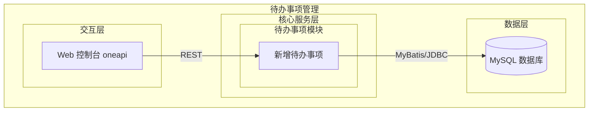
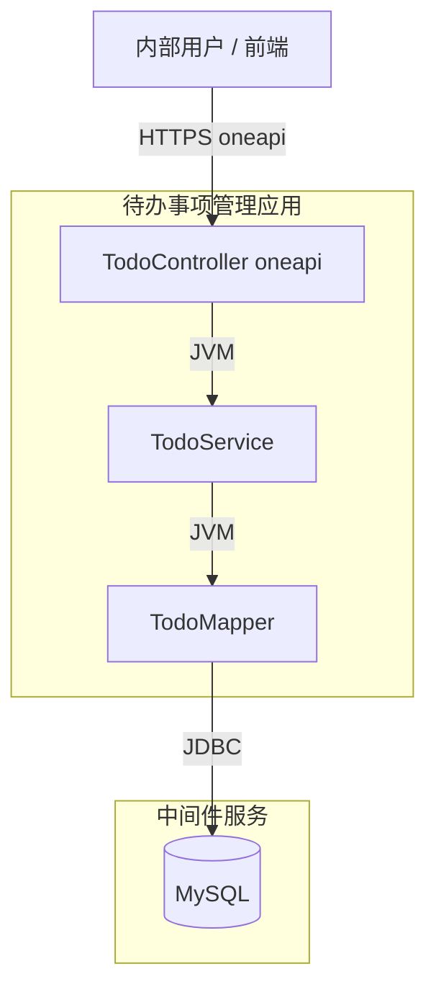
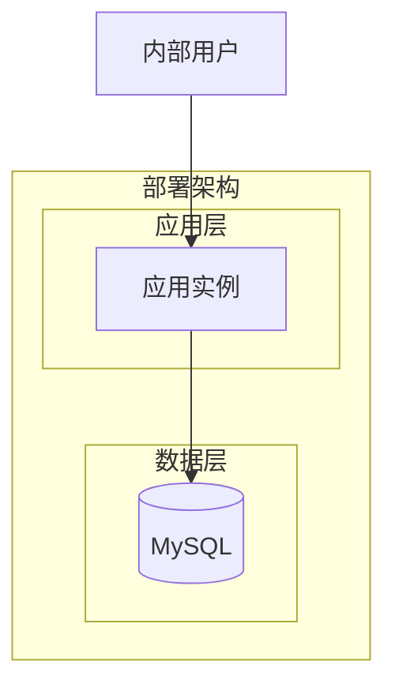
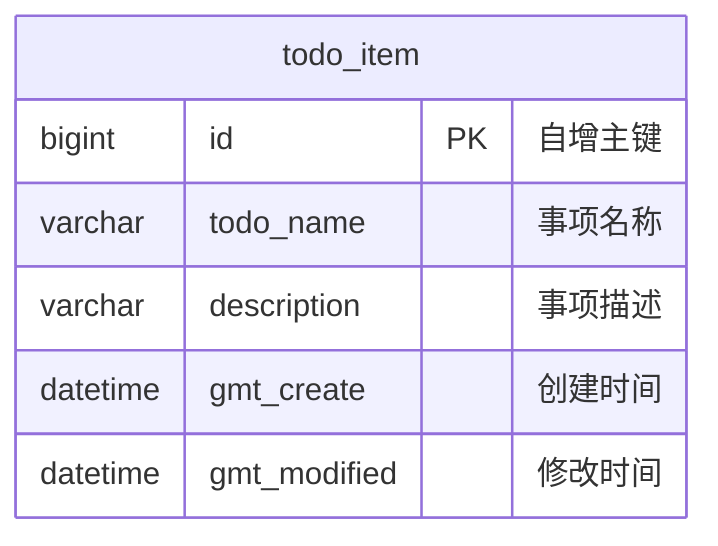
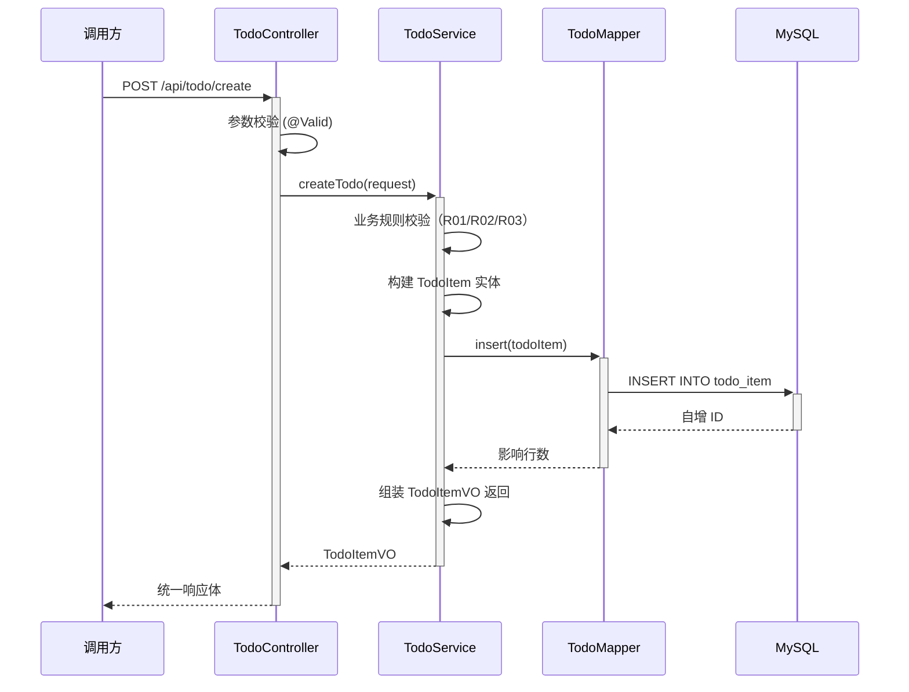

> **文档元信息**
>
> | 项目 | 内容 |
> |------|------|
> | 文档版本 | v1.0 |
> | 作者 | AiWork |
> | 创建日期 | 2026-10-14 |
> | 需求来源 | 日常待办事项记录 — 内部需求 |
> | 评审状态 | 待评审 |

# 日常待办事项管理 系分设计

## 1. 需求与范围

### 背景与目标

目标用户为内部用户，需要一个轻量级的日常待办事项记录能力。当前最小闭环聚焦"新增待办事项"，支撑用户快速录入任务名称与描述。

### 核心功能

- **F01 新增待办事项**：用户输入事项名称和描述，系统完成校验后持久化存储，返回创建成功的待办事项信息。

### 约束与非功能要求

- 技术栈：Spring Boot + MyBatis + MySQL
- 数据库命名遵循数科规范（全小写 + 下划线，主键 `pk_` 前缀，普通索引 `idx_` 前缀）
- 每表必备 `id`、`gmt_create`、`gmt_modified` 字段
- 接口遵循 oneapi REST 风格
- 目标用户为内部用户，默认信任域内调用，登录态由网关/拦截器统一处理（本次不单独实现）

### 排除范围

- 不包含待办事项的编辑、删除、查询列表、标记完成等功能
- 不包含用户体系、权限、多租户
- 不包含定时提醒、消息推送
- 不包含前端页面（仅后端 API）

### 需求功能清单与优先级

| 编号 | 功能点 | 优先级 | PRD 原始描述/章节 | 备注 |
|------|--------|--------|-------------------|------|
| F01 | 新增待办事项 | P0 | 输入事项名称与描述，创建待办记录 | 最小闭环唯一功能点 |

### 假设与待确认项

| 编号 | 假设/待确认内容 | 当前假设 | 确认状态 |
|------|-----------------|----------|----------|
| A01 | 待办事项归属用户 | 内部用户，单用户模式，不区分 userId | 待确认 |
| A02 | 事项名称长度上限 | 200 字符 | 待确认 |
| A03 | 事项描述长度上限 | 2000 字符 | 待确认 |
| A04 | 是否需要事项截止日期 | 当前最小闭环不含截止日期 | 待确认 |
| A05 | 数据库实例 | 使用项目已有 MySQL 实例 | 待确认 |

## 2. 架构与模块

### 功能架构



- **交互层说明**：通过 oneapi REST 接口为前端或调用方提供待办事项创建能力。
- **核心服务层说明**：`todo` 模块负责待办事项的业务逻辑，当前仅包含新增待办事项（F01）。
- **数据层说明**：MySQL 持久化存储待办事项记录。

**模块清单**

| 模块 | 职责 | 依赖 |
|------|------|------|
| todo | 待办事项 CRUD（当前仅 Create），业务校验，数据持久化 | MyBatis Mapper、MySQL |

### 应用集成架构



**集成关系说明：**

| 调用方 | 被调用方 | 协议 | 接口类型 | 说明 |
|--------|----------|------|----------|------|
| 内部用户/前端 | TodoController | HTTPS | oneapi REST | 新增待办事项 |
| TodoController | TodoService | JVM | Java 方法调用 | 业务处理 |
| TodoService | TodoMapper | JVM | MyBatis Mapper | 数据持久化 |
| TodoMapper | MySQL | JDBC | SQL INSERT | 写入待办记录 |

### 部署架构



**部署说明：**

- **应用层**：单实例部署，后续可水平扩展。当前最小闭环无需复杂拓扑。
- **数据层**：单 MySQL 实例，后续可按需引入主从架构。

## 3. 数据模型与存储

### 实体清单

| 实体名称 | 实体说明 | 所属模块 | 与其他实体的关系 |
|----------|----------|----------|-----------------|
| todo_item | 待办事项记录 | todo | 无（独立实体） |

### 实体关系图



**模型说明：**

- `todo_item` 是最小闭环的唯一实体，每条记录代表一条待办事项。
- 当前无关联实体，后续可扩展：用户表、分类标签表、附件表等。
- 事项名称字段名使用 `todo_name`，避免与 MySQL 保留字 `name` 冲突。

## 4. 接口设计

### 4.1 oneapi（Web 控制台接口）

| 编号 | 接口名称 | 方法 | 路径 | 模块 |
|------|----------|------|------|------|
| W01 | 新增待办事项 | POST | /api/todo/create | todo |

### 4.2 OpenAPI（对外接口）

当前最小闭环不涉及对外 OpenAPI。

### 4.3 内部接口（Service 层）

| 编号 | 接口名称 | 类 | 方法签名 |
|------|----------|------|----------|
| S01 | 新增待办事项 | TodoService | `TodoItemVO createTodo(TodoCreateRequest request)` |

### 4.4 集成接口（Integration 层）

当前最小闭环不涉及外部集成。

## 5. 功能模块设计

### 5.1 todo（待办事项模块）

#### 5.1.1 表结构设计

##### 5.1.1.1 todo_item（待办事项表）

| 字段名 | 数据类型 | 约束 | 默认值 | 说明 |
|--------|----------|------|--------|------|
| id | bigint | PK, 自增, NOT NULL | AUTO_INCREMENT | 系统自增主键 |
| todo_name | varchar(200) | NOT NULL | - | 事项名称 |
| description | varchar(2000) | NULL | NULL | 事项描述 |
| gmt_create | datetime | NOT NULL | CURRENT_TIMESTAMP | 创建时间 |
| gmt_modified | datetime | NOT NULL | CURRENT_TIMESTAMP | 修改时间 |

**索引：**

- PK: `pk_todo_item` (id)
- IDX: `idx_todo_item_gmt_create` (gmt_create)

**建表 DDL：**

```sql
CREATE TABLE todo_item (
    id          BIGINT       NOT NULL AUTO_INCREMENT COMMENT '系统自增主键',
    todo_name   VARCHAR(200) NOT NULL              COMMENT '事项名称',
    description VARCHAR(2000) DEFAULT NULL         COMMENT '事项描述',
    gmt_create  DATETIME     NOT NULL DEFAULT CURRENT_TIMESTAMP COMMENT '创建时间',
    gmt_modified DATETIME    NOT NULL DEFAULT CURRENT_TIMESTAMP COMMENT '修改时间',
    PRIMARY KEY pk_todo_item (id),
    INDEX idx_todo_item_gmt_create (gmt_create)
) ENGINE=InnoDB DEFAULT CHARSET=utf8mb4 COMMENT='待办事项表';
```

##### 5.1.1.x 枚举与常量定义

本模块无枚举/常量定义。

#### 5.1.2 接口详细设计

##### W01 新增待办事项

- **URI**: POST `/api/todo/create`
- **描述**: 创建一条新的待办事项记录。
- **入参**:

| 参数名称 | 类型 | 是否必填 | 描述 |
|----------|------|----------|------|
| todoName | String | 是 | 事项名称，1-200 字符 |
| description | String | 否 | 事项描述，0-2000 字符 |

- **出参**:

| 参数名称 | 类型 | 描述 |
|----------|------|------|
| result | String | 结果 code，"OK" 表示成功 |
| msg | String | 提示信息 |
| data | Object | 业务数据 |
| data.id | Long | 创建的待办事项 ID |
| data.todoName | String | 事项名称 |
| data.description | String | 事项描述 |
| data.gmtCreate | String | 创建时间 (yyyy-MM-dd HH:mm:ss) |

- **错误码**:

| 错误码 | 说明 |
|--------|------|
| PARAM_INVALID | 参数校验失败（名称为空或超长） |
| SYSTEM_ERROR | 系统内部错误 |

- **业务规则**:

| 规则编号 | 规则描述 | 校验时机 | 不满足时的处理 |
|----------|----------|----------|--------------|
| R01 | todoName 不能为空 | 创建时 | 返回 PARAM_INVALID，提示"事项名称不能为空" |
| R02 | todoName 长度不超过 200 字符 | 创建时 | 返回 PARAM_INVALID，提示"事项名称不能超过200字符" |
| R03 | description 长度不超过 2000 字符 | 创建时 | 返回 PARAM_INVALID，提示"事项描述不能超过2000字符" |

- **请求示例**:

```json
{
  "todoName": "完成系分设计文档",
  "description": "输出待办事项模块的完整系分设计"
}
```

- **响应示例**:

```json
{
  "result": "OK",
  "msg": "SUCCESS",
  "data": {
    "id": 1,
    "todoName": "完成系分设计文档",
    "description": "输出待办事项模块的完整系分设计",
    "gmtCreate": "2026-10-14 10:30:00"
  }
}
```

#### 5.1.3 子功能详细设计

##### 5.1.3.1 新增待办事项（F01）

- 处理时序图



**业务规则：**

| 规则编号 | 规则描述 | 校验时机 | 不满足时的处理 |
|----------|----------|----------|--------------|
| R01 | todoName 不能为空 | 创建时，Controller 层 @NotBlank | 返回 PARAM_INVALID |
| R02 | todoName 长度不超过 200 | 创建时，Controller 层 @Size | 返回 PARAM_INVALID |
| R03 | description 长度不超过 2000 | 创建时，Controller 层 @Size | 返回 PARAM_INVALID |

**异常场景：**

| 异常场景 | 处理方式 |
|----------|----------|
| 数据库连接失败 | 返回 SYSTEM_ERROR，上层可重试 |
| 插入时主键冲突 | 理论上自增主键不会冲突；若发生则返回 SYSTEM_ERROR |
| 请求体格式错误（非 JSON） | Spring 框架返回 400 Bad Request |

**并发控制：**

- 并发场景：新增操作为纯 INSERT，各请求独立，不存在对同一记录的并发冲突。
- 控制策略：无并发风险，原因：每次创建为独立新记录，自增主键由数据库保证唯一性，无需额外并发控制。

**状态机设计：**

当前最小闭环的待办事项仅为"已创建"单一状态，无状态流转。后续扩展时可按需引入 `status` 字段（如 PENDING → IN_PROGRESS → DONE）。

## 6. 非功能性需求设计

### 6.1 高可用性

- 应用层：单实例部署。若实例宕机，可通过容器编排（如 K8s）自动重启或切换到备用实例。
- 数据层：MySQL 单实例。后续可引入主从架构提升读可用性。当前最小闭环，数据库不可用时直接返回 SYSTEM_ERROR，由调用方重试。
- 无降级策略（最小闭环无需）。

### 6.2 可扩展性

- 水平扩展：应用层无状态，可直接增加实例数量，通过负载均衡分发请求。
- 表结构预留：`todo_item` 表设计简洁，后续可通过 `ALTER TABLE ADD COLUMN` 扩展字段（如 status、priority、due_date、assignee_id 等），符合数据库规范中"新增字段必须设默认值"的要求。
- 模块扩展：可在 `todo` 模块内新增 Service 方法实现编辑、删除、查询等功能，无需调整现有接口。

### 6.3 稳定性/可靠性

- 参数校验双层保障：Controller 层 JSR-303 注解校验 + Service 层业务规则兜底。
- 数据库写入：单条 INSERT，事务边界清晰，无需分布式事务。
- 边界场景：todoName 为纯空格时，`@NotBlank` 注解自动拦截；超长字符串由 `@Size` 限制。

### 6.4 安全性设计

#### 6.4.1 账户系统方案

内部用户场景，登录态由网关或全局拦截器统一处理，本次最小闭环不单独实现。

#### 6.4.2 授权&访问控制

##### 6.4.2.1 是否实现水平权限检查

不涉及（单用户模式，无多租户/多用户资源隔离需求）。

##### 6.4.2.2 是否实现垂直权限检查

不涉及（无角色区分）。

##### 6.4.2.3 是否检查登录态

依赖网关/全局拦截器，本模块不单独处理。

#### 6.4.3 数据防护方案

##### 6.4.3.1 是否对敏感数据加密存储

不涉及。待办事项名称和描述为普通业务数据，非敏感信息。

##### 6.4.3.2 是否对敏感数据展示进行脱敏

不涉及。

### 6.5 监控/统计/日志/告警

- **日志**：Controller 层记录请求入参（INFO 级别）；Service 层记录创建结果（INFO 级别）；异常时记录 ERROR 级别日志及堆栈。
- **监控**：接入统一监控平台，关注接口 QPS、RT（响应时间）、错误率。
- **告警**：错误率超过阈值（如 1%）触发告警。

## 7. 变更三板斧

### 7.1 可监控

- 新增待办事项接口接入统一 Metrics：记录调用次数、成功/失败计数、P99 响应时间。
- 数据库慢查询监控：`todo_item` 的 INSERT 操作预期 <10ms，若出现慢查询触发告警。

### 7.2 可灰度

- 接口级灰度：可通过网关路由规则按流量百分比放量到新版本。
- 数据库变更：新增 `todo_item` 表为纯增量 DDL，对现有业务零影响，可直接上线。后续新增字段时按规范设置 DEFAULT 值，确保灰度期间新旧代码兼容。

### 7.3 可应急

- **开关设计**：可通过配置中心（如 Diamond/Nacos）下发 `todo.create.enabled` 开关，紧急情况下关闭创建能力，接口返回"功能暂不可用"。
- **回滚策略**：新增接口为纯增量功能，回滚仅需下线新版本部署包、恢复旧版本即可，无需数据库回滚（新增表不影响旧代码）。若需清理数据，直接 TRUNCATE `todo_item` 表。