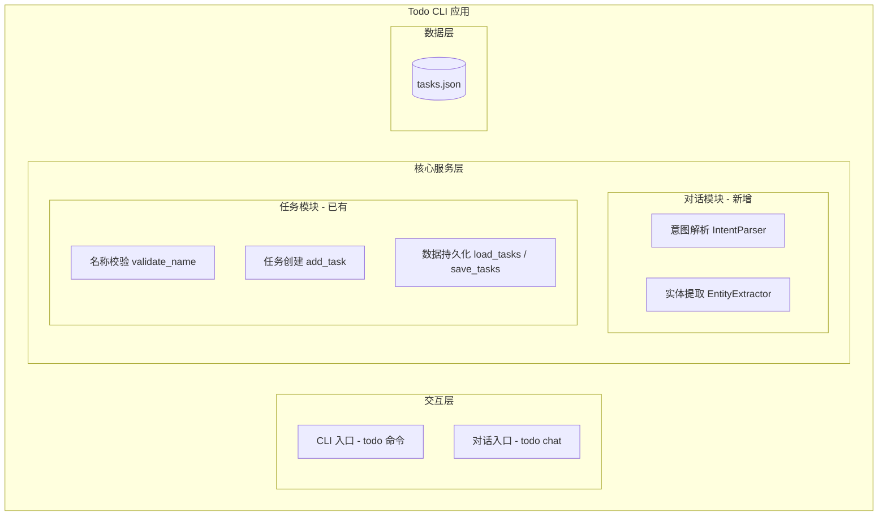
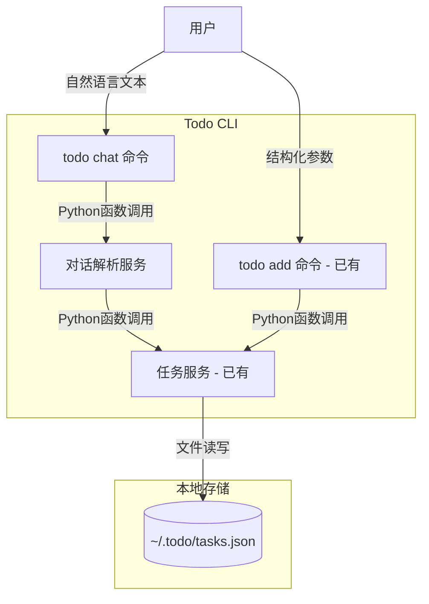
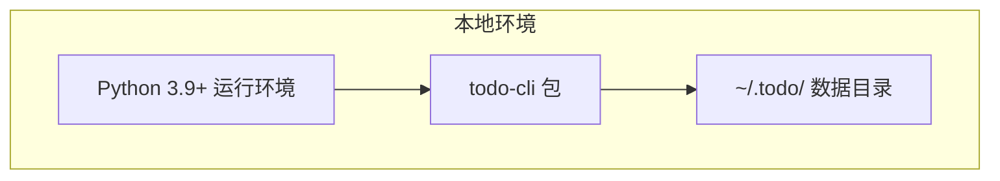
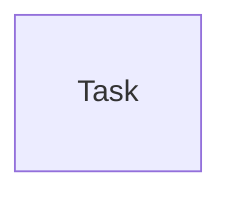
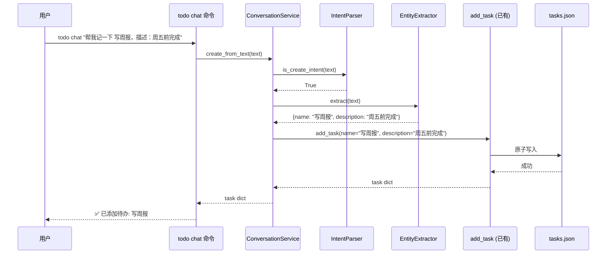

> **文档元信息**
>
> | 项目 | 内容 |
> |------|------|
> | 文档版本 | v1.0 |
> | 作者 | AiWork |
> | 创建日期 | 2026-10-20 |
> | 需求来源 | 内核升级-对话创建任务 |
> | 评审状态 | 待评审 |

# 内核升级-对话创建任务 系分设计

## 1. 需求与范围

### 背景与目标

现有 Todo CLI 工具（`todo-cli`）已实现命令行方式的新增待办事项功能（`todo add -n <名称> [-d <描述>]`）。本次"内核升级"旨在增加**对话式（自然语言）创建任务**的能力，使用户可以通过自然语言对话直接创建待办事项，无需记忆命令行参数格式。

目标用户：内部用户（企业内部员工）。

### 核心功能

1. **对话创建任务（F01）**：用户输入自然语言对话文本，系统自动解析并提取事项名称与描述，完成待办事项创建。
2. **意图识别（F02）**：系统能区分创建任务的意图与其他非任务类对话，仅在用户明确表达"创建/添加/记录"任务意图时执行创建。

### 约束与非功能要求

- 基于现有代码库扩展，不破坏现有 CLI 功能
- Python 3.9+，标准库零第三方依赖（项目硬性约束）
- 现有数据模型（`{name, description, created_at}` 的 JSON 文件存储）保持不变
- 对话接口需支持程序化调用（非交互式终端输入），为后续 AI Agent 集成预留接口

### 排除范围

- 不涉及任务的查询/更新/删除/完成标记
- 不涉及用户认证与多租户
- 不涉及对话历史持久化
- 不涉及 Web/移动端 UI
- 不涉及任务分类/优先级/截止日期等扩展字段

### 需求功能清单与优先级

| 编号 | 功能点 | 优先级 | PRD 原始描述 | 备注 |
|------|--------|--------|-------------|------|
| F01 | 对话创建任务——从自然语言中提取名称和描述并创建待办事项 | P0 | "对话创建任务"、"新增待办事项"、"事项名称和描述" | 最小闭环核心 |
| F02 | 意图识别——区分"创建任务"与"非任务对话" | P0 | "帮助用户记录日常待办事项" | 避免误创建，假设：非创建意图返回明确提示，不执行任何操作 |

### 假设与待确认项

| 编号 | 假设/待确认内容 | 当前假设 | 确认状态 |
|------|-----------------|----------|----------|
| A01 | 对话接口形式 | 假设为 Python 函数调用接口（`create_from_text(text: str) -> dict`），CLI 子命令 `todo chat` 作为入口 | 待确认 |
| A02 | 意图识别策略 | 假设基于关键词匹配（"添加/创建/记录/帮我记/代办/待办/todo"等），无需接入 NLP 模型，适配零第三方依赖约束 | 待确认 |
| A03 | 对话输入无名称时如何处理 | 假设：若无法从文本中提取有效名称，返回错误提示而不创建，不进行追问交互 | 待确认 |
| A04 | 对话创建是否复用现有 `validate_name` 和 `add_task` | 假设：完全复用，对话解析层仅做文本→name/description 的提取，校验和持久化全部委托给现有函数 | 待确认 |


## 2. 架构与模块

### 功能架构



- **交互层说明**：CLI 入口 `todo add` 保持不变；新增 `todo chat` 子命令接收自然语言文本。
- **核心服务层说明**：新增对话模块（IntentParser + EntityExtractor）负责文本解析；复用已有任务模块完成校验、创建和持久化。
- **数据层说明**：沿用现有 `~/.todo/tasks.json` JSON 文件，无变化。

**模块清单**

| 模块 | 职责 | 依赖 |
|------|------|------|
| 对话模块（conversation） | 解析自然语言文本，识别创建任务意图，提取名称与描述 | 任务模块（调用 validate_name、add_task） |
| 任务模块（task）——已有 | 任务名称校验、任务创建与持久化 | 数据层（load_tasks / save_tasks） |

### 应用集成架构

本功能无外部系统集成，为纯本地 CLI 工具。



**集成关系说明：**

| 调用方 | 被调用方 | 协议 | 接口类型 | 说明 |
|--------|----------|------|----------|------|
| 用户 | todo chat 命令 | CLI 参数 | 命令行 | 自然语言文本作为位置参数传入 |
| 用户 | todo add 命令 | CLI 参数 | 命令行 | 已有，保持不变 |
| ChatCLI | ConversationSvc | Python 函数调用 | 内部接口 | 文本→结构化参数 |
| ConversationSvc | TaskSvc | Python 函数调用 | 内部接口 | 复用已有 validate_name + add_task |
| TaskSvc | tasks.json | 文件 IO | 原子写入 | 已有，不变 |

### 部署架构

本功能为单机 CLI 工具，无服务端部署。采用本地 Python 包安装方式（`pip install -e .`），无需容器化或多副本。



**部署说明：**
- 单机运行，无负载均衡需求。
- 通过 `pyproject.toml` 的 `[project.scripts]` 注册 `todo` 入口。
- 数据存储于用户 home 目录 `~/.todo/tasks.json`。


## 3. 数据模型与存储

### 实体清单

| 实体名称 | 实体说明 | 所属模块 | 与其他实体的关系 |
|----------|----------|----------|-----------------|
| Task | 待办事项，包含名称、描述和创建时间 | 任务模块（已有） | 无关联实体 |

### 实体关系图

本需求仅涉及单一实体，无实体间关系。



**模型说明：**
- Task 实体为已有实体，本次不新增字段。字段结构：`{name: str, description: str, created_at: str(ISO8601)}`。
- 无新增实体。
- 数据以 JSON 数组形式存储于 `~/.todo/tasks.json`。
- 不涉及缓存/MQ。
- 租户隔离：本功能为单用户本地工具，不涉及多租户场景。


## 4. 接口设计

### 4.1 oneapi（Web 控制台接口）

本项不适用，原因：本功能为 CLI 工具，无 Web 控制台接口。

### 4.2 OpenAPI（对外接口）

本项不适用，原因：本功能为本地 CLI 工具，无对外 API 暴露。

### 4.3 内部接口（Service 层）

| 编号 | 接口名称 | 类 | 方法签名 |
|------|----------|-----|----------|
| S01 | 对话创建任务 | ConversationService | `create_from_text(text: str) -> dict` |
| S02 | 意图识别 | IntentParser | `is_create_intent(text: str) -> bool` |
| S03 | 实体提取 | EntityExtractor | `extract(text: str) -> dict` |
| S04 | 名称校验（已有） | — | `validate_name(name: str) -> None` |
| S05 | 任务创建（已有） | — | `add_task(name: str, description: str = "", data_file: Path \| None = None) -> dict` |

### 4.4 集成接口（Integration 层）

本项不适用，原因：无外部系统集成。


## 5. 功能模块设计

### 全局约定

| 项目 | 约定 |
|------|------|
| 通用出参结构 | 函数返回值直接为 Python dict，无统一封装。CLI 输出使用 emoji 前缀（`✅` 成功、`❌` 错误） |
| 错误处理 | Python 异常机制（ValueError 表示参数错误，OSError 表示文件错误），无自定义错误码。CLI 出口统一 exit code 1 |

**模块映射：**

| 模块 | 源码文件 | 已有/新增 |
|------|---------|----------|
| 对话模块 | `src/todo_cli/conversation.py` | 新增 |
| 任务模块 | `src/todo_cli/main.py` | 已有（无变动） |


### 5.1 对话模块（conversation）

#### 5.1.1 表结构设计

本模块不涉及数据库表。任务数据沿用已有 JSON 文件格式，无表结构变更。

##### 5.1.1.x 枚举与常量定义

| 枚举名称 | 取值 | 含义 | 关联字段 |
|----------|------|------|----------|
| CREATE_INTENT_KEYWORDS | `["添加", "创建", "新增", "记录", "帮我记", "代办", "待办", "todo", "add", "create", "记录一下", "记一下"]` | 触发创建任务意图的中文/英文关键词 | 意图识别 |
| NON_INTENT_INDICATORS | `["查看", "查询", "列出", "删除", "完成", "list", "show", "delete", "done", "complete"]` | 明确非创建意图的指示词（用于排除） | 意图识别 |
| NAME_PATTERN | 正则：`(?:添加\|创建\|新增\|记录\|帮我记\|代办\|待办\|todo\|add\|create\|记一下\|记录一下)\s*(?:一个\|一下\|个\s*)?(.+?)(?:\s*[，,]\s*(?:描述\|备注\|说明\|内容)\s*[：:]\s*(.+))?$` | 从文本中提取名称和描述的规则 | 实体提取 |

#### 5.1.2 接口详细设计

##### S01 create_from_text —— 对话创建任务

- **方法签名**: `create_from_text(text: str, data_file: Path | None = None) -> dict`
- **描述**: 接收自然语言文本，解析意图后提取名称与描述，调用已有 `add_task` 创建任务。
- **入参**:

| 参数名称 | 类型 | 是否必填 | 描述 |
|----------|------|----------|------|
| text | str | 是 | 用户输入的自然语言文本 |
| data_file | Path \| None | 否 | 数据文件路径，默认使用 DEFAULT_DATA_FILE |

- **出参**:

| 参数名称 | 类型 | 描述 |
|----------|------|------|
| (返回值) | dict | 创建成功的任务 dict，包含 name、description、created_at |

- **错误处理**:
  - 非创建意图：抛出 `ValueError("无法识别为创建任务意图")`
  - 无法提取名称：抛出 `ValueError("无法从事项描述中提取名称")`
  - 名称非法：由 `validate_name` 抛出 `ValueError`
  - 文件写入失败：由 `save_tasks` 抛出 `OSError`

- **请求示例**:
```
用户输入: "帮我记一下 写周报，描述：周五前完成"
```

- **响应示例**:
```json
{
  "name": "写周报",
  "description": "周五前完成",
  "created_at": "2026-10-20T12:00:00+00:00"
}
```

##### S02 is_create_intent —— 意图识别

- **方法签名**: `is_create_intent(text: str) -> bool`
- **描述**: 判断输入文本是否为"创建任务"意图。基于关键词匹配：包含 CREATE_INTENT_KEYWORDS 任一关键词且不包含 NON_INTENT_INDICATORS 中明确排除词。
- **入参**:

| 参数名称 | 类型 | 是否必填 | 描述 |
|----------|------|----------|------|
| text | str | 是 | 待判断的自然语言文本 |

- **出参**: `bool` — True 表示检测到创建意图。

##### S03 extract —— 实体提取

- **方法签名**: `extract(text: str) -> dict`
- **描述**: 从自然语言文本中提取事项名称和可选描述。使用正则 NAME_PATTERN 匹配。
- **入参**:

| 参数名称 | 类型 | 是否必填 | 描述 |
|----------|------|----------|------|
| text | str | 是 | 已确认包含创建意图的自然语言文本 |

- **出参**: `{name: str, description: str}`，description 可能为空字符串。

#### 5.1.3 子功能详细设计

##### 5.1.3.1 对话创建任务（F01）

**处理时序图：**



**业务规则：**

| 规则编号 | 规则描述 | 校验时机 | 不满足时的处理 |
|----------|----------|----------|---------------|
| R01 | 输入文本不能为空 | 函数入口 | 抛出 ValueError("输入文本不能为空") |
| R02 | 必须识别为创建任务意图 | 意图解析时 | 抛出 ValueError("无法识别为创建任务意图") |
| R03 | 必须能从文本中提取有效名称 | 实体提取时 | 抛出 ValueError("无法从事项描述中提取名称") |
| R04 | 名称必须通过 validate_name 校验 | 调用 add_task 前 | 由 validate_name 抛出 ValueError，向上传播 |
| R05 | 描述字段可选，未提取到时为空字符串 | 实体提取时 | 默认 description="" |

**异常场景：**

| 异常场景 | 处理方式 |
|----------|----------|
| 用户输入非任务文本（如"今天天气怎么样"） | is_create_intent 返回 False → 抛出 ValueError |
| 用户输入"添加"但无具体内容（如"添加一下"） | extract 无法匹配名称 → 抛出 ValueError |
| 用户输入含非法控制字符的名称 | validate_name 拒绝 → 抛出 ValueError |
| 磁盘空间不足写入失败 | save_tasks 抛出 OSError → 向上传播，CLI 输出错误信息 |

**并发控制：**
- 并发场景：同一用户短时间内多次调用对话创建（通过脚本或 AI Agent 并发调用）。
- 控制策略：现有 `save_tasks` 采用"读取→追加→原子替换"模式，不保证并发安全（读-改-写竞态）。对于当前单用户 CLI 场景无并发风险。原因：CLI 工具为单进程串行调用，且目标场景为个人使用。
  - 未来如需支持高并发：建议引入文件锁（`fcntl.flock`）或改用 SQLite。

**状态机设计：**

本实体（Task）无状态字段，仅创建即完成。不涉及状态流转。

**技术选型方案对比：**

| 方案 | 描述 | 优势 | 劣势 | 推荐 |
|------|------|------|------|------|
| 方案A：关键词+正则 | 基于关键词词典判断意图 + 正则提取实体 | 零依赖、轻量、确定性行为、易测试 | 覆盖面有限，对复杂语法识别率低 | ✅ 推荐 |
| 方案B：接入 NLP 模型 | 使用预训练 NLP 模型进行意图分类和 NER | 理解能力强，覆盖面广 | 引入重量级第三方依赖，违反硬性约束 | ❌ |
| 方案C：LLM API 调用 | 调用大模型 API 解析自然语言 | 理解能力最强 | 引入网络依赖和 API 费用，不适合本地 CLI | ❌ |

**推荐方案**：方案A（关键词+正则），理由：满足项目"零第三方依赖"硬性约束，实现简单，对于"创建待办"这类结构化意图足够覆盖主流中文表达。

**模块自检——完备性对账：**

| 检查项 | 状态 | 说明 |
|--------|------|------|
| F01 对话创建任务 | ✅ | 通过 create_from_text 实现 |
| F02 意图识别 | ✅ | 通过 is_create_intent 实现 |
| 名称提取 | ✅ | 通过 extract 的 NAME_PATTERN 正则实现 |
| 描述提取 | ✅ | 通过 extract 正则的可选捕获组实现 |
| 复用已有函数 | ✅ | 调用已有 validate_name、add_task |
| 错误处理 | ✅ | 空文本、非意图、无名称、非法名称、IO 异常均已覆盖 |


## 6. 非功能性需求设计

### 6.1 高可用性

本项不适用，原因：本功能为本地 CLI 工具，无服务端进程，无上下游依赖。所有操作为同步本地文件 IO，不存在服务宕机或下游异常场景。

### 6.2 可扩展性

- **水平扩展**：本项不适用，原因：CLI 工具为单机单用户运行模式，无需多实例。
- **架构扩展**：
  - 意图识别关键词通过常量列表定义，易于扩展新关键词。
  - 实体提取正则通过常量定义，可通过扩展正则支持更复杂的语法模式。
  - 未来如需支持更多对话能力（如查询、删除），可在 ConversationService 中扩展新方法，不影响现有功能。

### 6.3 稳定性/可靠性

- **边界场景**：
  - 输入空字符串：已通过 R01 校验，返回明确错误。
  - 输入超长文本：正则匹配性能可控（O(n)），无递归风险。
  - 文件损坏（JSON 格式错误）：已有 `load_tasks` 返回空列表，对话模块继承此行为。
  - 磁盘空间不足：`save_tasks` 原子写入失败时抛出 OSError，不产生半截文件。
- **原子性保证**：复用已有 `save_tasks` 的 `NamedTemporaryFile + os.replace` 原子写入机制。

### 6.4 安全性设计

#### 6.4.1 账户系统方案

本项不适用，原因：本地单用户 CLI 工具，无账户系统。

#### 6.4.2 授权与访问控制

本项不适用，原因：本地 CLI 工具，所有操作在用户本地文件系统上执行，文件权限由操作系统管理。

#### 6.4.3 数据防护方案

本项不适用，原因：待办事项为个人任务记录，不涉及身份证、银行卡、密码等敏感数据。数据存储于用户 home 目录 `~/.todo/`，权限由操作系统文件权限控制。

### 6.5 监控/统计/日志/告警

本项不适用，原因：本地 CLI 工具，无服务端运行环境，不涉及线上监控告警。CLI 执行结果通过标准输出/标准错误呈现。


## 7. 变更三板斧

### 7.1 可监控

本项不适用，原因：本地 CLI 工具，无服务端运行环境，不涉及运行时监控埋点。

- 开发阶段：通过单元测试覆盖所有意图解析和实体提取路径，确保功能正确性。
- 使用阶段：CLI 输出（stdout/stderr）即为用户可感知的操作结果。

### 7.2 可灰度

本项不适用，原因：CLI 工具通过 Python 包安装方式发布，无服务端灰度引流机制。用户通过 `pip install --upgrade` 升级。

- 替代方案：新版本发布时可采用版本号策略（semver），用户自主选择升级时机。

### 7.3 可应急

- **回退方案**：新增的对话模块（`conversation.py`）与已有 CLI（`todo add`）完全解耦。若对话功能出现问题，用户可降级使用原有的 `todo add` 命令，不影响核心任务创建能力。
- **开关控制**：无需额外开关——`todo chat` 和 `todo add` 为独立子命令，互不影响。
- **回滚依赖**：新增文件仅 `src/todo_cli/conversation.py` 和对 `main.py` 的 CLI 子命令注册。回滚时仅需移除这两处变更，已有 `load_tasks`/`save_tasks`/`add_task`/`validate_name` 不受影响。
- **数据兼容性**：对话创建与 CLI 创建共用同一数据文件 `tasks.json`，数据格式不变，回滚后已有数据完全兼容。


## 附录：方案检查（Step 9）

| 检查项 | 结果 | 说明 |
|--------|------|------|
| 模块划分合理性 | 通过 | 对话模块和任务模块各单一职责，无循环依赖，无超大模块 |
| 依赖关系合理性 | 通过 | 对话→任务单向依赖；下游异常通过异常传播处理 |
| 单点问题（部署） | 不适用 | CLI 单机工具，无服务端部署 |
| 表模型设计范式 | 不适用 | JSON 文件存储，无关系型数据库表 |
| 隐私安全检查 | 通过 | 不涉及敏感数据 |
| 兼容性检查（接口） | 通过 | 新增接口不修改已有接口，完全向后兼容 |
| 兼容性检查（表） | 不适用 | 无数据库表 |
| 数据迁移检查 | 通过 | 无表结构变更，数据格式不变，无需迁移 |
| 一致性检查（功能点） | 通过 | F01→create_from_text, F02→is_create_intent 均已覆盖 |
| 一致性检查（表） | 不适用 | 无新增数据库表 |
| 一致性检查（接口） | 通过 | S01-S05 在 Step 5 均有详细定义 |
| 一致性检查（枚举） | 通过 | 枚举定义与接口设计中的常量引用一致 |
| 状态机完整性检查 | 不适用 | Task 无状态字段 |
| 并发风险检查 | 通过 | 已识别"读-改-写"竞态并给出控制策略；当前单用户场景无风险 |
| 单点问题（定时任务） | 不适用 | 无定时任务 |
| 非功能性设计可行性 | 通过 | 所有不适用项已说明原因；可扩展性设计合理 |
| 可监控可行性 | 不适用 | CLI 工具 |
| 可灰度可行性 | 不适用 | CLI 工具通过 pip 升级，非服务端灰度 |
| 可应急可行性 | 通过 | 独立子命令，回退无副作用，数据兼容 |