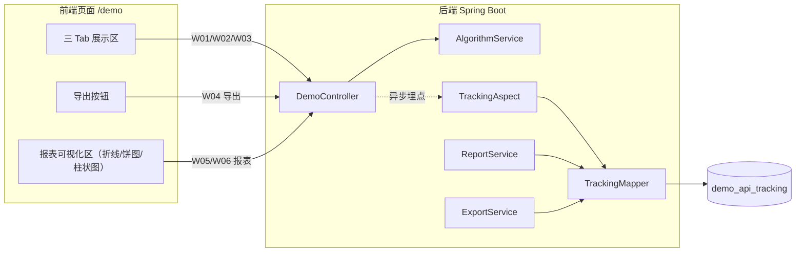
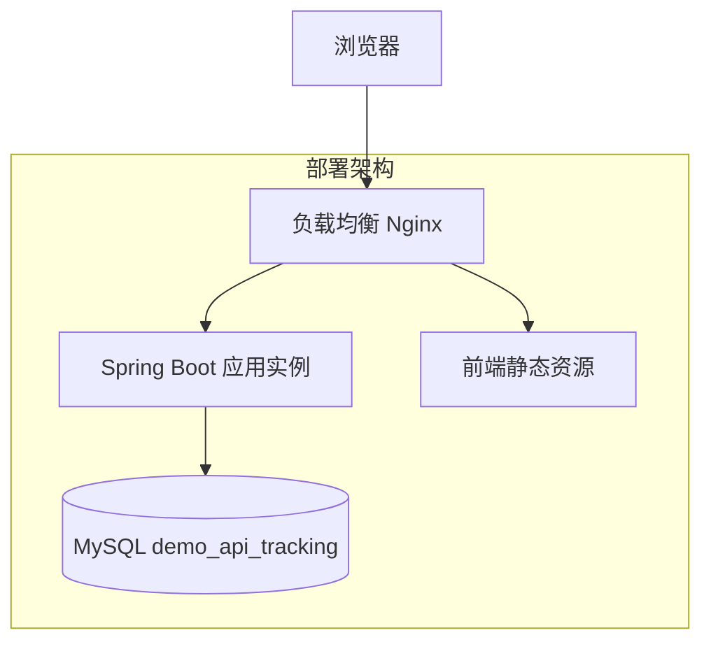
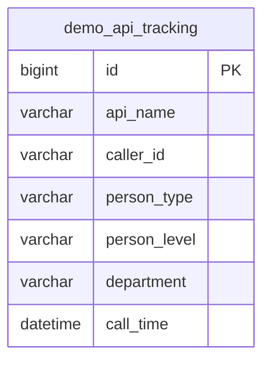
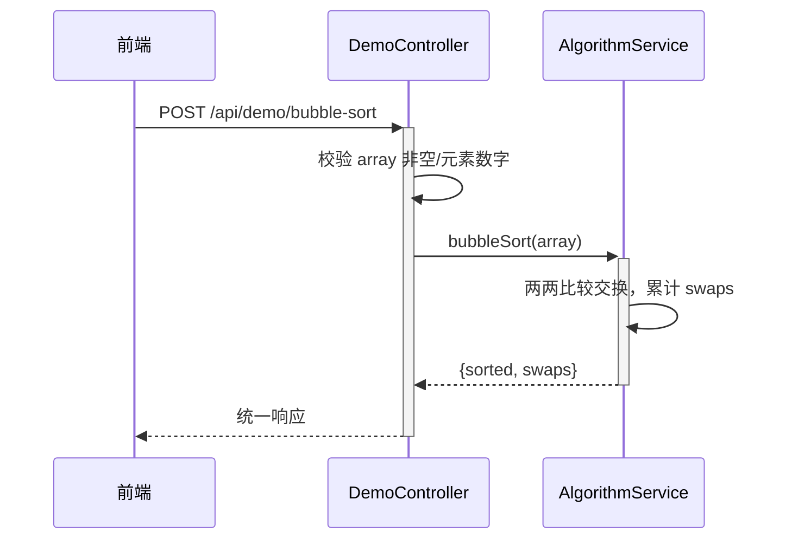
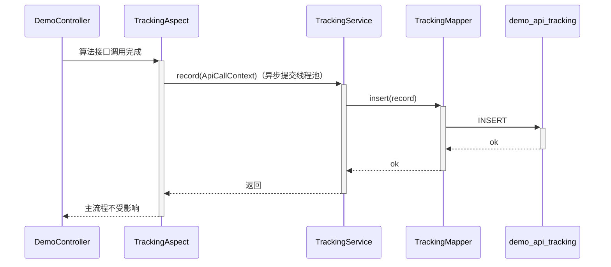
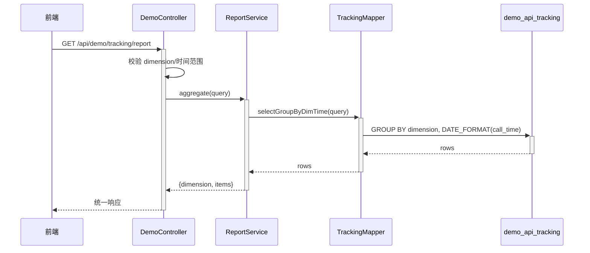
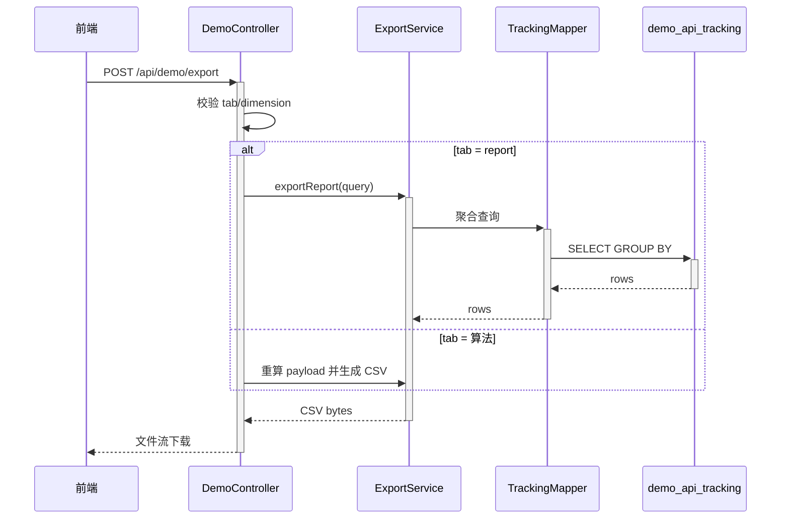
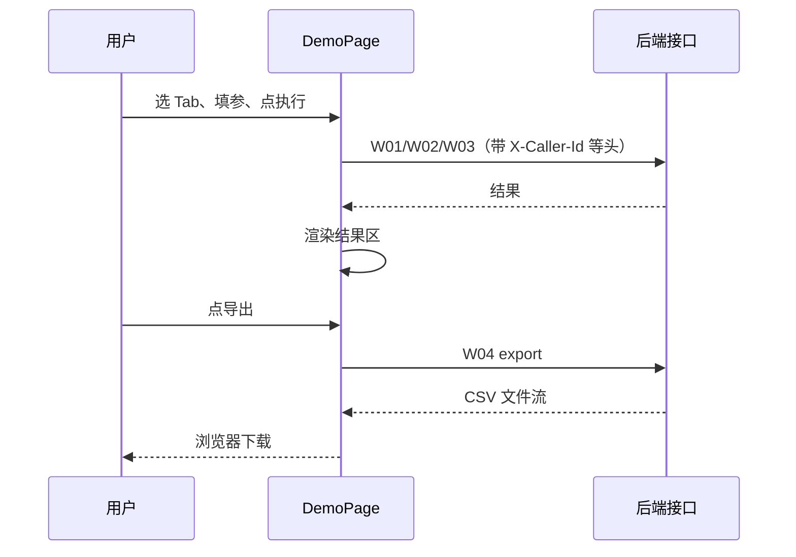
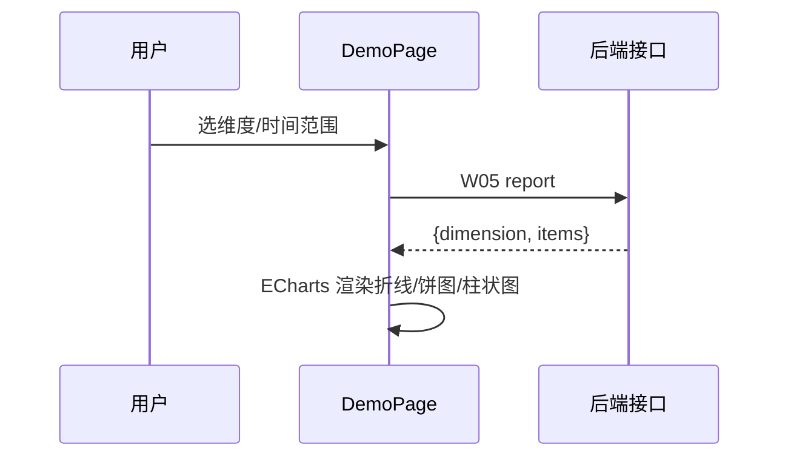

> **文档元信息**
>
> | 项目 | 内容 |
> |------|------|
> | 文档版本 | v1.0 |
> | 作者 | AiWork |
> | 创建日期 | 2026-10-20 |
> | 需求来源 | `.agents/20261020-分别写三个接口helloworld_哈希/spec.md`（需求：三接口 helloworld/哈希/冒泡排序 + 前端多 Tab + 导出 + 埋点 + 报表可视化） |
> | 评审状态 | 待评审 |
> | 关联任务 | DEV-966dcd0a-7905-11f1-9649-3b4281182f10-ebbe48e3-72a8-459e-b48f-b25c23672dd0 |

# 三个示例算法接口 + 调用埋点与可视化报表 系分设计

## 1. 需求与范围

### 1.1 背景与目标
当前仓库为空白起步工程（仅含 `README.md`，内容 `# testllw`）。本次需求构建一个**最小可运行的全栈示例**，打通「后端算法接口 → 前端展示 → 导出 → 调用埋点 → 报表可视化」闭环：

1. 后端提供三个基础算法接口：HelloWorld、哈希算法、冒泡排序。
2. 前端新增一个页面，用三个 Tab 分别展示三个接口的执行结果。
3. 页面提供导出按钮，后端提供导出接口，支持导出各 Tab 的展示结果。
4. 后端对接口调用做埋点，记录**调用次数**与**调用人**；前端在同一页面可视化「调用情况」报表，支持按**人员类型 / 人员层级 / 人员部门**等维度查看，并以**折线图、饼图、柱状图**等多种形式展示。

### 1.2 需求功能清单与优先级

| 编号 | 功能点 | 优先级 | PRD 原始描述 | 备注 |
|------|--------|--------|--------------|------|
| F01 | HelloWorld 接口 | P0 | 写 helloworld 接口 | 返回问候字符串，可带 name |
| F02 | 哈希算法接口 | P0 | 写哈希算法接口 | 对入参文本计算 SHA-256 摘要 |
| F03 | 冒泡排序接口 | P0 | 写冒泡排序接口 | 对入参数组升序排序，返回交换次数 |
| F04 | 前端三 Tab 页面 | P0 | 页面三个 Tab 展示不同执行结果 | 路由 /demo |
| F05 | 导出功能 | P0 | 新增导出按钮，后台提供导出接口 | 导出当前 Tab 结果 / 报表摘要（CSV） |
| F06 | 调用埋点 | P0 | 后端埋点获取调用次数和调用人 | 异步落库，含人员维度冗余字段 |
| F07 | 调用报表可视化 | P0 | 前端可视化报表，按人员类型/层级/部门维度，折线图+饼图+柱状图 | 实时聚合 + 三种图表 |

### 1.3 约束与非功能要求
- 后端：Java（Spring Boot + Maven），据 spec A01 推断。
- 前端：React + Ant Design + ECharts（示例工程，轻量、可独立运行）。
- 埋点异步落库，不阻塞主业务流程。
- 导出格式：CSV（文本结果类直接导出；报表导出摘要数据）。
- 报表在时间维度（day/hour）与人员维度上可聚合。

### 1.4 排除范围
- 不做用户登录/鉴权系统，调用人以请求头占位透传。
- 不做多语言、不做移动端适配。
- 不做高可用/分布式部署。

### 1.5 假设与待确认项

| 编号 | 假设/待确认内容 | 当前假设 | 确认状态 |
|------|-----------------|----------|----------|
| A01 | 后端语言/框架 | Spring Boot + Maven | 待确认（据 test_command 推断） |
| A02 | 前端框架 | React + Ant Design + ECharts | 待确认 |
| A03 | 调用人来源 | 请求头 X-Caller-Id / X-Person-Type / X-Person-Level / X-Dept 占位 | 待确认 |
| A04 | 报表时间粒度 | 默认按天，支持 hour | 已确认（设计） |
| A05 | 导出内容范围 | 当前 Tab 展示结果 + 报表摘要数据 | 已确认（设计） |
| A06 | 人员维度数据来源 | 埋点表冗余 person_type/level/department 字段 | 已确认（设计） |
| A07 | 哈希算法 | SHA-256，返回明示算法名 | 已确认（设计） |
| A08 | 冒泡排序 | 返回升序结果 + 交换次数 | 已确认（设计） |

## 2. 架构与模块

### 2.1 功能架构



### 2.2 模块清单

| 模块 | 职责 | 依赖 |
|------|------|------|
| 算法服务 AlgorithmService | helloworld / hash(SHA-256) / bubbleSort 纯算法实现 | 无 |
| 接口控制层 DemoController | 暴露 6 个 HTTP 接口、参数校验、响应封装 | AlgorithmService、埋点切面、ReportService、ExportService |
| 埋点组件 TrackingAspect | 拦截算法接口调用，异步记录调用人+维度+时间 | TrackingMapper |
| 埋点存储 TrackingMapper + demo_api_tracking | 持久化埋点记录，提供聚合查询 | MySQL |
| 导出服务 ExportService | 生成当前 Tab 结果 / 报表摘要 CSV | TrackingMapper |
| 报表服务 ReportService | 按人员维度 + 时间维度聚合调用次数 | TrackingMapper |
| 前端页面 DemoPage | 三 Tab 展示、导出触发、报表图表渲染 | 后端 HTTP API |

### 2.3 集成架构

无外部系统集成。前端静态资源经后端/网关同源或 CORS 访问 `/api/demo`；后端仅访问 MySQL。

### 2.4 部署架构



部署说明：示例工程单实例；算法接口无状态，后续可水平扩容多实例（此时埋点异步线程池与报表聚合均无单点状态依赖）。

## 3. 数据模型与存储

### 3.1 实体清单

| 实体名称 | 实体说明 | 所属模块 | 与其他实体的关系 |
|----------|----------|----------|-----------------|
| demo_api_tracking | 接口调用埋点记录 | 埋点存储 | 无关联（单表自包含） |

### 3.2 实体关系图



模型说明：单张埋点明细表承载全部报表聚合；报表由 ReportService 实时 GROUP BY，不落预聚合表；无缓存/MQ；单租户（tenant_id 本项不适用）。

## 4. 接口设计

统一前缀 `/api/demo`，统一响应 `{ code, msg, data }`。

### 4.1 oneapi（Web 控制台接口）

| 编号 | 接口名称 | 方法 | 路径 | 模块 |
|------|----------|------|------|------|
| W01 | HelloWorld | GET | /api/demo/helloworld | 算法 |
| W02 | 哈希算法 | POST | /api/demo/hash | 算法 |
| W03 | 冒泡排序 | POST | /api/demo/bubble-sort | 算法 |
| W04 | 结果导出 | POST | /api/demo/export | 导出 |
| W05 | 调用报表 | GET | /api/demo/tracking/report | 报表 |
| W06 | 维度可选值 | GET | /api/demo/tracking/dimensions | 报表 |

### 4.2 OpenAPI（对外接口）

本项不适用，原因：示例工程仅内部 Web 控制台使用，无对外开放诉求。

### 4.3 内部接口（Service 层）

| 编号 | 接口名称 | 类 | 方法签名 |
|------|----------|------|----------|
| S01 | 问候 | AlgorithmService | String hello(String name) |
| S02 | 哈希 | AlgorithmService | HashResult sha256(String text) |
| S03 | 排序 | AlgorithmService | SortResult bubbleSort(int[] array) |
| S04 | 埋点记录 | TrackingService | void record(ApiCallContext ctx) |
| S05 | 报表聚合 | ReportService | ReportResult aggregate(ReportQuery query) |
| S06 | 导出 | ExportService | byte[] export(ExportQuery query) |

### 4.4 集成接口（Integration 层）

本项不适用，原因：无外部系统集成。

## 5. 功能模块设计

### 5.1 算法模块（F01/F02/F03）

无表结构。纯算法能力，无状态、无存储依赖。

#### 5.1.1 接口详细设计

##### W01 HelloWorld（F01）
- **URI**: GET /api/demo/helloworld?name=World
- **描述**: 返回问候字符串
- **入参**:

| 参数名称 | 类型 | 是否必填 | 描述 |
|----------|------|----------|------|
| name | String | 否 | 问候对象，缺省 "World"，长度 ≤ 64 |

- **出参**:

| 参数名称 | 类型 | 描述 |
|----------|------|------|
| code | String | "0" 表示成功 |
| msg | String | 提示信息 |
| data.message | String | 问候文案 "Hello, {name}!" |

- **错误码**: ALG_001 name 超长。
- **请求示例**:
```json
{}
```
- **响应示例**:
```json
{ "code": "0", "msg": "SUCCESS", "data": { "message": "Hello, World!" } }
```

##### W02 哈希算法（F02）
- **URI**: POST /api/demo/hash
- **描述**: 对入参文本计算 SHA-256 摘要
- **入参**:

| 参数名称 | 类型 | 是否必填 | 描述 |
|----------|------|----------|------|
| text | String | 是 | 原文，非空 |

- **出参**:

| 参数名称 | 类型 | 描述 |
|----------|------|------|
| data.algorithm | String | 固定 "SHA-256" |
| data.digest | String | hex 小写 64 位摘要 |

- **错误码**: ALG_002 text 为空。
- **技术选型**：SHA-256（JDK MessageDigest，与标准向量可验证）｜MD5（弱，弃）｜SHA-1（弱，弃）→ **推荐 SHA-256**。
- **请求示例**:
```json
{ "text": "abc" }
```
- **响应示例**:
```json
{ "code": "0", "msg": "SUCCESS", "data": { "algorithm": "SHA-256", "digest": "ba7816bf8f01cfea414140de5dae2223b00361a396177a9cb410ff61f20015ad" } }
```

##### W03 冒泡排序（F03）
- **URI**: POST /api/demo/bubble-sort
- **描述**: 对入参数组执行冒泡排序并返回升序结果与交换次数
- **入参**:

| 参数名称 | 类型 | 是否必填 | 描述 |
|----------|------|----------|------|
| array | number[] | 是 | 待排序数组，长度 1~1000 |

- **出参**:

| 参数名称 | 类型 | 描述 |
|----------|------|------|
| data.sorted | number[] | 升序结果 |
| data.swaps | int | 交换次数 |

- **错误码**: ALG_003 数组为空；ALG_004 元素非数字。
- **请求示例**:
```json
{ "array": [5, 3, 8, 1] }
```
- **响应示例**:
```json
{ "code": "0", "msg": "SUCCESS", "data": { "sorted": [1, 3, 5, 8], "swaps": 4 } }
```

#### 5.1.2 子功能详细设计

##### 冒泡排序处理时序（F03）



**业务规则（算法模块汇总）**:
| 规则编号 | 规则描述 | 校验时机 | 不满足时的处理 |
|----------|----------|----------|--------------|
| R01 | hash 的 text 非空 | 调用时 | 返回 ALG_002 |
| R02 | bubble-sort 的 array 非空 | 调用时 | 返回 ALG_003 |
| R03 | bubble-sort 元素均为数字 | 调用时 | 返回 ALG_004 |
| R04 | 排序结果稳定升序 | 返回前 | 自身保证 |

**异常场景**:
| 异常场景 | 处理方式 |
|----------|----------|
| text 为空 | 返回 ALG_002，不触发算法 |
| array 含非数字 | 返回 ALG_004，不外抛堆栈 |
| array 长度超限（>1000） | 返回 ALG_005（参数超限），防超大入参拖垮服务 |

**并发控制**: 算法为无状态纯函数，无并发风险。

### 5.2 埋点模块（F06）

#### 5.2.1 表结构设计

##### demo_api_tracking

| 字段名 | 数据类型 | 约束 | 默认值 | 说明 |
|--------|----------|------|--------|------|
| id | bigint | PK, 自增 | - | 主键 |
| api_name | varchar(32) | NOT NULL | - | 接口标识：helloworld/hash/bubbleSort |
| caller_id | varchar(64) | NOT NULL | anonymous | 调用人工号/标识 |
| person_type | varchar(32) | NOT NULL | unknown | 人员类型 |
| person_level | varchar(32) | NOT NULL | unknown | 人员层级 |
| department | varchar(64) | NOT NULL | unknown | 人员部门 |
| call_time | datetime | NOT NULL | CURRENT_TIMESTAMP | 调用时间 |
| gmt_create | datetime | NOT NULL | CURRENT_TIMESTAMP | 创建时间 |
| gmt_modified | datetime | NOT NULL | CURRENT_TIMESTAMP | 修改时间 |

**索引**:
- IDX: `idx_tracking_api_time` (api_name, call_time)
- IDX: `idx_tracking_dim` (person_type, call_time)（person_level/department 聚合按维度单列 + call_time 左前缀查询；示例数据量小不逐一冗余建索引）

##### 枚举与常量定义

| 枚举名称 | 取值 | 含义 | 关联字段 |
|----------|------|------|----------|
| ApiName | helloworld / hash / bubbleSort | 被调算法接口标识 | api_name |
| TrackDimension | person_type / person_level / department | 报表聚合维度 | 报表查询 dimension |

#### 5.2.2 接口详细设计

埋点不对外暴露独立写接口，由 `@DemoApiTracking` 注解 + AOP 切面在算法接口成功返回后异步落库。

- 调用人来源：请求头 `X-Caller-Id`（缺省 anonymous）、`X-Person-Type`、`X-Person-Level`、`X-Dept`。
- 主流程不感知埋点结果；写库失败仅记错误日志。

#### 5.2.3 子功能详细设计

##### 异步埋点时序（F06）



**业务规则**:
| 规则编号 | 规则描述 | 校验时机 | 不满足时的处理 |
|----------|----------|----------|--------------|
| R05 | 算法接口返回成功后记录 | 方法返回后 | 未成功不记（失败请求不计入调用） |
| R06 | 埋点写库失败 | 异步执行中 | 仅记错误日志，不回抛 |

**异常场景**:
| 异常场景 | 处理方式 |
|----------|----------|
| 写库异常/DB 不可用 | 记日志并丢弃，不影响算法接口响应 |

**并发控制**: 切面触发为「请求内异步」，单请求无并发冲突；多请求并发写库由数据库自增主键与索引保障，无竞态。

**状态机设计**: 本模块无状态字段，不适用。

### 5.3 报表模块（F07）

无新增表，读 demo_api_tracking 实时聚合。

#### 5.3.1 接口详细设计

##### W05 调用报表
- **URI**: GET /api/demo/tracking/report
- **描述**: 按维度 + 时间聚合接口调用次数
- **入参**:

| 参数名称 | 类型 | 是否必填 | 描述 |
|----------|------|----------|------|
| dimension | string | 是 | person_type / person_level / department |
| groupBy | string | 否 | day（默认）/ hour |
| start | string | 否 | 起始时间 yyyy-MM-dd |
| end | string | 否 | 结束时间 yyyy-MM-dd |
| apiName | string | 否 | 按接口过滤 |

- **出参**:

| 参数名称 | 类型 | 描述 |
|----------|------|------|
| data.dimension | string | 聚合维度 |
| data.groupBy | string | 时间粒度 |
| data.items[].key | string | 维度取值（如 "正式"、"P6"、"研发部"） |
| data.items[].series[].bucket | string | 时间桶（日期/小时） |
| data.items[].series[].count | long | 调用次数 |

- **错误码**: RPT_001 dimension 非法；RPT_002 start > end。
- **请求示例**:
```json
{}
```
- **响应示例**:
```json
{ "code": "0", "msg": "SUCCESS", "data": { "dimension": "person_type", "groupBy": "day", "items": [ { "key": "正式", "series": [ { "bucket": "2026-10-20", "count": 12 } ] } ] } }
```

##### W06 维度可选值
- **URI**: GET /api/demo/tracking/dimensions
- **入参**: 无
- **出参**:

| 参数名称 | 类型 | 描述 |
|----------|------|------|
| data.personTypes | string[] | distinct person_type |
| data.personLevels | string[] | distinct person_level |
| data.departments | string[] | distinct department |

#### 5.3.2 子功能详细设计

##### 报表聚合时序（F07）



前端图表映射：
- 折线图：items 各 key 的 series（调用次数随时间趋势）。
- 饼图：按 selected dimension 的 count 合计占比。
- 柱状图：同一时间桶内不同 key 的分组对比。

**业务规则**:
| 规则编号 | 规则描述 | 校验时机 | 不满足时的处理 |
|----------|----------|----------|--------------|
| R07 | dimension 必须为三种之一 | 调用时 | 返回 RPT_001 |
| R08 | start ≤ end | 调用时 | 返回 RPT_002 |
| R09 | 无数据 | 查询后 | 返回空 items，前端渲染空态 |

**并发控制**: 只读查询，无并发风险。

### 5.4 导出模块（F05）

#### 5.4.1 接口详细设计

##### W04 结果导出
- **URI**: POST /api/demo/export
- **描述**: 导出当前 Tab 展示结果或报表摘要（CSV）
- **入参**:

| 参数名称 | 类型 | 是否必填 | 描述 |
|----------|------|----------|------|
| tab | string | 是 | helloworld / hash / bubbleSort / report |
| payload | object | 否 | hash 的 text / bubbleSort 的 array（导出当前展示结果） |
| dimension | string | 否 | tab=report 时必填：person_type/person_level/department |
| groupBy | string | 否 | tab=report 时：day/hour |
| start | string | 否 | 报表时间范围起 |
| end | string | 否 | 报表时间范围止 |

- **出参**: CSV 文件流（Content-Type: text/csv；Content-Disposition: attachment），空数据返回带说明的 CSV 头。
- **错误码**: EXP_001 tab 非法；EXP_002 report 缺少 dimension。
- **业务规则**: tab=算法时后端依 payload 重算结果并导出行；tab=report 时导出聚合摘要。

#### 5.4.2 子功能详细设计

##### 导出时序（F05）



**异常场景**:
| 异常场景 | 处理方式 |
|----------|----------|
| tab 非法 | 返回 EXP_001 |
| report 缺少 dimension | 返回 EXP_002 |
| 导出无数据 | 返回带表头的空 CSV |

**并发控制**: 只读/重算，无并发风险。

### 5.5 前端页面模块（F04/F05/F07）

无后端表结构，路由 `/demo`。

#### 页面结构
- 顶部三 Tab：HelloWorld / 哈希 / 冒泡排序。
- Tab 内容区：入参表单 + 「执行」按钮 + 结果展示区。
- 导出按钮：可导出「当前 Tab 结果」或「报表数据」，触发 W04 下载。
- 报表区：维度选择（人员类型/层级/部门）+ 时间范围 + 折线图/饼图/柱状图。

#### 子功能设计

##### 结果展示 + 导出时序（F04/F05）



##### 报表可视化时序（F07）



**前端技术选型**：React + Ant Design（Tabs/Form/Button）+ ECharts（Line/Pie/Bar）。
| 方案 | 优点 | 缺点 | 结论 |
|------|------|------|------|
| ECharts | 三图内置、生态成熟、示例现成 | 体积较大 | ✅ 推荐 |
| AntV/G2 | 声明式、贴合 Ant | 学习成本略高 | 备选 |
| 纯 SVG 手绘 | 无依赖 | 开发量大、样式差 | 弃 |

## 6. 非功能性需求设计

### 6.1 高可用性
示例工程单实例；算法接口无状态可水平扩容；埋点异步队列独立于主请求线程，DB 抖动不影响算法接口可用。多副本高可用本项不适用（排除分布式）。

### 6.2 可扩展性
算法接口纯函数易横向扩展；埋点维度字段冗余设计后续可接入主数据（hrorg）替换请求头占位；报表实时聚合在小数据量下满足，数据量增长可平滑迁移到预聚合/分区表。

### 6.3 稳定性/可靠性
- 埋点异步落库失败仅记日志，不回抛、不影响主流程。
- 冒泡排序入参数组限定 1~1000，防超大入参拖垮服务与内存。
- 报表接口 SQL 走 idx（api_name, call_time / 维度列），限定时间范围防全表扫描。

### 6.4 安全性设计
- 账户系统：本项不适用，原因：示例工程无登录体系，调用人以请求头占位。
- 授权&访问控制：不涉及敏感数据，为公共示例数据查询；无水平/垂直权限检查。
- 数据防护：哈希接口针对普通文本，无敏感信息需加密；无脱敏需求。
- SQL 注入：映射框架参数化查询，无字符串拼接，天然防注入。

### 6.5 监控/统计/日志/告警
- 算法接口 QPS、RT、错误率（框架层接入 + 埋点告警）。
- 埋点异步线程池队列深度与丢弃数。
- 埋点写库失败计数与错误日志（作为告警来源）。

## 7. 变更三板斧

### 7.1 可监控
- 算法接口埋点：apiName、调用人、人员维度、调用时间、处理耗时、处理结果。
- 埋点写库失败计数（可观测异步链路健康度）；报表接口 QPS/RT。

### 7.2 可灰度
本项不适用，原因：新增独立页面与全新接口，不覆盖旧逻辑、无存量回归风险，无需切流灰度（随常规发布上线）。

### 7.3 可应急
- 埋点/报表/导出能力通过配置开关独立关闭，不影响三个算法接口主链路。
- 整体可回滚：新增表、新增接口、新增页面边界清晰，无存量数据兼容负担，回滚无上下游依赖风险。

## 8. 假设与待确认项汇总

| 编号 | 内容 | 说明 |
|------|------|------|
| A01 | 后端 Spring Boot + Maven | 据 test_command 推断，编码阶段确认 |
| A02 | 前端 React + Ant Design + ECharts | 编码阶段最终落地 |
| A03 | 调用人/维度来自请求头 | 接真实登录态后替换 |
| A07/A08 | SHA-256 / 冒泡含 swaps | 设计假设，与 spec 一致 |

## 9. 方案检查（19 项）

| 检查项 | 结果 | 说明 |
|--------|------|------|
| 模块划分合理性 | 通过 | 单一职责，无循环依赖，无超 50% 功能模块 |
| 依赖关系合理性 | 通过 | 埋点/报表/导出均读 DB，算法模块独立，下游 DB 异常时算法主链路可降级 |
| 单点问题（部署） | 通过 | 示例单实例符合排除范围 |
| 表模型范式 | 通过 | 满足 3NF，单表无冗余依赖 |
| 隐私安全 | 通过 | 无敏感字段/无脱敏需求 |
| 兼容性（接口） | 通过 | 全部新增，无旧调用方 |
| 兼容性（表） | 通过 | 新增表，无存量兼容负担 |
| 数据迁移 | 通过 | 无初始化数据需求，DDL 建表即可 |
| 一致性（功能点） | 通过 | F01~F07 均在 Step 5 展开 |
| 一致性（表） | 通过 | Step 3 的 demo_api_tracking 在 5.2 完整定义 |
| 一致性（接口） | 通过 | W01~W06 均在 5.x 详细定义 |
| 一致性（枚举） | 通过 | ApiName/TrackDimension 与字段说明一致 |
| 状态机完整性 | 不适用 | 无状态字段 |
| 并发风险 | 通过 | 算法无状态、埋点异步无竞态、报表只读 |
| 单点问题（定时任务） | 不适用 | 无定时任务 |
| 非功能可行性 | 通过 | 异步埋点、索引、参数限流均落地可行 |
| 三板斧（可监控） | 通过 | 埋点+耗时+失败计数可观测 |
| 三板斧（可灰度） | 通过（不适用） | 全新功能无需切流灰度 |
| 三板斧（可应急） | 通过 | 配置开关 + 整体可回滚 |