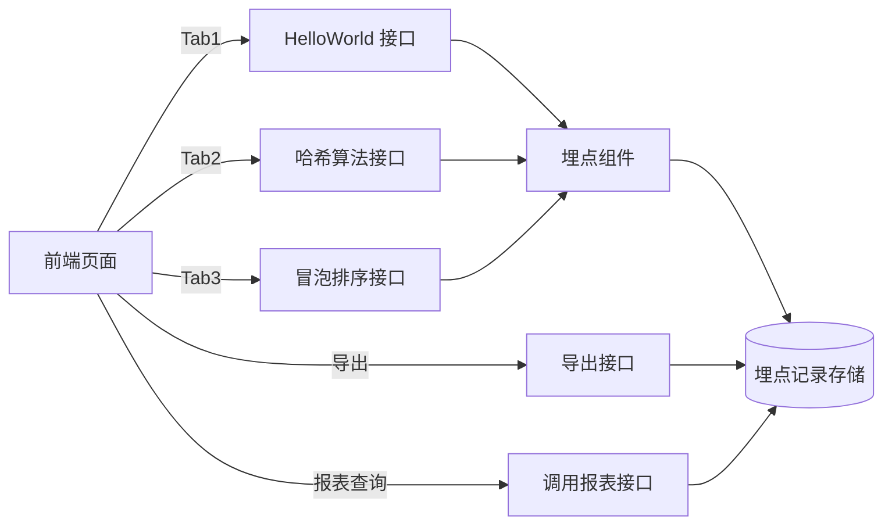

> **文档元信息**
>
> | 项目 | 内容 |
> |------|------|
> | 文档版本 | v1.0 |
> | 作者 | AiWork |
> | 创建日期 | 2026-10-20 |
> | 需求来源 | 分别写三个接口 helloworld、哈希算法以及冒泡排序；前端多 Tab 展示、导出、埋点与调用报表 |
> | 评审状态 | 待评审 |
> | 关联任务 | DEV-966dcd0a-7905-11f1-9649-3b4281182f10-ebbe48e3-72a8-459e-b48f-b25c23672dd0 |

# 需求规格说明（spec）

## 1. 需求与范围

### 1.1 背景与目标

当前仓库为空白起步工程（仅含 `README.md`，内容 `# testllw`）。本次需求旨在构建一个**最小可运行的全栈示例**，打通「后端算法接口 → 前端展示 → 导出 → 调用埋点 → 报表可视化」闭环：

1. 后端提供三个基础算法接口：HelloWorld、哈希算法、冒泡排序。
2. 前端新增一个页面，用三个 Tab 分别展示三个接口的执行结果。
3. 页面提供导出按钮，后端提供导出接口，支持导出各 Tab 的展示结果。
4. 后端对接口调用做埋点，记录**调用次数**与**调用人**；前端在同一页面可视化“调用情况”报表，支持按**人员类型 / 人员层级 / 人员部门**等维度查看，并以**折线图、饼图、柱状图**等多种形式展示。

本规格作为后续「系分 → 编码 → 评审」环节的输入基线。

### 1.2 核心功能清单与优先级

| 编号 | 功能点 | 优先级 | 说明 |
|------|--------|--------|------|
| F01 | HelloWorld 接口 | P0 | 返回问候字符串 |
| F02 | 哈希算法接口 | P0 | 对入参文本计算哈希摘要并返回 |
| F03 | 冒泡排序接口 | P0 | 对入参数组执行冒泡排序并返回有序结果 |
| F04 | 前端三 Tab 页面 | P0 | 三个 Tab 分别展示三个接口执行结果 |
| F05 | 导出功能 | P0 | 页面提供导出按钮，后端提供导出接口，支持导出各页面展示结果 |
| F06 | 调用埋点 | P0 | 后端记录接口调用次数与调用人 |
| F07 | 调用报表可视化 | P0 | 前端同页展示调用报表，按人员类型/层级/部门维度，折线图+饼图+柱状图 |

### 1.3 约束与非功能要求

- 后端技术栈：Java（Spring Boot，从 state 配置 `test_command = mvn -q -DskipTests=false test` 推断为 Maven 工程）。
- 前端技术栈：仓库为空，无既有前端约定，建议采用轻量方案（React + Ant Design Charts / ECharts）或同构静态页；以改动最小、可独立运行优先。
- 埋点需异步落库，不阻塞主业务流程。
- 导出支持格式：至少支持 CSV（文本结果类可直接导出）；如需带图表，导出报表快照或摘要数据。
- 报表聚合需在时间维度（如按日/小时）与人员维度上可下钻。
- 本示例工程优先级高于生产级完备性，YAGNI：不引入分布式、不引入复杂权限体系，调用人识别以请求头/登录态占位。

### 1.4 排除范围

- 不做用户登录/鉴权系统，调用人识别采用占位方案（登录态/请求头透传）。
- 不做多语言国际化、不做移动端适配。
- 不做高可用/分布式部署。

### 1.5 假设与待确认项

| 编号 | 假设/待确认内容 | 当前假设 | 影响 |
|------|-----------------|----------|------|
| A01 | 后端语言/框架 | Spring Boot + Maven（据 test_command 推断） | 编码阶段接口框架 |
| A02 | 前端框架 | 仓库为空，建议 React；待编码阶段最终定 | 前端实现方式 |
| A03 | 调用人来源 | 登录态用户信息，暂以 Header/占位符承载 | 埋点记录字段 |
| A04 | 报表时间粒度 | 按天聚合（可扩展小时） | 折线图 X 轴 |
| A05 | 导出内容范围 | 当前 Tab 展示结果 + 报表数据 | 导出接口入参 |
| A06 | 人员维度数据来源 | 埋点记录中冗余 `personType/level/department` 字段 | 报表维度聚合 |

## 2. 架构与模块

### 2.1 总体架构

### 2.2 模块划分

| 模块 | 职责 | 依赖 |
|------|------|------|
| 算法服务层（AlgorithmService） | 提供 helloworld / hash / bubbleSort 三个纯算法实现 | 无 |
| 接口控制层（Controller） | 暴露 HTTP 接口、参数校验、响应封装 | AlgorithmService、埋点组件 |
| 埋点组件（TrackingAspect/AOP 或显式调用） | 拦截算法接口调用，异步记录调用人、维度、时间 | 埋点存储 DAO |
| 埋点存储（tracking 表 + DAO） | 持久化埋点记录，提供聚合查询 | 数据库 |
| 导出服务（ExportService） | 将指定 Tab 结果 / 报表数据导出为 CSV 等 | 存储 |
| 报表服务（ReportService） | 按人员类型/层级/部门、时间维度聚合调用次数 | 埋点存储 |
| 前端（页面 + Tab + 图表 + 导出按钮） | 调用接口展示结果，渲染报表图表，触发导出 | 后端 HTTP API |

### 2.3 数据流

1. 用户在页面选择 Tab → 前端调用对应算法接口 → 后端执行算法并**埋点记录调用** → 返回结果 → 前端渲染结果。
2. 用户点击导出 → 前端携带当前 Tab 标识（或报表类型）调用导出接口 → 后端查询结果/报表 → 生成文件流返回下载。
3. 前端加载报表 → 调用报表接口（可按维度/时间传参）→ 后端聚合埋点数据 → 返回结构化数据 → 前端渲染折线图/饼图/柱状图。

## 3. 接口设计（后端 API）

统一前缀 `/api/demo`，统一响应结构 `{ code, message, data }`。

| # | 方法 | 路径 | 入参 | 出参 | 说明 |
|---|------|------|------|------|------|
| 1 | GET | `/api/demo/helloworld` | 无（或可选 name） | `{ message }` | F01，返回问候语 |
| 2 | POST | `/api/demo/hash` | `{ text }` | `{ algorithm, digest }` | F02，返回 SHA-256 摘要（摘要算法明示） |
| 3 | POST | `/api/demo/bubble-sort` | `{ array: number[] }` | `{ sorted: number[], swaps: number }` | F03，返回冒泡排序结果与交换次数 |
| 4 | POST | `/api/demo/export` | `{ tab: "helloworld"\|"hash"\|"bubbleSort"\|"report", dimension?, range? }` | 文件流（CSV） | F05，导出指定页面结果或报表 |
| 5 | GET | `/api/demo/tracking/report` | `{ dimension: personType\|level\|department, groupBy: day\|hour, start?, end? }` | `{ dimension, items: [{key, count, series[]}] }` | F07，报表聚合查询 |

### 3.1 埋点记录模型（tracking 表）

| 字段 | 类型 | 说明 |
|------|------|------|
| id | bigint | 主键 |
| api_name | varchar | 被调用的接口方法标识（helloworld/hash/bubbleSort） |
| caller_id | varchar | 调用人工号/标识 |
| person_type | varchar | 人员类型（如 正式/外包/实习生） |
| person_level | varchar | 人员层级（如 P5/P6/P7） |
| department | varchar | 人员部门 |
| call_time | datetime | 调用时间 |
| created_at | datetime | 记录时间 |

约束：埋点**异步**写入，失败仅记录错误日志，不影响接口主流程。

## 4. 前端设计

- 页面路由：新增一个页面（如 `/demo`）。
- 结构：
  - 顶部：三个 Tab（HelloWorld / 哈希 / 冒泡排序）。
  - Tab 内容区：入参表单 + “执行”按钮 + 结果展示区。
  - 底部/同页：**调用情况报表区**。
    - 维度选择：人员类型 / 人员层级 / 人员部门（可加时间范围）。
    - 图表：折线图（调用次数随时间趋势）、饼图（调用次数按所选维度占比）、柱状图（调用次数按维度分组对比）。
  - 导出按钮：支持导出「当前 Tab 展示结果」与「报表数据」。

## 5. 错误处理

- 参数校验失败：返回 `code=400` 级提示，避免空数组进入排序/空文本进入哈希。
- 冒泡排序入参非数字：明确报错，不外抛堆栈。
- 埋点写入失败：仅落错误日志，不向上抛出。
- 导出查询无数据：返回空文件或明确提示（空数据导出 `message` 说明）。
- 报表无数据：返回空聚合结构，前端展示空态。

## 6. 测试策略

- 单元测试（后端，Maven）：算法正确性（哈希摘要与标准向量一致、冒泡排序有序性、helloworld 文案）、埋点记录落库（可用内存/H2 桩）、报表聚合逻辑。
- 接口测试：五个接口的入参与响应断言。
- 前端：Tab 切换、结果渲染、导出按钮触发下载、三图表渲染冒烟。

## 7. 验收标准

1. `GET /helloworld` 返回问候语，前端 Tab1 正确展示。
2. 对已知文本调用哈希接口，摘要与标准 SHA-256 一致；Tab2 正确展示。
3. 传入乱序数组，排序接口返回升序结果；Tab3 正确展示。
4. 每次算法接口调用后，埋点表新增一条记录（含调用人 + 维度字段）。
5. 报表接口按人员类型/层级/部门返回聚合次数，前端三图（折线/饼图/柱状）正确渲染。
6. 导出接口按 Tab 输出可下载文件，内容与页面展示结果一致。

## 8. 风险与待澄清

- 调用人身份来源未明确（无既有登录体系），当前采用字段占位方案，后续接入真实登录态时替换。
- 人员维度（类型/层级/部门）的数据来源未定义，当前假设埋点时冗余记录，数据需由调用方提供或从主数据查询。
- 仓库为空、无既有代码结构，前端技术栈与后端工程骨架需在编码阶段先行搭建。