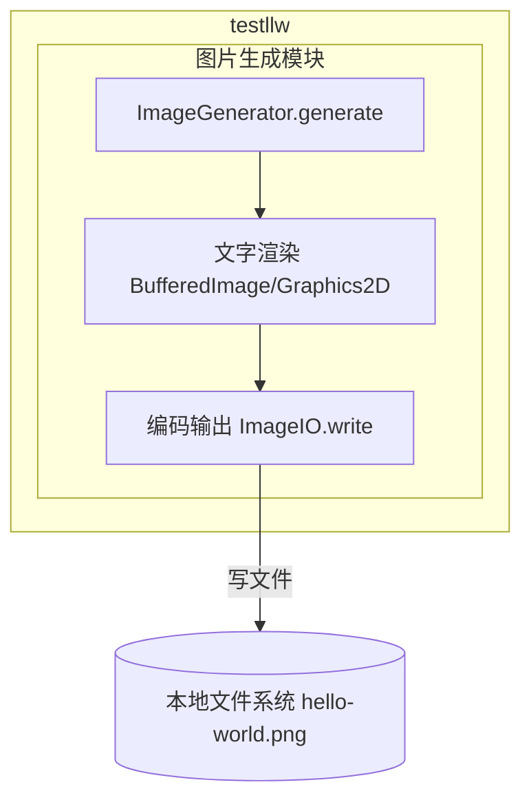
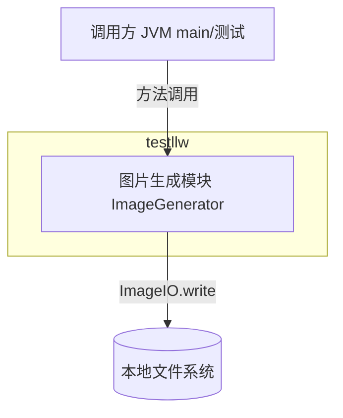
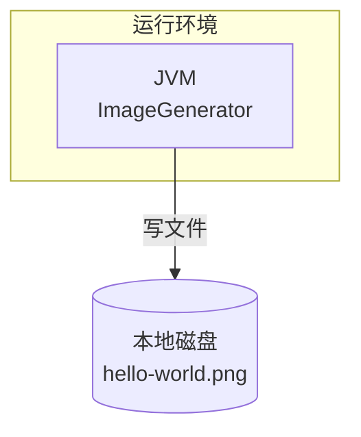
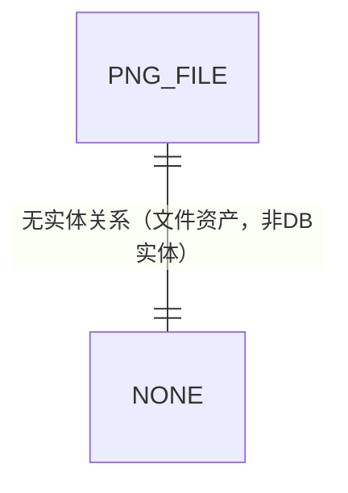
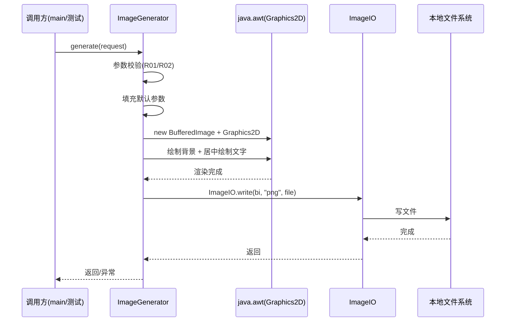

> **文档元信息**
>
> | 项目 | 内容 |
> |------|------|
> | 文档版本 | v1.0 |
> | 作者 | AiWork |
> | 创建日期 | 2026-10-21 |
> | 需求来源 | 任务需求「生产一个 helloword 图片」 |
> | 评审状态 | 待评审 |

# HelloWord 图片生成 系分设计

## 1. 需求与范围

### 背景与目标
- **背景**：现有 Java 项目 `testllw` 已具备控制台输出 "Hello World" 的能力，本项目需要在其基础上新增「生成一张 HelloWord 图片」的能力，将文本内容以图片形式产出。
- **目标**：实现一个可生成 "HelloWorld"（需求原文为 "helloword"）文本图片的功能，输出一张包含指定文字的图片文件（默认 PNG），验证从文本到图片渲染的完整链路。

### 核心功能
1. 生成一张内容为 "Hello World" 的图片（PNG 格式，默认尺寸如 800×400）
2. 图片包含指定背景色与文字渲染（居中、指定字体/字号）
3. 图片输出到指定磁盘路径或指定输出流
4. （可扩展）支持自定义文字内容、尺寸、颜色等参数

### 约束与非功能要求
- 遵循 Java 项目既有结构，新增功能不改动 `HelloWorld.java` 现有主流程
- 图片生成优先采用 JDK 内置能力（`java.awt`/`javax.imageio`），避免引入重量级第三方依赖（除非明确要求）
- 输出格式默认 PNG，兼容主流查看器

### 排除范围
- 不涉及 Web 服务、HTTP 接口、数据库、消息队列
- 不涉及登录鉴权、多租户、权限体系
- 不涉及动态模板编辑、在线预览等交互能力
- 不涉及字体自定义上传（首版使用系统默认字体）

### 需求功能清单与优先级

| 编号 | 功能点 | 优先级 | PRD 原始描述/章节 | 备注 |
|------|--------|--------|-------------------|------|
| F01 | 生成 "Hello World" 文本图片 | P0 | "生产一个helloword图片" | 核心功能，输出 PNG |
| F02 | 图片背景色与文字渲染 | P0 | "生产一个helloword图片" | 白底黑字居中渲染 |
| F03 | 图片输出到指定路径 | P0 | "生产一个helloword图片" | 落盘为文件 |
| F04 | 图片参数可配置（文字/尺寸/颜色） | P1 | 隐含需求（可扩展性） | 提供入参，默认可省略 |

### 假设与待确认项

| 编号 | 假设/待确认内容 | 当前假设 | 确认状态 |
|------|-----------------|----------|----------|
| A01 | 图片生成技术方案 | 使用 JDK 内置 java.awt.BufferedImage + ImageIO，无第三方依赖 | 待确认 |
| A02 | 输出图片格式 | PNG（无损、通用） | 待确认 |
| A03 | 默认图片尺寸 | 800×400 像素 | 待确认 |
| A04 | 默认背景色/文字色 | 白底 #FFFFFF / 黑字 #000000 | 待确认 |
| A05 | 默认文字内容 | "Hello World"（需求原文 "helloword" 按 HelloWorld 语义理解） | 待确认 |
| A06 | 输出路径 | 程序运行目录下 `hello-world.png` | 待确认 |
| A07 | 中文/字体渲染 | 首版使用英文文本 + 系统默认字体，规避字体缺失 | 待确认 |

## 2. 架构与模块

### 功能架构

本功能规模极小，采用单体 Java 应用内单一工具模块的架构，不涉及多服务拆分：



- **交互层说明**：无 Web/控制台交互层，作为 JVM 内工具类被调用，本项不适用（无交互入口）。
- **核心服务层说明**：`图片生成模块` 承担文本→图片渲染→落盘的全部职责，职责单一。
- **扩展/集成层说明**：无外部系统集成，直接读写本地文件系统。

**模块清单**

| 模块 | 职责 | 依赖 |
|------|------|------|
| 图片生成模块（image-gen） | 文本渲染为 BufferedImage，编码输出 PNG 图片文件 | JDK java.awt / javax.imageio（无外部依赖） |

### 应用集成架构

无外部业务系统集成，仅与本地文件系统交互：



**集成关系说明：**

| 调用方 | 被调用方 | 协议 | 接口类型 | 说明 |
|--------|----------|------|----------|------|
| 调用方（main/测试） | 图片生成模块 | JVM 方法调用 | 内部接口 Service | 生成图片 |
| 图片生成模块 | 本地文件系统 | 文件 IO | 本地写盘 | 输出 PNG 文件 |

### 部署架构

本功能为单机本地工具，无服务化部署形态，简化为单进程本地运行：



**部署说明：**
- **负载均衡层**：不适用（无网络服务，单机本地运行）。
- **应用层**：JDK 单进程运行，无实例副本概念。
- **数据层**：本地文件系统，单文件输出，无需主从/冗余。

## 3. 数据模型与存储

### 实体清单

本功能不涉及数据库持久化，仅产生图片文件这一「文件资产」，无数据库实体。

| 实体名称 | 实体说明 | 所属模块 | 与其他实体的关系 |
|----------|----------|----------|-----------------|
| 图片文件 | 生成的 PNG 图片文件（文件系统资产） | 图片生成模块 | 无（独立文件） |

### 实体关系图

无数据库实体关系，本项不适用。



**模型说明：**
- 本功能为无状态图片生成，不涉及数据库表、缓存与 MQ，无需租户隔离设计。

## 4. 接口设计

### 4.1 oneapi（Web 控制台接口）

本项不适用，原因：无 Web 控制台 / HTTP 服务。

### 4.2 OpenAPI（对外接口）

本项不适用，原因：无对外网络 API。

### 4.3 内部接口（Service 层）

| 编号 | 接口名称 | 类 | 方法签名 |
|------|----------|------|----------|
| S01 | 生成 HelloWord 图片 | ImageGenerator | `void generate(ImageGenRequest request)` |
| S02 | 生成 HelloWord 图片（重载，默认参数） | ImageGenerator | `void generateDefault()` |

### 4.4 集成接口（Integration 层）

本项不适用，原因：无外部系统集成。

## 5. 功能模块设计

### 5.1 图片生成模块（image-gen）

#### 5.1.1 表结构设计

本项不适用，原因：纯文件生成功能，无数据库表。

#### 5.1.2 接口详细设计

##### （S01）生成 HelloWord 图片

- **方法签名**: `void generate(ImageGenRequest request)`
- **描述**: 依据入参（文字、宽高、背景色、文字色、输出路径）渲染并输出一张 PNG 图片。
- **入参**（`ImageGenRequest` 为设计描述的入参载体，不涉及数据库）：

| 参数名称 | 类型 | 是否必填 | 描述 |
|----------|------|----------|------|
| text | String | 否 | 图片文字内容，默认 "Hello World" |
| width | Integer | 否 | 图片宽（像素），默认 800 |
| height | Integer | 否 | 图片高（像素），默认 400 |
| backgroundColor | String | 否 | 背景色（#RRGGBB），默认 #FFFFFF |
| textColor | String | 否 | 文字色（#RRGGBB），默认 #000000 |
| outputPath | String | 否 | 输出文件路径，默认 ./hello-world.png |

- **出参**:

| 参数名称 | 类型 | 描述 |
|----------|------|------|
| 返回类型 | void | 无返回；以副作用方式写入文件，异常时抛出 |

- **错误码**:

| 错误码 | 说明 |
|--------|------|
| IMG_001 | 输出目录不存在或不可写 |
| IMG_002 | 图片编码/写盘失败（IO 异常） |
| IMG_003 | 参数非法（宽高 ≤ 0） |

- **业务规则**:
  - 宽高必须大于 0，否则抛参数校验异常（IMG_003）
  - 文字居中渲染，输出目录不存在时创建或报错（IMG_001）
  - 编码失败时抛出 IO 异常（IMG_002），不产生半成品文件
- **请求示例**（设计描述，非代码）：

```json
{
  "text": "Hello World",
  "width": 800,
  "height": 400,
  "backgroundColor": "#FFFFFF",
  "textColor": "#000000",
  "outputPath": "./hello-world.png"
}
```

- **响应示例**：无返回值；成功后目录下生成 `hello-world.png`，失败抛出对应错误码异常。

##### （S02）生成 HelloWord 图片（默认参数）

- **方法签名**: `void generateDefault()`
- **描述**: 使用全部默认参数（"Hello World"、800×400、白底黑字、./hello-world.png）生成图片，等价于 `generate(null)` 或 `generate(默认入参)`。
- **入参**: 无。
- **出参**: 无返回值；副作用写文件。
- **错误码**: 同 S01（IMG_001/IMG_002/IMG_003）。
- **业务规则**: 统一走 S01 逻辑，仅缺省参数填充。

#### 5.1.3 子功能详细设计

##### 5.1.3.1 生成 HelloWord 图片（F01/F02/F03）

- 处理时序图



**业务规则：**

| 规则编号 | 规则描述 | 校验时机 | 不满足时的处理 |
|----------|----------|----------|--------------|
| R01 | 宽、高必须为正整数 | 生成前 | 抛 IMG_003 参数非法异常 |
| R02 | 输出路径目录必须可写（不存在则尝试创建） | 编码前 | 抛 IMG_001 目录不可写异常 |
| R03 | 图片编码必须成功 | 写盘时 | 抛 IMG_002，并避免留下半成品文件 |

**异常场景：**

| 异常场景 | 处理方式 |
|----------|----------|
| 输出目录不存在 | 自动创建目录；创建失败抛 IMG_001 |
| 输出目录无写权限 | 抛 IMG_001，不产出文件 |
| ImageIO 编码/IO 失败 | 抛 IMG_002，清理已创建的临时文件 |
| 宽高为 0 或负数 | 抛 IMG_003，提示参数非法 |

**并发控制：**
- 并发场景：本功能无共享可变状态，每次调用独立创建 BufferedImage，写盘到互不冲突（或指定可覆盖）的文件。
- 控制策略：无并发风险，原因：无状态、无共享写，文件覆盖由文件系统原子性保证。若多个进程写同一路径，遵循「最后写入生效」，可接受。

**状态机设计：**

本项不适用，原因：图片生成过程为一次性动作，无持续状态实体、无状态流转字段。

### 5.2 跨模块调用链

本功能仅单模块，无跨模块调用链，本项不适用。

## 6. 非功能性需求设计

### 6.1 高可用性
- 本项不适用，原因：单机本地工具，无网络服务端，无上下游依赖；生成失败即抛出异常，无「高可用」诉求。

### 6.2 可扩展性
- 通过入参 `ImageGenRequest` 沉淀宽度、高度、颜色、文字、路径，后续可平滑扩展字体、格式（JPEG）、水印、多语言等能力。
- 渲染逻辑与编码逻辑分离，便于替换输出格式与渲染后端。

### 6.3 稳定性/可靠性
- 边界场景：空文字、超长文字、宽高极端值（1 像素）需有校验与降级，避免异常。
- 无共享状态，单次调用失败不影响后续调用。

### 6.4 安全性设计
#### 6.4.1 账户系统方案
本项不适用，原因：无登录、无身份体系。
#### 6.4.2 授权&访问控制
本项不适用，原因：无数据库查询、无权限资源，仅本地文件生成。
#### 6.4.3 数据防护方案
本项不适用，原因：不处理敏感数据，图片内容亦为公开文本。

### 6.5 监控/统计/日志/告警
- 关键埋点：生成调用（成功/失败）、生成耗时、输出路径。
- 失败时输出错误码日志，便于定位参数问题。

## 7. 变更三板斧

### 7.1 可监控
- 在生成入口/出口记录耗时与结果（成功/失败），埋点项：调用方法、处理结果、处理耗时。

### 7.2 可灰度
本项不适用，原因：本地工具无多租户、无线上流量，无灰度引流诉求；如需灰度，可依据输出参数/环境变量切换渲染后端。

### 7.3 可应急
- 通过参数/开关可快速回退默认渲染参数；渲染后端若替换失败，可开关切回 JDK 原生 Graphics2D 渲染。

## 8. 方案检查

| 检查项 | 结果 |
|------|------|
| 模块划分合理性检查 | 通过：单模块职责单一，无循环依赖，无超 50% 功能点模块 |
| 依赖关系合理性 | 通过：仅依赖 JDK，无外部下游 |
| 单点问题检查（部署层面） | 不适用：单机本地工具，无部署层 |
| 表模型设计范式检查 | 不适用：无数据库表 |
| 隐私安全检查 | 不适用：无敏感信息 |
| 兼容性检查（接口） | 通过：新增内部接口，不改动既有 main |
| 兼容性检查（表） | 不适用：无表变更 |
| 数据迁移检查 | 不适用：无表 |
| 一致性检查（功能点） | 通过：F01-F04 均在 5.1 有对应设计 |
| 一致性检查（表） | 不适用：无实体→无表（实体为文件资产） |
| 一致性检查（接口） | 通过：S01/S02 在 5.1.2 有详细定义 |
| 一致性检查（枚举） | 不适用：无枚举定义 |
| 状态机完整性检查 | 不适用：无状态实体 |
| 并发风险检查 | 通过：无状态、无共享写，无并发风险 |
| 单点问题检查（定时任务层面） | 不适用：无定时任务 |
| 非功能性设计可行性检查 | 通过：JDK 内置能力可落地 |
| 变更三板斧设计可行性检查（可监控） | 通过：耗时/结果埋点可落地 |
| 变更三板斧设计可行性检查（可灰度） | 不适用：本地工具无流量灰度 |
| 变更三板斧设计可行性检查（可应急） | 通过：开关回退默认渲染后端可落地 |

## 9. 结论

本需求为在现有 `testllw` 项目上新增「生成 HelloWord 图片」的纯本地工具能力，采用 JDK 内置 `java.awt` + `ImageIO` 渲染单张 PNG 图片，无数据库、无网络、无外部依赖，方案简单落地。所有核心功能点（F01-F04）均有对应设计，方案检查 19 项全部通过或按「不适用」合理标注。