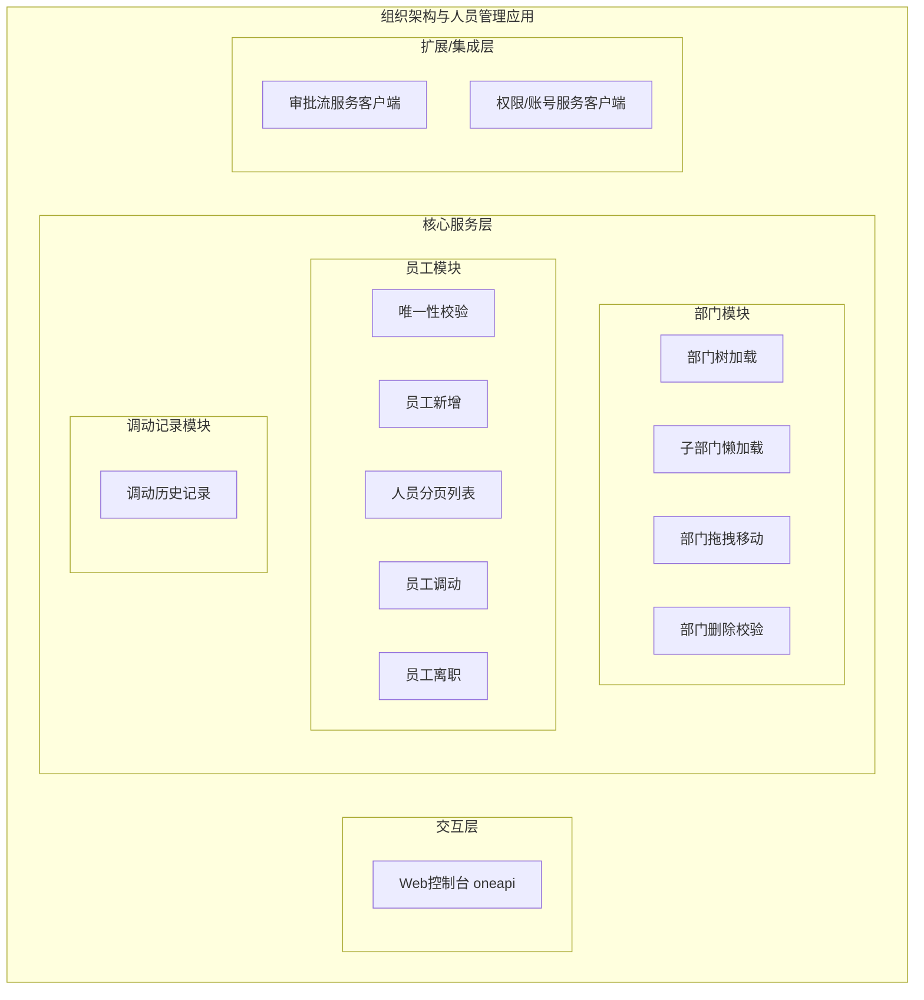
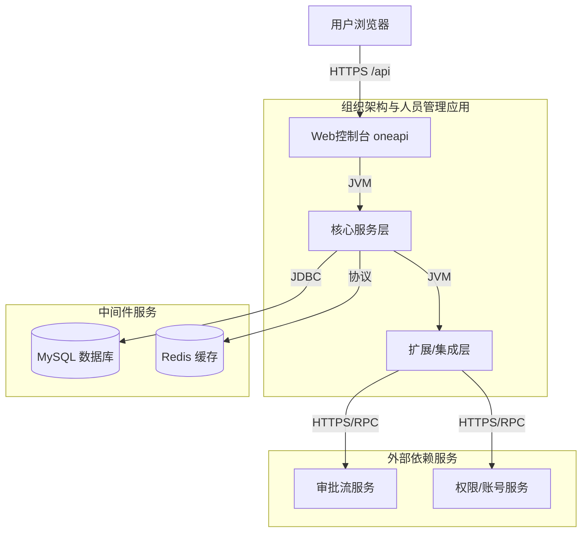
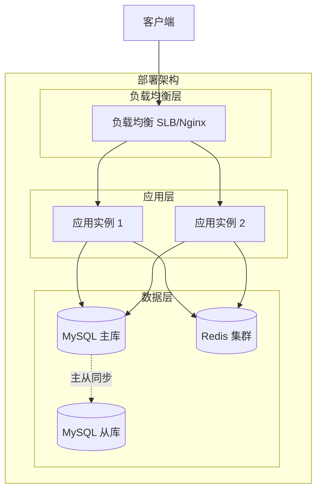
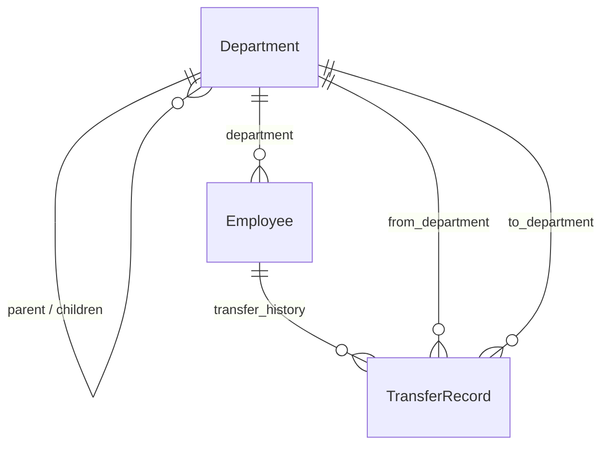
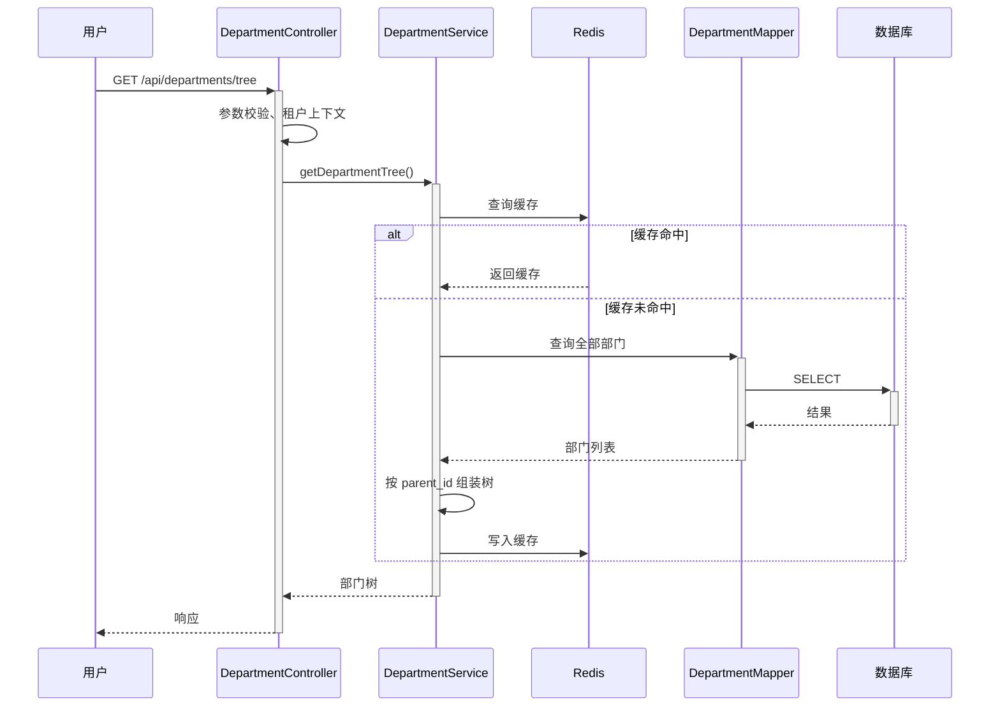
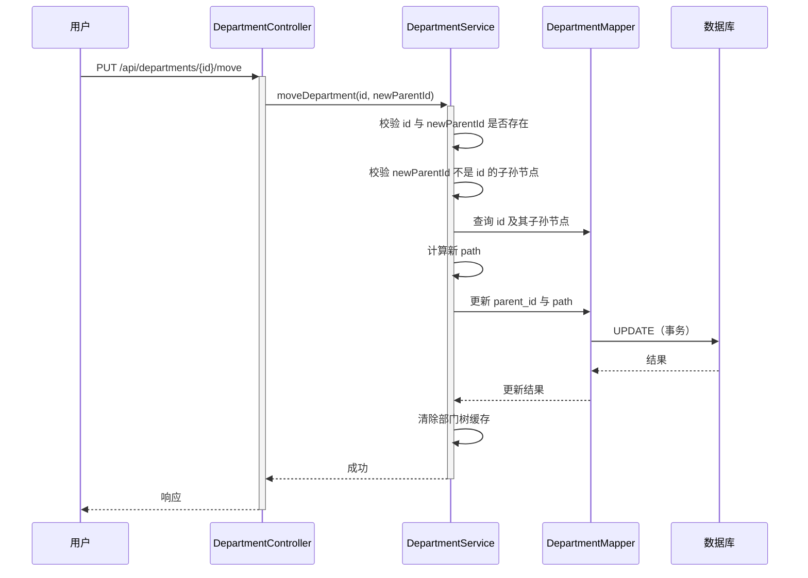
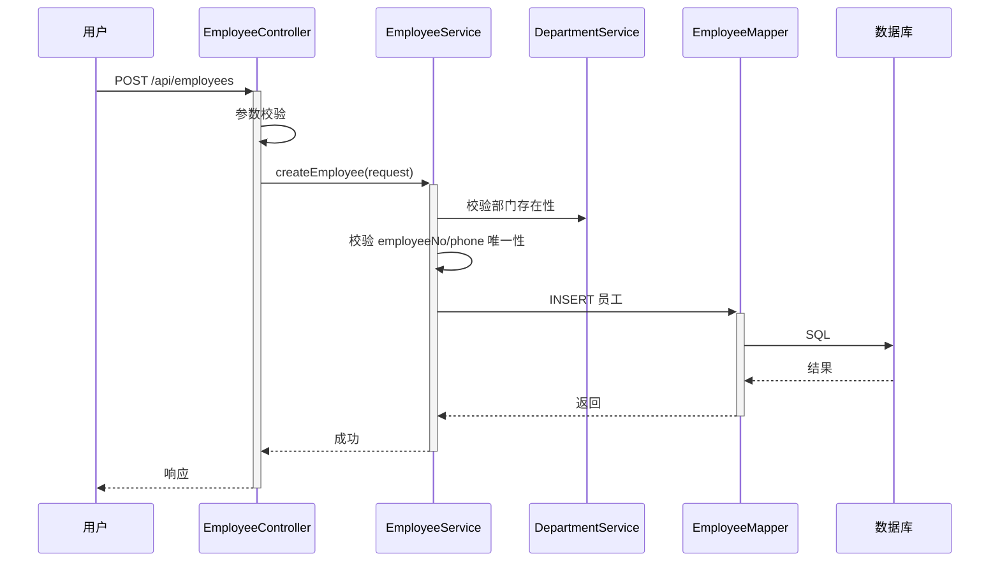
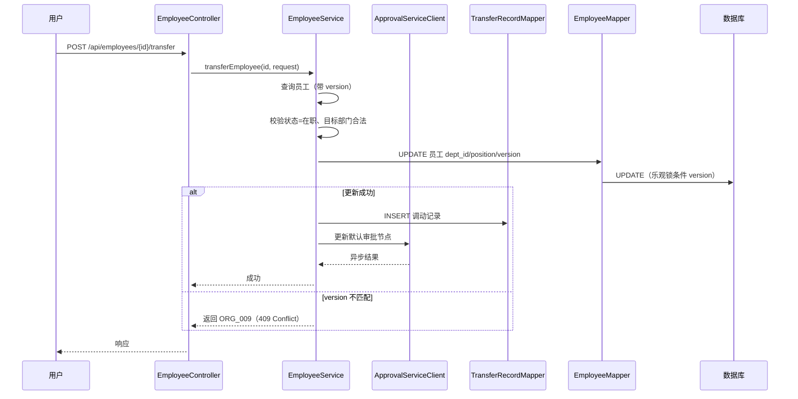
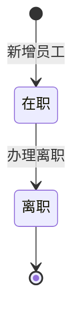
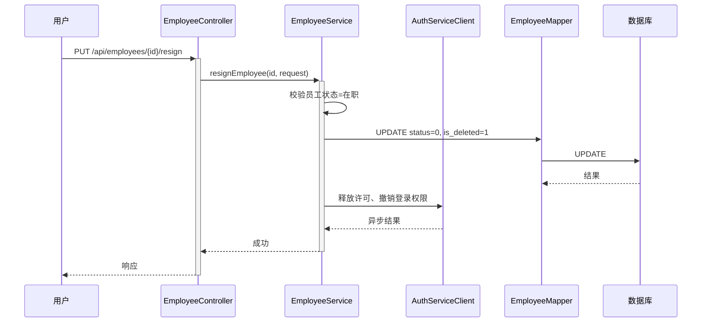

> **文档元信息**
>
> | 项目 | 内容 |
> |------|------|
> | 文档版本 | v1.0 |
> | 作者 | AiWork |
> | 创建日期 | 2026-10-29 |
> | 需求来源 | 需求Case：组织架构与人员管理系统 |
> | 评审状态 | 待评审 |

# 组织架构与人员管理系统 系分设计

## 1. 需求与范围

### 1.1 背景与目标

随着团队规模扩大，人员与部门关系变得复杂。现需建设一套**组织架构与人员管理模块**，支撑：

1. 部门的树形结构搭建与层级调整。
2. 员工在部门间的入职、调动、离职等全生命周期管理。
3. 为审批、权限等其他业务系统提供准确、及时的人员数据源。

### 1.2 核心功能

- 部门树形结构的加载、懒加载与拖拽调整层级。
- 员工新增（含唯一性校验）。
- 员工调动（级联更新默认审批流节点、记录调动历史）。
- 员工离职（逻辑删除、释放系统账号许可、清除登录权限）。
- 角色与数据权限：超管/HR 可管理全量数据；部门主管仅可查看本部门及下属部门人员，可编辑本部门人员部分信息。

### 1.3 约束与非功能要求

- 后端接口统一返回 `{ code, msg, data }` 结构。
- 严禁物理删除，统一采用逻辑删除（`is_deleted`）。
- 高并发下调动的数据一致性采用乐观锁（`version`）。
- 部门树拖拽需防循环引用。
- 大数据量人员列表必须分页返回。
- 与审批、权限系统存在集成关系。

### 1.4 排除范围

- 完整的审批流程编排（如审批节点、审批规则配置）不在本模块内实现，本模块仅级联更新员工相关默认审批流节点。
- 完整的 IAM/SSO 账号体系不在本模块内实现，本模块仅通过集成接口通知权限系统释放/清除登录权限。
- 前端 UI 组件具体实现不在系分范围内。

### 1.5 需求功能清单与优先级

| 编号 | 功能点 | 优先级 | PRD 原始描述/章节 | 备注 |
|------|--------|--------|-------------------|------|
| F01 | 部门树加载与展示 | P0 | 需求1：部门树形结构的加载与交互 | 默认展开第一级，点击加载人员 |
| F02 | 部门树懒加载 | P0 | 需求1：懒加载 | 点击展开按钮请求子部门 |
| F03 | 部门拖拽移动 | P0 | 需求1：拖拽调整部门层级 | 需防循环引用 |
| F04 | 员工唯一性校验 | P0 | 需求2：实时校验 | 工号、手机号全局唯一 |
| F05 | 员工新增提交 | P0 | 需求2：新增提交 | 校验部门合法性 |
| F06 | 员工调动 | P0 | 需求3：人员调动 | 级联审批流节点更新、留痕 |
| F07 | 员工离职 | P0 | 需求4：员工离职 | 逻辑删除、释放许可、清除权限 |
| F08 | 部门删除校验 | P1 | 异常场景2 | 部门下有人时禁止删除 |
| F09 | 大数据量分页 | P1 | 异常场景3 | 人员列表分页 |
| F10 | 并发调动冲突处理 | P1 | 异常场景4 | 乐观锁 |

### 1.6 假设与待确认项

| 编号 | 假设/待确认内容 | 当前假设 | 确认状态 |
|------|-----------------|----------|----------|
| A01 | 用户身份与权限由外部 IAM 提供，本模块通过用户上下文获取角色与租户 | 租户字段采用 `tenant_id`，超管/HR/部门主管由 IAM 注入角色 | 待确认 |
| A02 | 审批流系统提供“按员工更新默认审批节点”的内部/集成接口 | 通过集成接口调用，失败记录待补偿日志 | 待确认 |
| A03 | 权限/账号系统提供“撤销登录权限、释放许可”的接口 | 通过集成接口调用，失败记录待补偿日志 | 待确认 |
| A04 | 部门编码未在需求中明确要求，本设计以 `id` 作为树形关联主键，并增加 `path` 加速子孙查询 | 已采用 `path` 字段 | 已确认（设计假设） |
| A05 | 本模块不提供前端实现，但接口字段需满足前端分页、筛选需求 | 列表接口支持 `page`/`size`/`status`/`deptId` | 已确认（设计假设） |

## 2. 架构与模块

### 2.1 功能架构



**模块清单**

| 模块 | 职责 | 依赖 |
|------|------|------|
| 部门模块 | 部门树维护、层级移动、删除校验 | 员工模块（查询部门下员工数） |
| 员工模块 | 员工增删改查、调动、离职、唯一性校验 | 部门模块、调动记录模块、审批流服务、权限服务 |
| 调动记录模块 | 记录员工调动历史 | 无外部依赖 |

### 2.2 应用集成架构



**集成关系说明**

| 调用方 | 被调用方 | 协议 | 接口类型 | 说明 |
|--------|----------|------|----------|------|
| 用户浏览器 | Web控制台 | HTTPS | oneapi REST | 部门树、员工管理操作 |
| 核心服务层 | MySQL | JDBC | SQL | 持久化部门、员工、调动记录 |
| 核心服务层 | Redis | RESP | 缓存 | 部门树、字典缓存 |
| 核心服务层 | 审批流服务 | HTTPS/RPC | 集成接口 | 更新默认审批节点 |
| 核心服务层 | 权限/账号服务 | HTTPS/RPC | 集成接口 | 撤销登录权限、释放许可 |

### 2.3 部署架构



**部署说明**

- **负载均衡层**：SLB/Nginx，负责 HTTPS 流量分发与 TLS 终止。
- **应用层**：多实例无状态部署，支持水平扩展。
- **数据层**：MySQL 主从高可用，Redis 集群用于缓存与分布式锁（可选）。

## 3. 数据模型与存储

### 3.1 实体清单

| 实体名称 | 实体说明 | 所属模块 | 与其他实体的关系 |
|----------|----------|----------|-----------------|
| 部门（Department） | 部门信息，支持自关联树形结构 | 部门模块 | 自关联：一个部门有且仅有一个父部门（根部门无父部门）；一个部门可包含多个子部门；一个部门可包含多名员工 |
| 员工（Employee） | 员工基本信息、所属部门、状态 | 员工模块 | 多对一关联部门；一名员工可有多条调动记录 |
| 调动记录（TransferRecord） | 记录员工每次调动的历史 | 调动记录模块 | 多对一关联员工、源部门、目标部门 |

### 3.2 实体关系图



**模型说明**

- 部门表为自关联树，通过 `parent_id` + `path` 维护层级关系。
- 员工与部门为多对一关系，通过 `dept_id` 关联。
- 调动记录记录每次调动的源部门、目标部门、新职位、原因及操作人。

## 4. 接口设计

### 4.1 oneapi（Web 控制台接口）

| 编号 | 接口名称 | 方法 | 路径 | 模块 |
|------|----------|------|------|------|
| W01 | 获取部门树 | GET | /api/departments/tree | 部门模块 |
| W02 | 懒加载子部门 | GET | /api/departments/{id}/children | 部门模块 |
| W03 | 拖拽移动部门 | PUT | /api/departments/{id}/move | 部门模块 |
| W04 | 删除部门 | DELETE | /api/departments/{id} | 部门模块 |
| W05 | 校验员工字段唯一性 | GET | /api/employees/check | 员工模块 |
| W06 | 新增员工 | POST | /api/employees | 员工模块 |
| W07 | 分页查询员工列表 | GET | /api/employees | 员工模块 |
| W08 | 查看员工详情 | GET | /api/employees/{id} | 员工模块 |
| W09 | 员工调动 | POST | /api/employees/{id}/transfer | 员工模块 |
| W10 | 员工离职 | PUT | /api/employees/{id}/resign | 员工模块 |

### 4.2 OpenAPI（对外接口）

本模块当前无对外开放接口。如后续需向外部系统暴露人员数据源，建议新增 `/openapi/employees` 系列接口，并接入网关鉴权。

### 4.3 内部接口（Service 层）

| 编号 | 接口名称 | 类 | 方法签名 |
|------|----------|------|----------|
| S01 | 获取部门树 | DepartmentService | getDepartmentTree(rootId) |
| S02 | 移动部门 | DepartmentService | moveDepartment(id, newParentId) |
| S03 | 校验部门下是否存在员工 | DepartmentService | hasEmployees(deptId) |
| S04 | 检查字段唯一性 | EmployeeService | checkUnique(field, value) |
| S05 | 新增员工 | EmployeeService | createEmployee(request) |
| S06 | 调动员工 | EmployeeService | transferEmployee(id, request) |
| S07 | 办理离职 | EmployeeService | resignEmployee(id, request) |

### 4.4 集成接口（Integration 层）

| 编号 | 接口名称 | 类 | 方法签名 | 说明 |
|------|----------|------|----------|------|
| I01 | 更新默认审批节点 | ApprovalServiceClient | updateDefaultApprover(employeeId, newDeptId) | 员工调动后通知审批流服务更新默认审批人 |
| I02 | 撤销登录权限 | AuthServiceClient | revokeLoginPermission(employeeId) | 员工离职后清除登录态与权限 |
| I03 | 释放账号许可 | AuthServiceClient | releaseLicense(employeeId) | 员工离职后释放许可数 |

## 5. 功能模块设计

### 5.1 部门模块

#### 5.1.1 表结构设计

##### 5.1.1.1 部门表（org_department）

| 字段名 | 数据类型 | 约束 | 默认值 | 说明 |
|--------|----------|------|--------|------|
| id | bigint | PK，自增 | - | 系统自增主键 |
| tenant_id | bigint | NOT NULL, IDX | - | 租户ID |
| name | varchar(64) | NOT NULL | - | 部门名称 |
| parent_id | bigint | NOT NULL, IDX | 0 | 父部门ID，0表示根部门 |
| path | varchar(512) | NOT NULL, IDX | - | 层级路径，如 `1-2-5` |
| sort_order | int | NOT NULL | 0 | 同级排序 |
| status | tinyint | NOT NULL | 1 | 部门状态：1=启用，0=禁用 |
| is_deleted | tinyint | NOT NULL | 0 | 逻辑删除：0=否，1=是 |
| gmt_create | datetime | NOT NULL | CURRENT_TIMESTAMP | 创建时间 |
| gmt_modified | datetime | NOT NULL | CURRENT_TIMESTAMP | 修改时间 |

**索引**

- PK: `pk_org_department_id` (id)
- UK: `uk_org_department_tenant_name_parent` (tenant_id, name, parent_id, is_deleted) — 同一父部门下名称唯一
- IDX: `idx_org_department_parent_id` (tenant_id, parent_id, is_deleted)
- IDX: `idx_org_department_path` (tenant_id, path)
- IDX: `idx_org_department_tenant` (tenant_id, is_deleted)

##### 5.1.1.2 枚举与常量定义

| 枚举名称 | 取值 | 含义 | 关联字段 |
|----------|------|------|----------|
| DepartmentStatus | 1 | 启用 | org_department.status |
| DepartmentStatus | 0 | 禁用 | org_department.status |
| IsDeleted | 0 | 未删除 | org_department.is_deleted |
| IsDeleted | 1 | 已删除 | org_department.is_deleted |

#### 5.1.2 接口详细设计

##### W01 获取部门树

- **URI**: `GET /api/departments/tree`
- **描述**: 返回完整部门树，默认展开第一级；返回数据包含 `children` 递归结构。
- **入参**

| 参数名称 | 类型 | 是否必填 | 描述 |
|----------|------|----------|------|
| depth | int | 否 | 默认返回全部层级；可限制深度 |

- **出参**

| 参数名称 | 类型 | 描述 |
|----------|------|------|
| code | int | 结果code |
| msg | string | 提示信息 |
| data | array | 部门树节点 |

- **错误码**

| 错误码 | 说明 |
|--------|------|
| ORG_001 | 部门不存在 |

- **业务规则**
  - 仅返回当前租户下未逻辑删除的部门。
  - 结果按 `sort_order` 升序排列。

- **请求示例**

```
GET /api/departments/tree
```

- **响应示例**

```json
{
  "code": 200,
  "msg": "SUCCESS",
  "data": [
    {
      "id": 1,
      "name": "研发部",
      "children": [
        {
          "id": 2,
          "name": "前端组",
          "children": []
        }
      ]
    }
  ]
}
```

##### W02 懒加载子部门

- **URI**: `GET /api/departments/{id}/children`
- **描述**: 点击展开按钮时，请求指定部门的直接子部门。
- **入参**

| 参数名称 | 类型 | 是否必填 | 描述 |
|----------|------|----------|------|
| id | path | 是 | 部门ID |

- **出参**: 同 W01，返回 `children` 数组。
- **业务规则**
  - 仅返回当前租户下指定部门的直接子部门。
  - 若 `id` 不存在或已删除，返回 `ORG_001`。

##### W03 拖拽移动部门

- **URI**: `PUT /api/departments/{id}/move`
- **描述**: 拖拽调整部门层级，修改父部门。
- **入参**

| 参数名称 | 类型 | 是否必填 | 描述 |
|----------|------|----------|------|
| id | path | 是 | 被移动部门ID |
| newParentId | long | 是 | 目标父部门ID |

- **错误码**

| 错误码 | 说明 |
|--------|------|
| ORG_001 | 部门不存在 |
| ORG_002 | 不能将部门移动到自身或其子孙节点下 |
| ORG_003 | 目标父部门不存在 |

- **业务规则**
  - 校验被移动部门与目标父部门是否属于同一租户。
  - 校验 `newParentId` 不能是被移动部门自身或其子孙节点，否则返回 `400`。
  - 更新 `parent_id` 和 `path`，并级联更新该部门及其所有子孙的 `path` 字段。
  - 事务内完成，任一失败整体回滚。

- **请求示例**

```json
{
  "newParentId": 5
}
```

- **响应示例**

```json
{
  "code": 200,
  "msg": "移动成功",
  "data": null
}
```

##### W04 删除部门

- **URI**: `DELETE /api/departments/{id}`
- **描述**: 删除部门前校验部门下是否存在员工。
- **入参**

| 参数名称 | 类型 | 是否必填 | 描述 |
|----------|------|----------|------|
| id | path | 是 | 部门ID |

- **错误码**

| 错误码 | 说明 |
|--------|------|
| ORG_001 | 部门不存在 |
| ORG_004 | 部门下存在员工，无法删除 |

- **业务规则**
  - 仅逻辑删除，将 `is_deleted` 置为 1。
  - 若部门下存在未删除员工，返回错误并提示员工数量。

#### 5.1.3 子功能详细设计

##### 5.1.3.1 部门树加载（F01/F02）

- **处理时序图**



- **业务规则**

| 规则编号 | 规则描述 | 校验时机 | 不满足时的处理 |
|----------|----------|----------|--------------|
| R01 | 仅返回当前租户且未逻辑删除的部门 | 查询时 | 过滤 `tenant_id`、`is_deleted` |
| R02 | 结果按 `sort_order` 升序 | 组装树时 | 默认排序 |
| R03 | 懒加载仅返回直接子部门 | W02 | 按 `parent_id` 精确查询 |

- **异常场景**

| 异常场景 | 处理方式 |
|----------|----------|
| 部门不存在 | 返回 `ORG_001` |
| 租户上下文缺失 | 返回通用未授权错误 |

- **并发控制**：部门树读取为主，无并发写风险；写操作通过数据库事务保证一致性。

##### 5.1.3.2 部门拖拽移动（F03）

- **处理时序图**



- **业务规则**

| 规则编号 | 规则描述 | 校验时机 | 不满足时的处理 |
|----------|----------|----------|--------------|
| R04 | 同一租户内移动 | 移动前 | 返回 `ORG_003` |
| R05 | 目标父部门不能为自身或子孙 | 移动前 | 返回 `ORG_002`，HTTP 400 |
| R06 | 级联更新 path | 移动时 | 事务内完成 |

- **异常场景**

| 异常场景 | 处理方式 |
|----------|----------|
| 循环引用 | 返回 `ORG_002`，前端还原树状态 |
| 目标部门不存在 | 返回 `ORG_003` |

##### 5.1.3.3 部门删除（F08）

- **业务规则**

| 规则编号 | 规则描述 | 校验时机 | 不满足时的处理 |
|----------|----------|----------|--------------|
| R07 | 部门下无未删除员工 | 删除前 | 返回 `ORG_004`，并提示员工数量 |
| R08 | 仅允许逻辑删除 | 删除时 | 更新 `is_deleted=1` |

- **并发控制**：删除前查询员工数与删除操作置于同一事务，避免并发新增员工后删除成功。

### 5.2 员工模块

#### 5.2.1 表结构设计

##### 5.2.1.1 员工表（org_employee）

| 字段名 | 数据类型 | 约束 | 默认值 | 说明 |
|--------|----------|------|--------|------|
| id | bigint | PK，自增 | - | 系统自增主键 |
| tenant_id | bigint | NOT NULL, IDX | - | 租户ID |
| name | varchar(64) | NOT NULL | - | 员工姓名 |
| employee_no | varchar(64) | NOT NULL | - | 工号，租户内唯一 |
| phone | varchar(32) | NOT NULL | - | 手机号，租户内唯一 |
| dept_id | bigint | NOT NULL, IDX | - | 所属部门ID |
| position | varchar(128) | NOT NULL | - | 职位 |
| status | tinyint | NOT NULL | 1 | 员工状态：1=在职，0=离职 |
| version | bigint | NOT NULL | 0 | 乐观锁版本号 |
| is_deleted | tinyint | NOT NULL | 0 | 逻辑删除：0=否，1=是 |
| gmt_create | datetime | NOT NULL | CURRENT_TIMESTAMP | 创建时间 |
| gmt_modified | datetime | NOT NULL | CURRENT_TIMESTAMP | 修改时间 |

**索引**

- PK: `pk_org_employee_id` (id)
- UK: `uk_org_employee_tenant_employee_no` (tenant_id, employee_no, is_deleted)
- UK: `uk_org_employee_tenant_phone` (tenant_id, phone, is_deleted)
- IDX: `idx_org_employee_dept_id` (tenant_id, dept_id, is_deleted, status)
- IDX: `idx_org_employee_tenant_status` (tenant_id, status, is_deleted)

> **设计说明**：唯一索引中包含 `is_deleted`，保证已删除员工的工号/手机号释放后可重新使用；若业务要求全局永久唯一，则去掉 `is_deleted`。

##### 5.2.1.2 调动记录表（org_transfer_record）

| 字段名 | 数据类型 | 约束 | 默认值 | 说明 |
|--------|----------|------|--------|------|
| id | bigint | PK，自增 | - | 系统自增主键 |
| tenant_id | bigint | NOT NULL, IDX | - | 租户ID |
| employee_id | bigint | NOT NULL, IDX | - | 员工ID |
| old_dept_id | bigint | NOT NULL | - | 调动前部门ID |
| new_dept_id | bigint | NOT NULL | - | 调动后部门ID |
| new_position | varchar(128) | NOT NULL | - | 新职位 |
| reason | varchar(512) | 可空 | - | 调动原因 |
| operator_id | bigint | NOT NULL | - | 操作人ID |
| transfer_time | datetime | NOT NULL | - | 调动时间 |
| gmt_create | datetime | NOT NULL | CURRENT_TIMESTAMP | 创建时间 |
| gmt_modified | datetime | NOT NULL | CURRENT_TIMESTAMP | 修改时间 |

**索引**

- PK: `pk_org_transfer_record_id` (id)
- IDX: `idx_org_transfer_record_employee_id` (tenant_id, employee_id)
- IDX: `idx_org_transfer_record_new_dept` (tenant_id, new_dept_id)

##### 5.2.1.3 枚举与常量定义

| 枚举名称 | 取值 | 含义 | 关联字段 |
|----------|------|------|----------|
| EmployeeStatus | 1 | 在职 | org_employee.status |
| EmployeeStatus | 0 | 离职 | org_employee.status |
| IsDeleted | 0 | 未删除 | org_employee.is_deleted |
| IsDeleted | 1 | 已删除 | org_employee.is_deleted |

#### 5.2.2 接口详细设计

##### W05 校验员工字段唯一性

- **URI**: `GET /api/employees/check`
- **描述**: 实时校验工号或手机号是否已存在。
- **入参**

| 参数名称 | 类型 | 是否必填 | 描述 |
|----------|------|----------|------|
| field | string | 是 | 字段名：`employeeNo` / `phone` |
| value | string | 是 | 待校验值 |

- **出参**

| 参数名称 | 类型 | 描述 |
|----------|------|------|
| code | int | 结果code |
| msg | string | 提示信息 |
| data.isExist | boolean | 是否存在 |

- **业务规则**
  - 仅支持 `employeeNo` 与 `phone` 两种字段。
  - 校验范围：当前租户内、未删除、未离职（可配置）员工。
  - 若 `field` 不合法，返回参数错误。

- **响应示例**

```json
{
  "code": 200,
  "msg": "SUCCESS",
  "data": {
    "isExist": false
  }
}
```

##### W06 新增员工

- **URI**: `POST /api/employees`
- **描述**: 录入员工信息，工号、手机号全局唯一，部门必须存在。
- **入参**

| 参数名称 | 类型 | 是否必填 | 描述 |
|----------|------|----------|------|
| name | string | 是 | 员工姓名 |
| employeeNo | string | 是 | 工号 |
| phone | string | 是 | 手机号 |
| deptId | long | 是 | 所属部门ID |
| position | string | 是 | 职位 |

- **错误码**

| 错误码 | 说明 |
|--------|------|
| ORG_005 | 工号已存在 |
| ORG_006 | 手机号已存在 |
| ORG_007 | 所属部门不存在 |

- **业务规则**
  - 服务端再次校验 `employeeNo`、`phone` 唯一性。
  - 校验 `deptId` 是否有效且未删除。
  - 初始状态为“在职”。

- **请求示例**

```json
{
  "name": "张三",
  "employeeNo": "10086",
  "deptId": 2,
  "phone": "13800138000",
  "position": "前端开发"
}
```

##### W07 分页查询员工列表

- **URI**: `GET /api/employees`
- **描述**: 支持按部门、状态分页查询。
- **入参**

| 参数名称 | 类型 | 是否必填 | 描述 |
|----------|------|----------|------|
| deptId | long | 否 | 部门ID，查询该部门及下属部门员工 |
| status | int | 否 | 状态筛选：1=在职，0=离职 |
| keyword | string | 否 | 姓名/工号/手机号模糊查询 |
| page | int | 否 | 页码，默认 1 |
| size | int | 否 | 每页条数，默认 20 |

- **出参**: `data` 包含分页列表。
- **业务规则**
  - 部门主管只能查看本部门及下属部门员工。
  - 超管/HR 可查看全量。
  - 默认按 `gmt_create` 降序排列。

##### W08 查看员工详情

- **URI**: `GET /api/employees/{id}`
- **描述**: 查看员工详细信息。
- **业务规则**
  - 需校验数据权限：主管只能查看本部门及子孙部门员工。
  - 已离职员工会返回 `resignDate`（通过关联记录或扩展字段）。

##### W09 员工调动

- **URI**: `POST /api/employees/{id}/transfer`
- **描述**: 更新员工部门、职位，记录调动历史，级联更新审批节点。
- **入参**

| 参数名称 | 类型 | 是否必填 | 描述 |
|----------|------|----------|------|
| id | path | 是 | 员工ID |
| newDeptId | long | 是 | 目标部门ID |
| newPosition | string | 是 | 新职位 |
| reason | string | 否 | 调动原因 |

- **错误码**

| 错误码 | 说明 |
|--------|------|
| ORG_001 | 目标部门不存在 |
| ORG_008 | 员工不存在或已离职 |
| ORG_009 | 并发冲突，version 已变更 |

- **业务规则**
  - 校验员工状态为“在职”。
  - 校验目标部门存在且未删除。
  - 采用乐观锁（`version`）控制并发，更新失败返回 `409 Conflict`。
  - 事务内顺序：更新员工 `dept_id`、`position`、`version`；写入调动记录；调用审批流服务更新默认审批节点。
  - 审批流服务调用失败不影响主事务，记录补偿日志。

- **请求示例**

```json
{
  "newDeptId": 3,
  "newPosition": "Java开发",
  "reason": "业务调整"
}
```

- **响应示例**

```json
{
  "code": 200,
  "msg": "调动成功",
  "data": null
}
```

##### W10 员工离职

- **URI**: `PUT /api/employees/{id}/resign`
- **描述**: 办理员工离职，逻辑删除、释放许可、清除登录权限。
- **入参**

| 参数名称 | 类型 | 是否必填 | 描述 |
|----------|------|----------|------|
| id | path | 是 | 员工ID |
| resignDate | string | 是 | 离职日期，格式 `yyyy-MM-dd` |

- **错误码**

| 错误码 | 说明 |
|--------|------|
| ORG_008 | 员工不存在或已离职 |

- **业务规则**
  - 仅在职员工可办理离职。
  - 更新 `status=0`（离职），`is_deleted=1`。
  - 调用权限/账号服务：释放许可、清除登录权限。
  - 历史考勤、审批数据保留，关联查询时通过 `status` 标识。

#### 5.2.3 子功能详细设计

##### 5.2.3.1 员工新增（F04/F05）

- **处理时序图**



- **业务规则**

| 规则编号 | 规则描述 | 校验时机 | 不满足时的处理 |
|----------|----------|----------|--------------|
| R09 | 姓名为空或超长校验 | 创建时 | 返回参数错误 |
| R10 | 工号租户内唯一 | 创建时 | 返回 `ORG_005` |
| R11 | 手机号租户内唯一 | 创建时 | 返回 `ORG_006` |
| R12 | 部门存在且未删除 | 创建时 | 返回 `ORG_007` |

- **异常场景**

| 异常场景 | 处理方式 |
|----------|----------|
| 并发重复提交 | 唯一索引兜底，返回对应错误码 |
| 部门不存在 | 返回 `ORG_007` |

##### 5.2.3.2 员工调动（F06）

- **处理时序图**



- **业务规则**

| 规则编号 | 规则描述 | 校验时机 | 不满足时的处理 |
|----------|----------|----------|--------------|
| R13 | 员工状态为在职 | 调动前 | 返回 `ORG_008` |
| R14 | 目标部门存在且未删除 | 调动前 | 返回 `ORG_001` |
| R15 | 乐观锁控制并发 | 更新时 | 返回 `ORG_009`，HTTP 409 |
| R16 | 记录调动历史 | 调动成功后 | 写入 `org_transfer_record` |
| R17 | 级联更新审批节点 | 调动成功后 | 调用审批流服务，失败记补偿日志 |

- **异常场景**

| 异常场景 | 处理方式 |
|----------|----------|
| 并发调动冲突 | 乐观锁拦截，返回 409，提示刷新重试 |
| 审批流服务不可用 | 主事务成功，异步补偿/告警 |

- **并发控制**
  - 采用数据库乐观锁：更新语句 `WHERE id=? AND version=?`。
  - 失败后提示前端“该员工信息已被他人修改，请刷新重试”。

- **状态机设计**



- **状态流转规则**

| 当前状态 | 目标状态 | 流转条件 | 前置校验 | 触发动作 |
|----------|----------|----------|----------|----------|
| 在职 | 调动后在职 | 提交调动 | 目标部门存在、version 未变 | 更新部门/职位、写调动记录、级联审批节点 |
| 在职 | 离职 | 办理离职 | 员存在且未离职 | 更新状态、释放许可、清除权限 |

##### 5.2.3.3 员工离职（F07）

- **处理时序图**



- **业务规则**

| 规则编号 | 规则描述 | 校验时机 | 不满足时的处理 |
|----------|----------|----------|--------------|
| R18 | 员工状态为在职 | 离职前 | 返回 `ORG_008` |
| R19 | 逻辑删除而非物理删除 | 离职时 | `is_deleted=1`，`status=0` |
| R20 | 释放账号许可 | 离职后 | 调用权限服务 |
| R21 | 清除登录权限 | 离职后 | 调用权限服务 |

- **异常场景**

| 异常场景 | 处理方式 |
|----------|----------|
| 员已离职 | 返回 `ORG_008` |
| 权限服务调用失败 | 记录失败日志，进入补偿队列 |

## 6. 非功能性需求设计

### 6.1 高可用性

- 应用多实例无状态部署，配合负载均衡实现无单点。
- 外部依赖（审批流、权限服务）异常时，本模块核心业务（如员工调动主事务）不依赖其成功返回，通过异步补偿与告警保证最终一致。
- 数据库采用主从高可用，读请求可路由从库（列表查询等）。

### 6.2 可扩展性

- 部门树、字典数据使用 Redis 缓存，支持水平扩展。
- 接口按业务领域划分模块，未来可按模块独立部署。
- 分页参数可配置，避免单表数据过大导致查询性能下降。

### 6.3 稳定性/可靠性

- 部门拖拽移动在事务内完成，`path` 字段保证查询稳定性。
- 唯一索引兜底员工唯一性校验，防止并发重复数据。
- 乐观锁避免并发调动导致的数据覆盖。

### 6.4 安全性设计

#### 6.4.1 账户系统方案

- 本模块不直接实现登录认证，依赖外部 IAM/SSO 提供登录态。
- 通过请求上下文获取当前用户 ID、角色、租户 ID。

#### 6.4.2 授权与访问控制

##### 6.4.2.1 水平权限检查

- 所有查询接口必须带 `tenant_id` 过滤，防止越权访问其他租户数据。
- 部门主管查看/编辑员工时，需校验目标员工所属部门是否为其管辖部门或子孙部门。

##### 6.4.2.2 垂直权限检查

- 超管/HR：可操作全量部门与员工。
- 部门主管：仅查看本部门及下属部门人员，可编辑本部门人员部分字段（如职位、联系方式，不可编辑工号、部门）。
- 具体权限点建议接入 RBAC 配置。

##### 6.4.2.3 登录态检查

- 所有 `/api/**` 接口默认要求登录态；未登录返回通用未授权错误。

#### 6.4.3 数据防护方案

##### 6.4.3.1 敏感数据加密存储

- 手机号、身份证号等敏感字段建议加密存储或脱敏处理；本设计将 `phone` 作为业务唯一键，若需加密存储，需在应用层加密后入库，并保留哈希用于唯一性校验。

##### 6.4.3.2 敏感数据展示脱敏

- 前端展示手机号时，建议只显示部分位数（如 `138****8000`）。
- 日志中禁止打印完整手机号、姓名等敏感信息。

### 6.5 监控/统计/日志/告警

- 接口层面埋点：调用量、成功率、平均耗时、P99。
- 外部服务调用埋点：审批流、权限服务调用成功/失败/耗时。
- 关键业务事件日志：员工调动、离职记录操作人、时间、变更内容。
- 异常告警：外部服务连续失败、数据库慢查询、缓存命中率下降。

## 7. 变更三板斧

### 7.1 可监控

- 在部门树加载、员工调动、员工离职等核心接口增加 Metrics 埋点。
- 外部服务调用（审批流、权限服务）记录调用链 ID、请求/响应结果、耗时。
- 对 `ORG_009` 并发冲突错误进行统计监控，评估并发热点。

### 7.2 可灰度

- 新增功能可通过按租户尾号灰度（如 `tenant_id % 100 < X`）。
- 部门树缓存开关：可灰度关闭缓存，观察数据库负载。
- 级联审批流更新可配置开关：失败是否阻断主流程，灰度期间可关闭级联避免影响核心调动。

### 7.3 可应急

- 部门树缓存出现不一致时，提供手动刷新/清空缓存接口。
- 审批流服务异常时，通过开关切回“仅更新本地数据，异步补偿”模式，避免主流程失败。
- 发布异常时，可快速回滚应用版本；回滚前确认数据库变更兼容（如新增字段为扩展字段，不影响旧版本）。

## 8. 方案检查

| 序号 | 检查项 | 结果 | 说明 |
|------|--------|------|------|
| 1 | 模块划分合理性 | 通过 | 部门、员工、调动记录职责单一，无循环依赖 |
| 2 | 依赖关系合理性 | 通过 | 集成外部服务异常时不阻塞主事务 |
| 3 | 单点问题（部署层面） | 通过 | 多实例 + 主从数据库 |
| 4 | 表模型设计范式 | 通过 | 满足第三范式，path 为冗余字段用于加速查询 |
| 5 | 隐私安全 | 通过 | 敏感字段计划脱敏/加密，接口带租户隔离 |
| 6 | 接口兼容性 | 通过 | 新增接口均为新增端点，不影响旧接口 |
| 7 | 表变更兼容性 | 通过 | 新增表/字段对旧版本无侵入 |
| 8 | 数据迁移 | 通过 | 新模块无历史数据迁移需求 |
| 9 | 功能点一致性 | 通过 | F01-F10 均在 Step 5 中有对应设计 |
| 10 | 实体一致性 | 通过 | Step 3 中 3 个实体均有完整表结构 |
| 11 | 接口一致性 | 通过 | Step 4 中 10 个 oneapi 接口均有详细设计 |
| 12 | 枚举一致性 | 通过 | 枚举与表字段说明一致 |
| 13 | 状态机完整性 | 通过 | 员工状态机覆盖在职/离职，无孤岛 |
| 14 | 并发风险 | 通过 | 调动使用乐观锁，删除部门使用事务 |
| 15 | 定时任务单点 | 不适用 | 本模块无定时任务 |
| 16 | 非功能性设计可行性 | 通过 | 缓存、分页、幂等均可行 |
| 17 | 可监控 | 通过 | 已规划接口与外部服务埋点 |
| 18 | 可灰度 | 通过 | 按租户尾号、功能开关灰度 |
| 19 | 可应急 | 通过 | 缓存刷新、级联开关、回滚方案已设计 |
