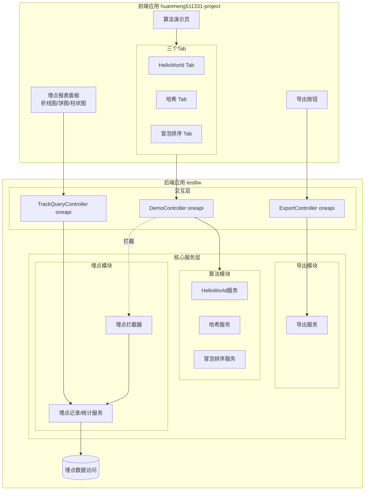
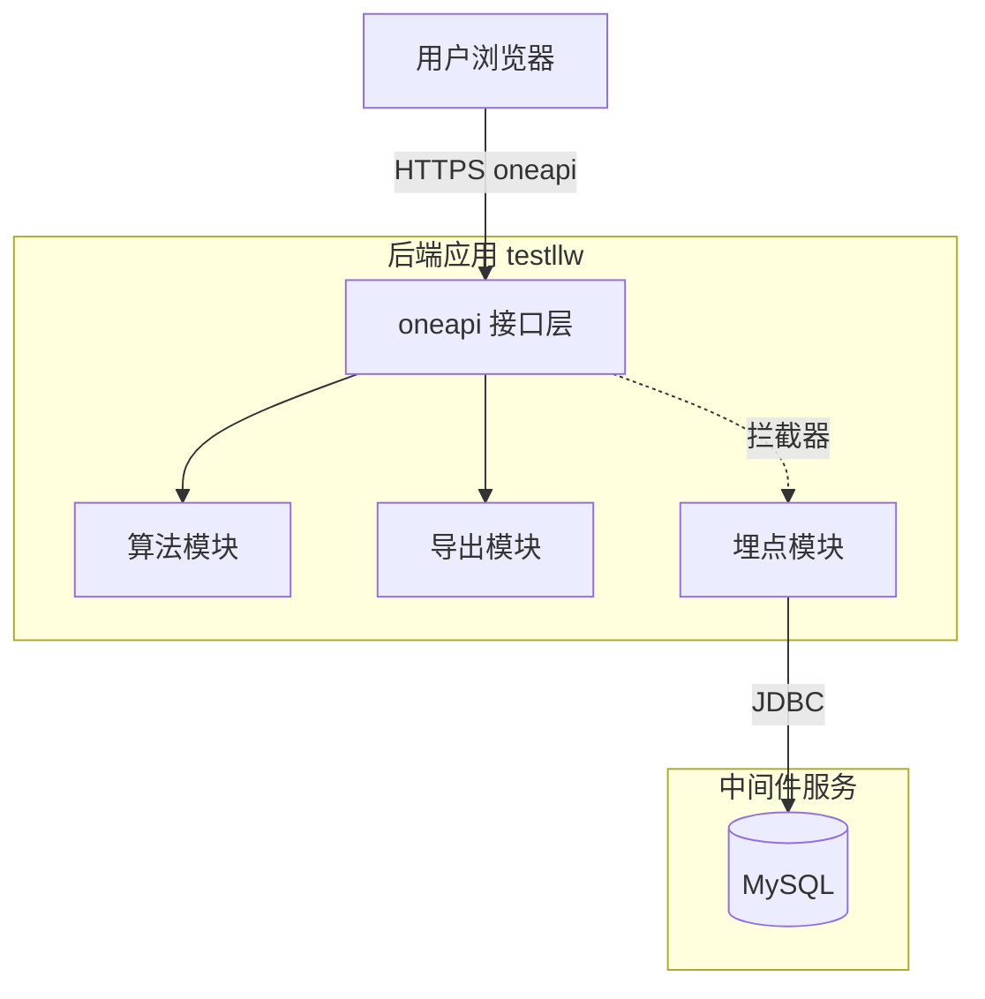
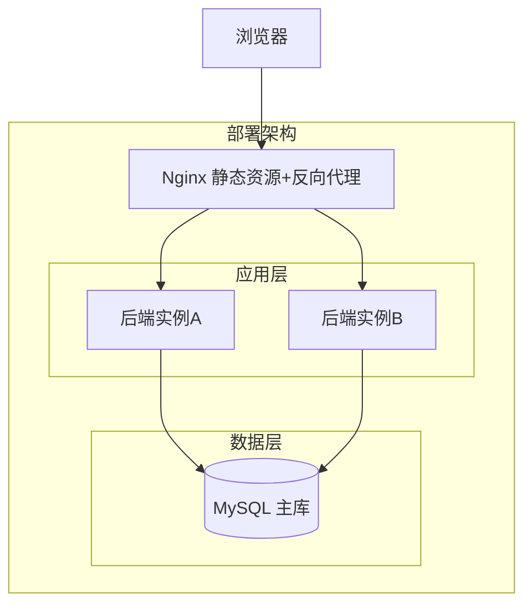
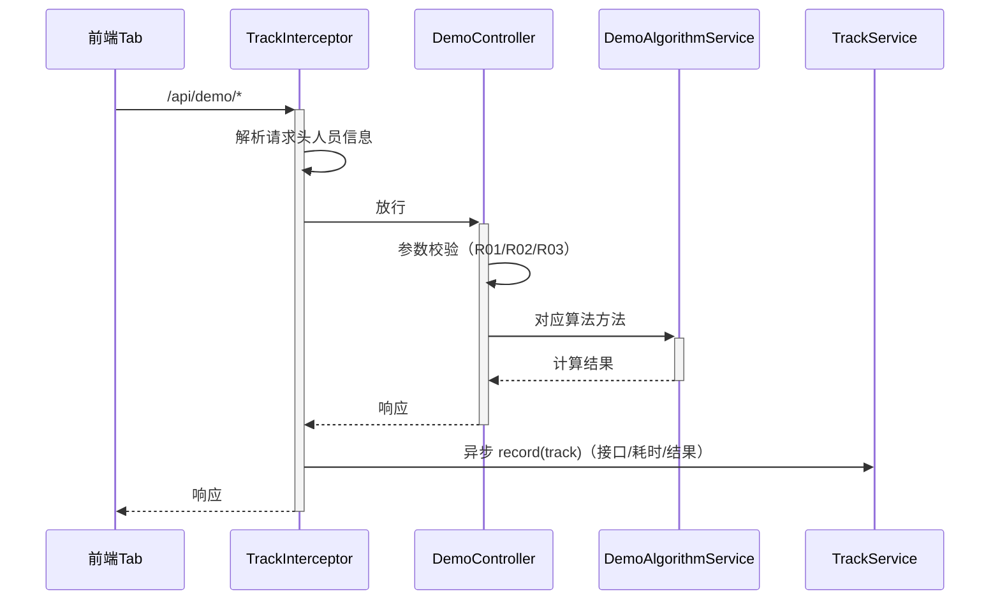
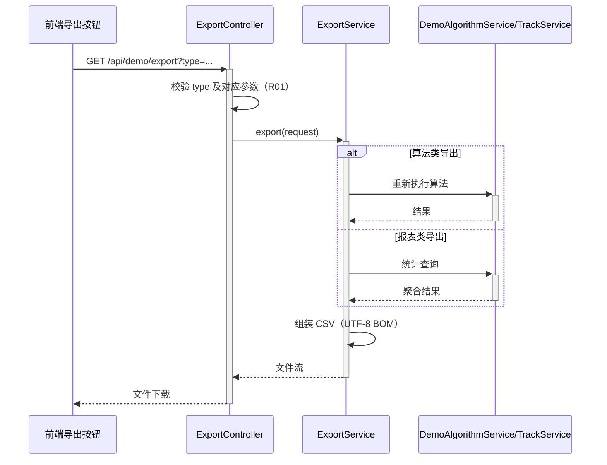

> **文档元信息**
>
> | 项目 | 内容 |
> |------|------|
> | 文档版本 | v1.0 |
> | 作者 | AiWork |
> | 创建日期 | 2026-10-30 |
> | 需求来源 | 任务输入需求描述（demos 三接口 + 前端三 Tab 页面 + 导出 + 埋点报表） |
> | 评审状态 | 待评审 |

# 算法演示与调用埋点报表 系分设计

## 1. 需求与范围

- 背景与目标：提供一个演示型应用，后端提供三个算法接口（helloworld、哈希算法、冒泡排序），前端新增一个页面以三个 Tab 展示各接口执行结果；支持导出各 Tab 展示结果；后端对三个接口做调用埋点（调用次数、调用人及其人员类型/层级/部门等维度），前端在当前页面以折线图、饼图、柱状图可视化调用情况。
- 核心功能：
  - 三个算法接口：helloworld（返回问候串）、哈希算法（对输入字符串计算哈希，支持算法选择）、冒泡排序（对输入数组排序并返回过程/结果）。
  - 前端演示页：一个页面、三个 Tab，分别调用对应接口并展示结果。
  - 导出：后端提供导出接口，导出当前各 Tab 的展示结果（CSV）。
  - 埋点：后端记录每次接口调用（调用人、人员类型、人员层级、人员部门、接口、耗时、结果、时间）。
  - 报表：前端在演示页内展示调用统计报表，支持按人员类型/层级/部门维度聚合，折线图（时间趋势）、饼图（占比）、柱状图（对比）。
- 约束与非功能要求：演示级应用，单机可运行；接口 P95 < 500ms（冒泡排序限制输入规模）；埋点写入不阻塞主流程。
- 排除范围：用户登录/权限体系自建（人员信息来自请求头/网关注入）、导出的异步任务中心、大数据量报表实时数仓。

### 需求功能清单与优先级

| 编号 | 功能点 | 优先级 | PRD 原始描述/章节 | 备注 |
|------|--------|--------|-------------------|------|
| F01 | helloworld 接口 | P0 | "分别写三个接口helloworld" | 返回问候语 |
| F02 | 哈希算法接口 | P0 | "哈希算法" | 支持 MD5/SHA-1/SHA-256 |
| F03 | 冒泡排序接口 | P0 | "冒泡排序" | 返回排序结果及交换次数 |
| F04 | 前端三 Tab 演示页 | P0 | "前端新增一个页面，有三个tab分别展示不同的执行结果" | 单页三 Tab |
| F05 | 结果导出接口及前端导出按钮 | P1 | "新增导出按钮，后台提供导出接口，支持导出各个页面的展示结果" | CSV 格式 |
| F06 | 调用埋点采集 | P0 | "后端再做个埋点，获取调用次数和调用人" | 拦截器统一采集 |
| F07 | 埋点统计查询接口 | P0 | "查看调用情况（根据不同的维度：人员类型、人员层级、人员部门等）" | 聚合查询 |
| F08 | 前端报表可视化（折线/饼/柱状） | P0 | "可视化出来一个报表…折线图以及饼图和柱状图不同展示形式" | ECharts |

### 假设与待确认项

| 编号 | 假设/待确认内容 | 当前假设 | 确认状态 |
|------|-----------------|----------|----------|
| A01 | 仓库分工 | testllw 为后端仓（Spring Boot + MySQL），huanmeng511331-project 为前端仓（React + Vite + ECharts）；两仓当前为空仓库 | 待确认 |
| A02 | 调用人身份来源 | 调用人及人员类型/层级/部门由请求头注入（X-User-Id / X-User-Type / X-User-Level / X-User-Dept），无网关时前端模拟注入 | 待确认 |
| A03 | 哈希算法范围 | 支持 MD5、SHA-1、SHA-256，默认 SHA-256 | 待确认 |
| A04 | 冒泡排序输入 | 整型数组，长度上限 1000，升序 | 待确认 |
| A05 | 导出格式 | CSV（UTF-8 BOM），同步导出，单次上限 1 万行 | 待确认 |
| A06 | 人员维度字段 | 人员类型（正式/外包/实习）、人员层级（P5-P9）、人员部门（字符串） | 待确认 |

## 2. 架构与模块

### 功能架构


- 交互层说明：oneapi REST 接口，统一 `{code, msg, data}` 出参。
- 核心服务层说明：算法模块（无状态计算）；导出模块（生成 CSV）；埋点模块（拦截器异步落库 + 聚合统计）。
- 扩展/集成层说明：本项不适用，原因：无外部系统集成，人员信息经请求头透传。

**模块清单**

| 模块 | 职责 | 依赖 |
|------|------|------|
| 算法模块 | 提供 helloworld / 哈希 / 冒泡排序计算能力 | 无 |
| 导出模块 | 按导出类型生成 CSV 文件流 | 算法模块（重新计算）、埋点模块 |
| 埋点模块 | 调用埋点采集、存储、多维聚合统计 | MySQL |
| 前端演示页 | 三 Tab 展示、导出按钮、报表可视化 | 后端 oneapi |

### 应用集成架构


**集成关系说明：**

| 调用方 | 被调用方 | 协议 | 接口类型 | 说明 |
|--------|----------|------|----------|------|
| 用户浏览器（前端仓） | 后端 oneapi | HTTPS | oneapi REST | 算法调用、导出、报表查询 |
| 后端埋点模块 | MySQL | JDBC | SQL | 埋点写入与聚合查询 |

### 部署架构


**部署说明：**
- 负载均衡层：Nginx 托管前端构建产物并反向代理 `/api` 至后端。
- 应用层：后端 Spring Boot 双实例（演示环境可单实例，假设：私有化容器化部署）。
- 数据层：单 MySQL 实例即可，埋点表数据量低（演示级）。

## 3. 数据模型与存储

### 实体清单

| 实体名称 | 实体说明 | 所属模块 | 与其他实体的关系 |
|----------|----------|----------|-----------------|
| ApiInvokeTrack | 接口调用埋点记录 | 埋点模块 | 无关联实体（独立日志型表） |

### 实体关系图


**模型说明：**
- 仅一张埋点表，算法接口无状态、不持久化业务数据，满足第三范式。
- 租户隔离：本项不适用，原因：单租户演示应用，如后续多租户化可扩展 tenant_id 字段。

## 4. 接口设计

### 4.1 oneapi（Web 控制台接口）

| 编号 | 接口名称 | 方法 | 路径 | 模块 |
|------|----------|------|------|------|
| W01 | HelloWorld | GET | /api/demo/helloworld | 算法模块 |
| W02 | 哈希计算 | POST | /api/demo/hash | 算法模块 |
| W03 | 冒泡排序 | POST | /api/demo/bubble-sort | 算法模块 |
| W04 | 结果导出 | GET | /api/demo/export | 导出模块 |
| W05 | 埋点统计查询 | GET | /api/track/stats | 埋点模块 |

### 4.2 OpenAPI（对外接口）

本项不适用，原因：无对外开放接口需求，全部为前端页面自用 oneapi。

### 4.3 内部接口（Service 层）

| 编号 | 接口名称 | 类 | 方法签名 |
|------|----------|------|----------|
| S01 | 问候服务 | DemoAlgorithmService | sayHello(String name) |
| S02 | 哈希服务 | DemoAlgorithmService | hash(String input, String algorithm) |
| S03 | 冒泡排序服务 | DemoAlgorithmService | bubbleSort(List<Integer> input) |
| S04 | 导出服务 | ExportService | export(ExportRequest request) → CSV 流 |
| S05 | 埋点记录 | TrackService | record(ApiInvokeTrack track)（异步） |
| S06 | 埋点统计 | TrackService | stats(TrackStatsQuery query) |

### 4.4 集成接口（Integration 层）

本项不适用，原因：无外部系统调用。

## 5. 功能模块设计

### 全局约定

- 错误码格式：`{MODULE}_{SEQ}`，模块映射：算法模块 DEMO、导出模块 EXPORT、埋点模块 TRACK。
- 通用出参结构：`{code, msg, data}`，成功 `code=OK`。
- 导出接口直接返回文件流（Content-Type: text/csv），不走通用出参。

### 5.1 算法模块

#### 5.1.1 表结构设计

本模块无表结构设计，原因：纯内存计算，无持久化。

#### 5.1.1.x 枚举与常量定义

| 枚举名称 | 取值 | 含义 | 关联字段 |
|----------|------|------|----------|
| HashAlgorithm | MD5 / SHA1 / SHA256 | 哈希算法类型 | W02 入参 algorithm |
| 排序方向 | ASC / DESC | 排序方向（默认 ASC） | W03 入参 order |

#### 5.1.2 接口详细设计

##### W01 HelloWorld

- **URI**: GET /api/demo/helloworld
- **描述**: 返回问候语
- **入参**:

| 参数名称 | 类型 | 是否必填 | 描述 |
|----------|------|----------|------|
| name | String | 否 | 被问候人姓名，默认 "World"，最长 50 字符 |

- **出参**:

| 参数名称 | 类型 | 描述 |
|----------|------|------|
| code | String | 结果code |
| msg | String | 提示信息 |
| data.message | String | 问候语，如 "Hello, World!" |
| data.timestamp | String | 服务器时间 |

- **错误码**:

| 错误码 | 说明 |
|--------|------|
| DEMO_001 | 参数长度超限 |

- **请求示例**: `GET /api/demo/helloworld?name=Tom`
- **响应示例**:
```json
{
  "code": "OK",
  "msg": "SUCCESS",
  "data": { "message": "Hello, Tom!", "timestamp": "2026-10-30 12:00:00" }
}
```

##### W02 哈希计算

- **URI**: POST /api/demo/hash
- **描述**: 对输入字符串计算指定算法哈希值
- **入参**:

| 参数名称 | 类型 | 是否必填 | 描述 |
|----------|------|----------|------|
| input | String | 是 | 待哈希原文，最长 4096 字符 |
| algorithm | String | 否 | MD5/SHA1/SHA256，默认 SHA256 |

- **出参**:

| 参数名称 | 类型 | 描述 |
|----------|------|------|
| code | String | 结果code |
| msg | String | 提示信息 |
| data.digest | String | 十六进制哈希值 |
| data.algorithm | String | 实际使用的算法 |
| data.inputLength | Integer | 原文长度 |

- **错误码**:

| 错误码 | 说明 |
|--------|------|
| DEMO_001 | 参数长度超限 |
| DEMO_002 | 不支持的哈希算法 |

- **请求示例**:
```json
{ "input": "hello", "algorithm": "SHA256" }
```
- **响应示例**:
```json
{
  "code": "OK",
  "msg": "SUCCESS",
  "data": { "digest": "2cf24dba5f…b982e", "algorithm": "SHA256", "inputLength": 5 }
}
```

##### W03 冒泡排序

- **URI**: POST /api/demo/bubble-sort
- **描述**: 对整型数组执行冒泡排序，返回结果与过程指标
- **入参**:

| 参数名称 | 类型 | 是否必填 | 描述 |
|----------|------|----------|------|
| numbers | Integer[] | 是 | 待排序数组，长度 1–1000 |
| order | String | 否 | ASC/DESC，默认 ASC |

- **出参**:

| 参数名称 | 类型 | 描述 |
|----------|------|------|
| code | String | 结果code |
| msg | String | 提示信息 |
| data.sorted | Integer[] | 排序结果 |
| data.compareCount | Integer | 比较次数 |
| data.swapCount | Integer | 交换次数 |
| data.elapsedMs | Long | 计算耗时（毫秒） |

- **错误码**:

| 错误码 | 说明 |
|--------|------|
| DEMO_001 | 数组为空或长度超 1000 |

- **请求示例**:
```json
{ "numbers": [5, 3, 8, 1], "order": "ASC" }
```
- **响应示例**:
```json
{
  "code": "OK",
  "msg": "SUCCESS",
  "data": { "sorted": [1, 3, 5, 8], "compareCount": 6, "swapCount": 3, "elapsedMs": 0 }
}
```

#### 5.1.3 子功能详细设计

##### 5.1.3.1 算法接口统一处理（F01/F02/F03）



**业务规则：**

| 规则编号 | 规则描述 | 校验时机 | 不满足时的处理 |
|----------|----------|----------|----------------|
| R01 | name ≤ 50 字符 | W01 入参校验 | 返回 DEMO_001 |
| R02 | input ≤ 4096 字符，algorithm ∈ {MD5,SHA1,SHA256} | W02 入参校验 | 返回 DEMO_001 / DEMO_002 |
| R03 | 数组长度 1–1000 | W03 入参校验 | 返回 DEMO_001 |
| R04 | 冒泡排序提前退出优化（一轮无交换即结束） | 计算时 | 正常返回 |

**异常场景：**

| 异常场景 | 处理方式 |
|----------|----------|
| 参数缺失/非法 | 参数校验拦截，统一返回对应错误码 |
| 计算过程异常 | 全局异常处理器返回 DEMO_999 系统异常，埋点记录失败结果 |
| 埋点写库失败 | 仅记录日志，不影响主流程响应 |

**并发控制：**
- 无并发风险，原因：算法无状态，不写共享资源；埋点写入为独立 INSERT。

**状态机设计：** 本项不适用，原因：无含状态字段的实体。

### 5.2 导出模块

#### 5.2.1 表结构设计

本模块无表结构设计，原因：导出内容为即时计算的算法结果或埋点查询结果，不落库。

#### 5.2.1.x 枚举与常量定义

| 枚举名称 | 取值 | 含义 | 关联字段 |
|----------|------|------|----------|
| ExportType | HELLO / HASH / BUBBLE_SORT / TRACK_STATS | 导出内容类型（对应三个 Tab 及报表） | W04 入参 type |

#### 5.2.2 接口详细设计

##### W04 结果导出

- **URI**: GET /api/demo/export
- **描述**: 按类型导出展示结果为 CSV 文件下载；算法类导出按入参重新执行算法生成结果，报表类导出复用统计查询
- **入参**:

| 参数名称 | 类型 | 是否必填 | 描述 |
|----------|------|----------|------|
| type | String | 是 | HELLO/HASH/BUBBLE_SORT/TRACK_STATS |
| name | String | 否 | type=HELLO 时的问候人 |
| input | String | 否 | type=HASH 时的原文 |
| algorithm | String | 否 | type=HASH 时的算法 |
| numbers | String | 否 | type=BUBBLE_SORT 时的逗号分隔数组 |
| dimension | String | 否 | type=TRACK_STATS 时的统计维度 |
| startTime | String | 否 | type=TRACK_STATS 时统计开始时间 |
| endTime | String | 否 | type=TRACK_STATS 时统计结束时间 |

- **出参**: CSV 文件流（Content-Disposition: attachment; filename=demo_{type}_{yyyyMMddHHmmss}.csv），单次最多 1 万行。
- **错误码**（参数错误时以 JSON 通用出参返回）:

| 错误码 | 说明 |
|--------|------|
| EXPORT_001 | 不支持的导出类型 |
| EXPORT_002 | 导出数据量超上限 |
| EXPORT_003 | 算法类导出参数缺失 |

- **请求示例**: `GET /api/demo/export/type=BUBBLE_SORT&numbers=5,3,8,1`
- **业务规则**: 导出动作本身也记录埋点（接口标记为 export）。

#### 5.2.3 子功能详细设计

##### 5.2.3.1 导出处理（F05）



**业务规则：**

| 规则编号 | 规则描述 | 校验时机 | 不满足时的处理 |
|----------|----------|----------|----------------|
| R01 | type 必填且合法；算法类导出参数复用对应接口规则 | 导出前 | 返回 EXPORT_001/EXPORT_003 |
| R02 | 导出行数 ≤ 10000 | 生成时 | 返回 EXPORT_002 |
| R03 | CSV 带 UTF-8 BOM，防止 Excel 打开乱码 | 生成时 | - |

**异常场景：**

| 异常场景 | 处理方式 |
|----------|----------|
| 导出流写中断（客户端取消） | 捕获 IOException，仅记日志 |
| 参数对应算法执行失败 | 返回对应算法错误码 |

**并发控制：** 无并发风险，原因：导出为只读/重计算操作，无共享写。

### 5.3 埋点模块

#### 5.3.1 表结构设计

##### 5.3.1.1 api_invoke_track（接口调用埋点表）

| 字段名 | 数据类型 | 约束 | 默认值 | 说明 |
|--------|----------|------|--------|------|
| id | bigint | PK, 自增 | - | 系统自增主键 |
| api_code | varchar(32) | NOT NULL | '' | 接口编码：hello/hash/bubble_sort/export |
| api_path | varchar(128) | NOT NULL | '' | 请求路径 |
| caller_id | varchar(64) | NOT NULL | '' | 调用人工号/ID |
| caller_name | varchar(64) | NOT NULL | '' | 调用人姓名 |
| person_type | varchar(16) | NOT NULL | '' | 人员类型：FORMAL/OUTSOURCE/INTERN |
| person_level | varchar(8) | NOT NULL | '' | 人员层级：P5-P9 |
| person_dept | varchar(64) | NOT NULL | '' | 人员部门 |
| invoke_result | varchar(16) | NOT NULL | '' | 调用结果：SUCCESS/FAIL |
| cost_ms | bigint | NOT NULL | 0 | 处理耗时（毫秒） |
| invoke_time | datetime | NOT NULL | - | 调用时间 |
| gmt_create | datetime | NOT NULL | CURRENT_TIMESTAMP | 创建时间 |
| gmt_modified | datetime | NOT NULL | CURRENT_TIMESTAMP | 修改时间 |

**索引：**
- PK: `pk_api_invoke_track` (id)
- IDX: `idx_track_time` (invoke_time)
- IDX: `idx_track_dept_time` (person_dept, invoke_time)

注：人员类型/层级维度基数低，统计查询以时间范围为主过滤条件，联合索引覆盖部门维度；报表为演示级数据量，满足查询性能。

##### 5.3.1.x 枚举与常量定义

| 枚举名称 | 取值 | 含义 | 关联字段 |
|----------|------|------|----------|
| ApiCode | hello / hash / bubble_sort / export | 被调接口编码 | api_invoke_track.api_code |
| InvokeResult | SUCCESS / FAIL | 调用结果 | api_invoke_track.invoke_result |
| PersonType | FORMAL / OUTSOURCE / INTERN | 人员类型 | api_invoke_track.person_type |
| StatsDimension | PERSON_TYPE / PERSON_LEVEL / PERSON_DEPT / CALLER | 统计维度 | W05 入参 dimension |

#### 5.3.2 接口详细设计

##### W05 埋点统计查询

- **URI**: GET /api/track/stats
- **描述**: 按维度查询调用统计，一次返回折线（时间趋势）、柱状（维度对比）、饼图（维度占比）三类数据
- **入参**:

| 参数名称 | 类型 | 是否必填 | 描述 |
|----------|------|----------|------|
| dimension | String | 是 | PERSON_TYPE/PERSON_LEVEL/PERSON_DEPT/CALLER |
| apiCode | String | 否 | 过滤单个接口，默认全部 |
| startTime | String | 否 | 统计开始时间（yyyy-MM-dd HH:mm:ss），默认近 7 天 |
| endTime | String | 否 | 统计结束时间，默认当前 |

- **出参**:

| 参数名称 | 类型 | 描述 |
|----------|------|------|
| code | String | 结果code |
| msg | String | 提示信息 |
| data.totalCount | Long | 时间范围内总调用次数 |
| data.trend | Array | 折线图数据：[{date, count}]，按天聚合 |
| data.dimensionStats | Array | 柱状/饼图数据：[{dimensionValue, count, ratio}] |

- **错误码**:

| 错误码 | 说明 |
|--------|------|
| TRACK_001 | 统计维度非法 |
| TRACK_002 | 时间范围非法（跨度 > 90 天） |

- **请求示例**: `GET /api/track/stats?dimension=PERSON_DEPT&startTime=2026-10-01 00:00:00`
- **响应示例**:
```json
{
  "code": "OK",
  "msg": "SUCCESS",
  "data": {
    "totalCount": 320,
    "trend": [{ "date": "2026-10-29", "count": 150 }, { "date": "2026-10-30", "count": 170 }],
    "dimensionStats": [{ "dimensionValue": "研发部", "count": 200, "ratio": 0.625 }]
  }
}
```

#### 5.3.3 子功能详细设计

##### 5.3.3.1 埋点采集（F06）

- 采用 Spring HandlerInterceptor：preHandle 记录开始时间并解析人员请求头，afterCompletion 计算耗时与结果，异步线程池（核心 2/最大 4/队列 500，拒绝策略 CallerRuns + 降级丢弃仅记日志）写入 api_invoke_track。

**业务规则：**

| 规则编号 | 规则描述 | 校验时机 | 不满足时的处理 |
|----------|----------|----------|----------------|
| R01 | 仅拦截 /api/demo/** 与 /api/demo/export | 拦截时 | 其他路径不埋点 |
| R02 | 人员请求头缺失时填充 UNKNOWN | 采集时 | 字段不允许为空，记录 UNKNOWN |
| R03 | 埋点失败不影响业务响应 | 始终 | 捕获全部异常仅记日志 |

**异常场景：**

| 异常场景 | 处理方式 |
|----------|----------|
| 数据库不可用 | 异步线程捕获异常记日志，主流程无感知 |
| 请求头含非法超长值 | 截断至字段长度，记 WARN 日志 |

**并发控制：** 高并发下异步队列满时采用 CallerRuns 退化为同步写；再失败则丢弃并记日志（埋点允许少量丢失）。

##### 5.3.3.2 埋点统计（F07）

**业务规则：**

| 规则编号 | 规则描述 | 校验时机 | 不满足时的处理 |
|----------|----------|----------|----------------|
| R01 | dimension 必填且合法 | 查询前 | 返回 TRACK_001 |
| R02 | 时间跨度 ≤ 90 天 | 查询前 | 返回 TRACK_002 |
| R03 | 折线图按天聚合（invoke_time 日期分组），维度统计按 dimension 字段分组计数 | 查询时 | - |

**状态机设计：** 本项不适用，原因：埋点记录为日志型数据，无状态流转。

### 5.4 前端模块（huanmeng511331-project）

- 路由：`/demo` 算法演示页。
- 页面结构：
  - 顶部 Tabs：HelloWorld / 哈希算法 / 冒泡排序，各 Tab 内含输入表单、执行按钮、结果展示区。
  - 每个 Tab 右上角"导出"按钮：携带当前 Tab 输入参数调用 W04，浏览器触发下载。
  - 页面底部"调用情况报表"区：维度选择器（人员类型/人员层级/人员部门/调用人）、时间范围选择器，调用 W05 后渲染折线图（趋势）、饼图（占比）、柱状图（维度对比），图表库采用 ECharts。
- **技术选型对比（图表库）：**

| 方案 | 优势 | 劣势 |
|------|------|------|
| ECharts（推荐） | 折线/饼/柱状开箱即用，文档完善，大数据量性能好 | 包体积略大 |
| AntV G2 | 语法灵活 | 学习成本高，常用图表需自行组合 |
| Chart.js | 轻量 | 中文生态与复杂交互较弱 |

推荐理由：三种图表形态均为 ECharts 内置类型，接入成本最低，直接采用。

## 6. 非功能性需求设计

### 6.1 高可用性
后端双实例部署，单实例故障由 Nginx 摘除；MySQL 不可用时算法接口仍可响应（无依赖），埋点降级为仅记日志；报表与导出接口不可用，前端提示降级文案。
### 6.2 可扩展性
算法模块以策略模式注册算法实现，新增算法接口仅需扩展 Service；应用无状态可水平扩容。
### 6.3 稳定性/可靠性
冒泡排序限制数组长度 ≤ 1000（O(n²) 可控）；导出限制 1 万行；哈希输入限制 4096 字符；所有接口参数强校验。
### 6.4 安全性设计
#### 6.4.1 账户系统方案
不自建登录，调用人身份由请求头注入（假设 A02），生产环境应由网关/统一认证注入并防伪造。
#### 6.4.2 授权&访问控制
##### 6.4.2.1 是否实现水平权限检查
演示应用不涉及私有数据行级隔离；埋点报表为聚合数据。
##### 6.4.2.2 是否实现垂直权限检查
本项不适用，原因：演示级公共功能，无角色区分。
##### 6.4.2.3 是否检查登录态
/api/** 统一拦截器校验调用人请求头存在性，缺失时以 UNKNOWN 放行（演示）；生产建议接入统一登录态校验。
#### 6.4.3 数据防护方案
##### 6.4.3.1 是否对敏感数据加密存储
本项不适用，原因：仅存储工号/姓名/部门等非高敏感信息。
##### 6.4.3.2 是否对敏感数据展示进行脱敏
报表中调用人姓名按维度 CALLER 展示时保留；日志中不打印完整请求头；SQL 全部使用预编译参数防注入。
### 6.5 监控/统计/日志/告警
埋点表即业务监控数据源；应用层记录接口耗时与异常日志；建议对导出失败率、埋点写库失败数配置日志关键字告警。

## 7. 变更三板斧

### 7.1 可监控
- 服务埋点：拦截器统一记录 /api/demo/**、/api/demo/export 的调用人、耗时、结果，落 api_invoke_track；报表页即埋点数据的可视化消费。
- 关键日志：算法异常、导出失败、埋点写库失败均打 ERROR 日志。
### 7.2 可灰度
- 功能开关：埋点采集开关 `track.enabled`（默认开启）、导出功能开关 `export.enabled`（默认开启），配置中心动态生效，可按需先对内部人员灰度开放报表页。
- 无存量数据与旧版本接口，无兼容灰度负担。
### 7.3 可应急
- 埋点故障：关闭 `track.enabled` 立即摘除异步写库，主流程不受影响。
- 导出故障：关闭 `export.enabled`，前端隐藏导出按钮。
- 算法接口故障：纯计算无外部依赖，兜底为发布包回滚；接口为新增，回滚不影响任何上下游。

## 8. 方案检查结论

| 检查项 | 结论 | 说明 |
|--------|------|------|
| 模块划分合理性 | 通过 | 算法/导出/埋点三模块职责单一，无循环依赖 |
| 依赖关系合理性 | 通过 | 仅依赖 MySQL，MySQL 故障时主流程降级可用 |
| 单点问题（部署） | 通过 | 双实例 + Nginx；MySQL 单点可接受（演示级，已标注） |
| 表模型范式 | 通过 | 单表日志型设计满足第三范式 |
| 隐私安全 | 通过 | 人员信息标识并限制日志输出，SQL 预编译 |
| 接口兼容性 | 通过 | 全部为新增接口 |
| 表兼容性 | 通过 | 新增表，无存量变更 |
| 数据迁移 | 通过 | 无需初始化数据 |
| 功能点一致性 | 通过 | F01-F08 均映射至第 5 章设计（F04/F08 为前端模块 5.4） |
| 表一致性 | 通过 | 唯一实体 ApiInvokeTrack 已在 5.3.1 完整定义 |
| 接口一致性 | 通过 | W01-W05 均有详细设计，S01-S06 覆盖 |
| 枚举一致性 | 通过 | 枚举取值与字段说明一致 |
| 状态机完整性 | 不适用 | 无含状态字段实体 |
| 并发风险 | 通过 | 无共享写；埋点异步队列策略已给出 |
| 定时任务单点 | 不适用 | 无定时任务 |
| 非功能设计可行性 | 通过 | 长度限制、降级、双实例均可落地 |
| 可监控可行性 | 通过 | 拦截器埋点方案成熟 |
| 可灰度方案 | 通过 | 开关方案（备选：按租户尾号灰度——无多租户，弃用） |
| 可应急方案 | 通过 | 开关摘除 + 新增功能回滚无上下游影响 |

**技术选型决策记录：**

| 决策项 | 决策结果 | 备选方案 | 决策原因 |
|--------|----------|----------|----------|
| 后端技术栈 | Spring Boot 单体 + MyBatis | Node.js / 微服务拆分 | 演示级需求，单体交付最快，符合仓规范 |
| 前端技术栈 | React + Vite + ECharts | Vue / AntV / Chart.js | ECharts 三图表开箱即用 |
| 埋点采集方式 | HandlerInterceptor + 异步线程池 | AOP 切面 / MQ 异步 | 拦截器覆盖路径最准；演示级无需 MQ |
| 导出实现 | 同步 CSV 文件流 | 异步任务 + 文件中心 | 数据量小，同步简单可靠 |
| 产出路径 | 使用任务指定 OUTPUT_FILE | 默认 .agents/system-analysis 路径 | 遵循产物硬性约束 |
