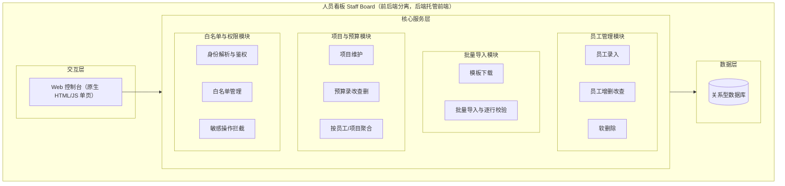
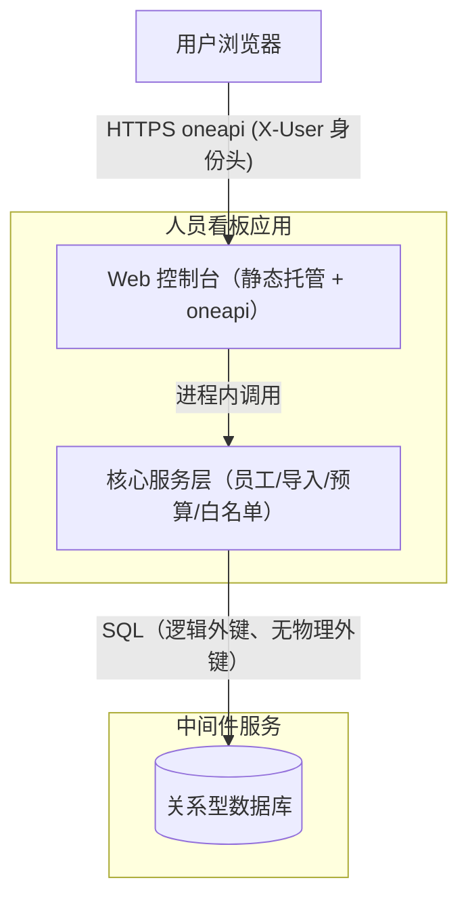
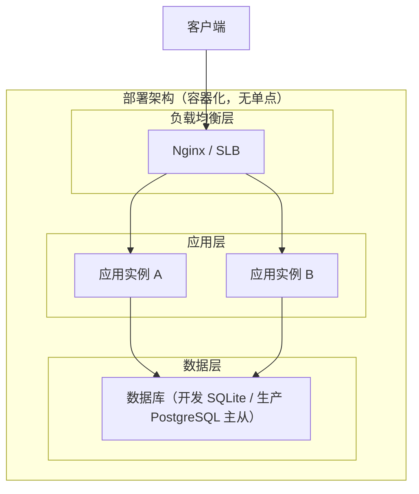
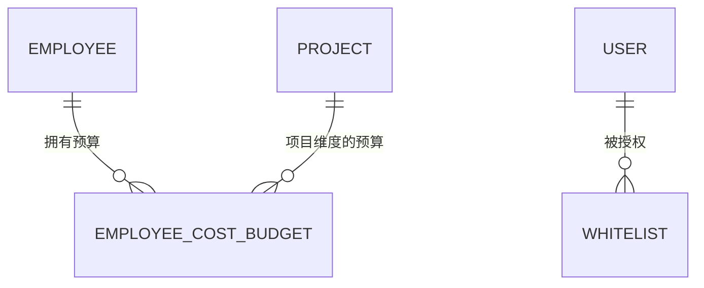
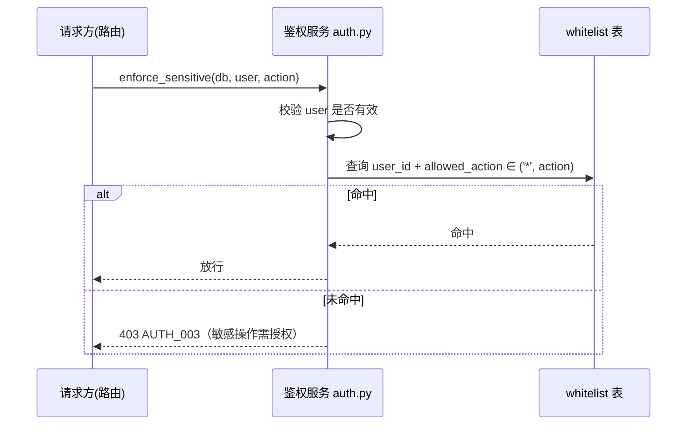
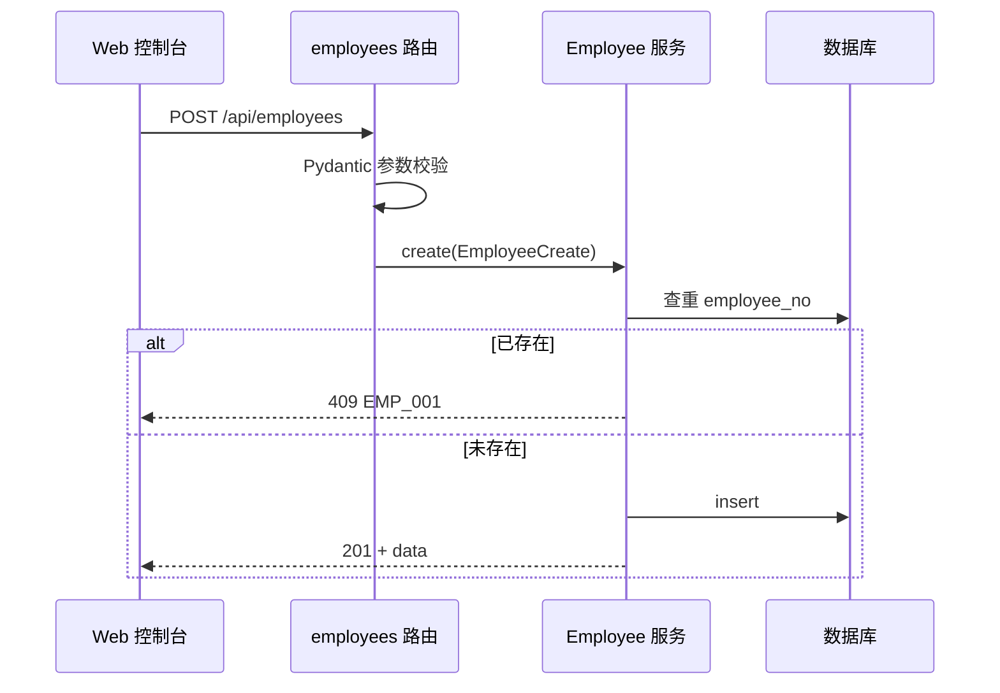
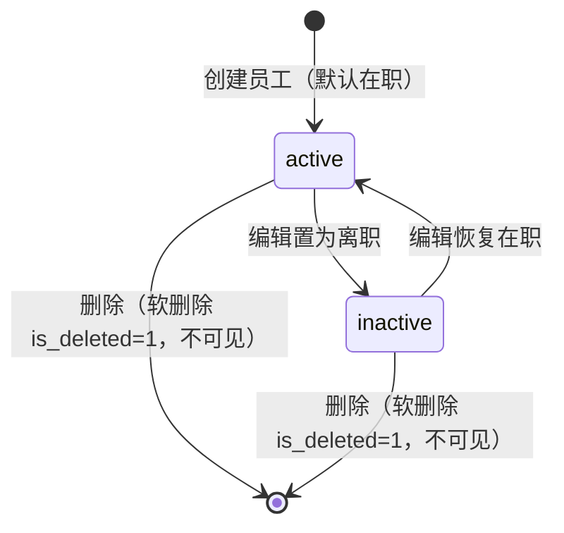
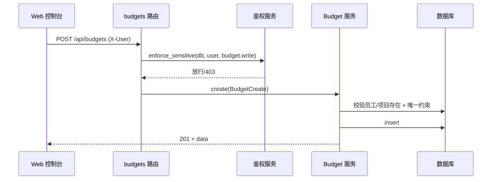
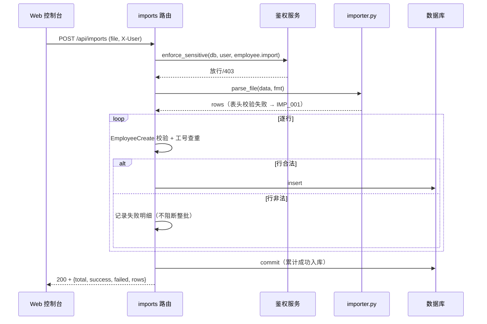

> **文档元信息**
>
> | 项目 | 内容 |
> |------|------|
> | 文档版本 | v1.0 |
> | 作者 | AiWork（系分节点，全自动流水线） |
> | 创建日期 | 2026-10-21 |
> | 需求来源 | `.agents/20261021-开发一个人员看板_有入口记录员工的基本信/spec.md` |
> | 评审状态 | 待评审 |

# 人员看板（Staff Board）系分设计

## 1. 需求与范围

### 背景与目标

- **背景**：当前仓库为从零搭建的新项目（工作树仅有 `README.md`、`.agents/`、`docs/`，无既有代码），无历史架构文档，本系分按**全量模式**全新设计。
- **目标**：搭建「人员看板」系统，统一管理团队人员台账与成本预算，提供员工基本信息录入入口、增删改查、批量导入、成本预算记录与维护，并通过「敏感操作授权白名单」收敛高风险操作权限。
- **面向用户**：管理员（维护台账/预算/白名单/导入）、普通查看者（只读查看）。

### 核心功能

需求原文：`开发一个人员看板，有入口记录员工的基本信息以及增删改查，支持导入以及记录成本预算--白名单、批量导入`。

1. 员工基本信息录入入口（F01）
2. 员工信息增删改查 CRUD（F02）
3. 批量导入（Excel 模板 + CSV 双格式）（F03）
4. 成本预算记录（员工 + 项目双维度）（F04）
5. 敏感操作授权白名单（F05）

### 约束与非功能要求

- 技术栈已确认：Web 前后端 + 关系型数据库（spec §5 Q1）。
- 数据一致性：工号全局唯一；预算「员工 + 项目 + 预算周期」唯一；导入事务化、逐行给出成功/失败明细。
- 可维护性：前后端分层清晰、字段与校验集中可配置。
- 审计：删除与预算变更等敏感操作留痕（初版以软删除 + 时间戳标注为最低限度留痕）。
- 安全：敏感操作与白名单机制联动；员工手机号/邮箱展示脱敏、日志脱敏。

### 排除范围

| 排他项 | 说明 |
|------|------|
| 考勤、薪酬计算、组织架构审批流 | 超出本需求范围 |
| 组织架构主数据对接（如 hrorg） | 初版员工数据由本系统录入/导入，不接外部主数据 |
| 完整操作审计流水（独立审计表） | 初版以软删除等最低限度留痕，完整审计留后续迭代 |
| 多租户隔离 | 本系统为单团队内部看板，不涉及多租户（故不加 `tenant_id`） |
| 预算的审批流、预算调剂 | 不涉及，预算仅录入、编辑、查看、聚合 |

### 需求功能清单与优先级

| 编号 | 功能点 | 优先级 | PRD 原始描述/章节 | 备注 |
|------|--------|--------|-------------------|------|
| F01 | 员工基本信息录入入口 | P0 | spec §4 FR1 | 新增员工表单，工号唯一、必填校验 |
| F02 | 员工 CRUD（查/增/改/删） | P0 | spec §4 FR2 | 列表检索分页；删除为软删除 |
| F03 | 批量导入（Excel+CSV、模板、逐行明细） | P0 | spec §4 FR3 | 8 列模板；导入前校验；逐行成功/失败 |
| F04 | 成本预算记录（员工+项目双维度） | P0 | spec §4 FR4 | 唯一约束 (employee_id, project_id, budget_period) |
| F05 | 敏感操作授权白名单 | P0 | spec §4 FR5 | 仅白名单用户可执行删除/导入/预算写 |

### 假设与待确认项

| 编号 | 假设/待确认内容 | 当前假设 | 确认状态 |
|------|-----------------|----------|----------|
| A01 | 产品形态与技术栈 | Web 前后端 + 关系型数据库 | 已确认（spec Q1） |
| A02 | 成本预算粒度 | 员工 + 项目双维度 | 已确认（spec Q2） |
| A03 | 白名单语义 | 敏感操作授权白名单 | 已确认（spec Q3） |
| A04 | 批量导入格式与模板 | Excel 模板 + CSV 双支持，8 列模板 | 已确认（spec Q4） |
| A05 | 员工字段范围 | 工号/姓名/部门/职位/邮箱/手机号/入职日期/在职状态 | 已确认（spec Q5） |
| A06 | 后端技术栈 | Python 3.11 + FastAPI + SQLAlchemy 2.0 + Pydantic v2（与计划文档一致） | 已确认（计划文档） |
| A07 | 用户身份与登录 | MVP 通过 `X-User` 请求头传递当前用户，生产环境替换为统一登录（办公网/buc 或自建），本需求安全评审仅覆盖授权模型 | 待确认（实现期） |
| A08 | 数据库命名/结构规范 | 遵循数科数据库规范（references/db.md）：表名小写、`pk_/uk_/idx_` 索引前缀、decimal 金额、datetime 时间、逻辑外键不强建物理外键 | 已确认（采用） |
| A09 | 员工删除语义 | 软删除（`is_deleted=1`），保留历史 | 已确认（spec FR2） |
| A10 | 敏感操作清单 | 员工删除、批量导入、预算写（增/改/删）三类 | 已确认（spec FR5） |

---

## 2. 架构与模块

### 功能架构



- **交互层说明**：原生 HTML/JS 单页应用，调用 oneapi REST 接口；通过 `X-User` 请求头传递当前用户身份。
- **核心服务层说明**：四个模块职责单一，员工管理、批量导入、项目与预算、白名单与权限；敏感操作统一经白名单门禁拦截。
- **数据层说明**：关系型数据库（开发用 SQLite，`DATABASE_URL` 可切换 PostgreSQL）。

**模块清单**

| 模块 | 职责 | 依赖 |
|------|------|------|
| 员工管理模块 | 员工录入、查询、修改、软删除；工号唯一校验；列表检索分页 | 白名单与权限模块（删除鉴权） |
| 批量导入模块 | Excel/CSV 模板下载、文件解析、逐行校验与入库、逐行结果明细 | 白名单与权限模块（导入鉴权）；员工管理模块（工号唯一） |
| 项目与预算模块 | 项目维护；成本预算增删改查与按维度聚合 | 员工管理模块（员工存在）；白名单与权限模块（写入鉴权） |
| 白名单与权限模块 | 用户/角色、白名单管理、敏感操作授权拦截 | 数据层 |
| 前端看板（交互层） | 列表/表单/导入/预算汇总视图，用户身份切换 | 核心服务层 REST 接口 |

模块依赖拓扑（无循环依赖）：`白名单与权限模块` ← `员工管理/批量导入/项目与预算模块` ← `前端看板`。

### 应用集成架构



**集成关系说明：**

| 调用方 | 被调用方 | 协议 | 接口类型 | 说明 |
|--------|----------|------|----------|------|
| 用户浏览器 | Web 控制台 | HTTPS | oneapi REST | 员工/导入/预算/白名单/用户接口 |
| Web 控制台（路由） | 核心服务层 | 进程内 | 内部函数调用 | Controller→Service→Repository |
| 核心服务层 | 关系型数据库 | 驱动连接 | SQL | 逻辑外键由应用层维护，不建物理外键 |

> 本系统无外部系统集成（不接 hrorg 主数据、不接第三方预算系统），故无 External 节点；集成接口见 4.4 输出「不适用」。

### 部署架构



**部署说明：**
- **负载均衡层**：Nginx/SLB，多实例轮询；静态资源由应用实例托管或前置 Nginx 托管。
- **应用层**：无状态应用，多副本水平扩容（默认 2 实例起步），无单点。
- **数据层**：生产用 PostgreSQL 主从（读从写主）；开发用 SQLite 单文件。

---

## 3. 数据模型与存储

### 实体清单

| 实体名称 | 实体说明 | 所属模块 | 与其他实体的关系 |
|----------|----------|----------|-----------------|
| employee（员工） | 员工台账主数据，含基本字段 + 软删除标记 | 员工管理模块 | 一对多 employee_cost_budget |
| user（用户） | 系统账号与角色（admin/viewer），白名单主体 | 白名单与权限模块 | 一对多 whitelist |
| project（项目） | 预算维度之一 | 项目与预算模块 | 一对多 employee_cost_budget |
| employee_cost_budget（员工成本预算） | 员工 × 项目 × 预算周期的预算记录 | 项目与预算模块 | 多对一 employee；多对一 project |
| whitelist（敏感操作授权白名单） | 用户 × 敏感动作的授权记录 | 白名单与权限模块 | 多对一 user |

### 实体关系图



**模型说明：**
- `employee_cost_budget` 以「员工 + 项目 + 预算周期」唯一，形成双维度：同一员工可在多项目各有预算，同一项目下多名员工各有预算。
- 所有关联均为**逻辑外键**（应用层维护一致性，不建物理外键，遵循 db.md「禁止外键」强制项）。
- 无独立 `budget_period` 枚举实体，`budget_period` 为字符串字段（如 `2026Q1`、`2026-10`）。
- 不加 `tenant_id`（单团队内部看板，排除多租户）。

---

## 4. 接口设计

### 4.1 oneapi（Web 控制台接口）

| 编号 | 接口名称 | 方法 | 路径 | 模块 |
|------|----------|------|------|------|
| W01 | 创建员工 | POST | /api/employees | 员工管理 |
| W02 | 员工列表（检索/分页） | GET | /api/employees | 员工管理 |
| W03 | 员工详情 | GET | /api/employees/{employee_no} | 员工管理 |
| W04 | 编辑员工 | PATCH | /api/employees/{employee_no} | 员工管理 |
| W05 | 删除员工（软删除，白名单） | DELETE | /api/employees/{employee_no} | 员工管理 |
| W06 | 导入模板下载 | GET | /api/imports/template | 批量导入 |
| W07 | 批量导入 | POST | /api/imports | 批量导入 |
| W08 | 创建项目 | POST | /api/projects | 项目与预算 |
| W09 | 项目列表 | GET | /api/projects | 项目与预算 |
| W10 | 创建预算 | POST | /api/budgets | 项目与预算 |
| W11 | 预算列表（按员工/项目聚合） | GET | /api/budgets | 项目与预算 |
| W12 | 编辑预算 | PATCH | /api/budgets/{budget_id} | 项目与预算 |
| W13 | 删除预算 | DELETE | /api/budgets/{budget_id} | 项目与预算 |
| W14 | 当前用户 | GET | /api/users/me | 白名单与权限 |
| W15 | 用户列表（仅管理员） | GET | /api/users | 白名单与权限 |
| W16 | 白名单列表 | GET | /api/whitelist | 白名单与权限 |
| W17 | 新增白名单授权 | POST | /api/whitelist | 白名单与权限 |
| W18 | 移除白名单授权 | DELETE | /api/whitelist/{id} | 白名单与权限 |

### 4.2 OpenAPI（对外接口）

本系统为内部看板，暂不对外提供 OpenAPI 能力。**本项不适用，原因：无外部系统/开放平台对接需求。**

### 4.3 内部接口（Service 层）

| 编号 | 接口名称 | 类/模块 | 方法签名 |
|------|----------|------|----------|
| S01 | 解析当前用户 | auth.py | `get_current_user(db, x_user) -> User` |
| S02 | 管理员校验 | auth.py | `require_admin(user) -> None` |
| S03 | 白名单命中判断 | auth.py | `is_whitelisted(db, user, action) -> bool` |
| S04 | 敏感操作强制校验 | auth.py | `enforce_sensitive(db, user, action) -> None` |
| S05 | 生成导入模板 | importer.py | `build_template(fmt) -> (bytes, mime)` |
| S06 | 解析导入文件 | importer.py | `parse_file(data, fmt) -> list[dict]` |
| S07 | 解析 Excel | importer.py | `parse_workbook(data) -> list[dict]`（内部） |
| S08 | 解析 CSV | importer.py | `parse_csv(data) -> list[dict]`（内部） |

### 4.4 集成接口（Integration 层）

**本项不适用，原因：本系统无外部系统集成（不接组织架构主数据、不接第三方预算/通知系统）。**---

## 5. 功能模块设计

### 全局约定

| 约定项 | 约定值 |
|------|------|
| 通用出参结构 | `{result, msg, data}`；`result=OK` 表示成功，失败返回错误码见各接口 |
| 错误码格式 | `{模块}_{序号}`，模块前缀：员工 `EMP`、导入 `IMP`、预算 `BUD`、项目 `PRJ`、白名单 `WHL`、鉴权 `AUTH` |
| 分页结构 | `data = {total, items}` |
| 命名规范 | 遵循 references/db.md：表/字段全小写下划线；主键 `pk_`、唯一 `uk_`、普通 `idx_` 索引前缀；逻辑外键（不建物理外键）；金额 decimal；时间 datetime；布尔 `is_` 前缀 |
| 登录态 | MVP 经 `X-User` 请求头解析当前用户；生产替换为统一登录后不改服务层签名 |

### 5.1 白名单与权限模块

#### 5.1.1 表结构设计

##### user（用户表）

| 字段名 | 数据类型 | 约束 | 默认值 | 说明 |
|--------|----------|------|--------|------|
| id | bigint | PK, 自增 | - | 主键 |
| username | varchar(64) | NOT NULL | - | 登录名/工号 |
| role | varchar(16) | NOT NULL | viewer | 角色：admin / viewer |
| gmt_create | datetime | NOT NULL | CURRENT_TIMESTAMP | 创建时间 |
| gmt_modified | datetime | NOT NULL | CURRENT_TIMESTAMP | 修改时间 |

**索引：** UK `uk_user_username`(username)。

##### whitelist（敏感操作授权白名单表）

| 字段名 | 数据类型 | 约束 | 默认值 | 说明 |
|--------|----------|------|--------|------|
| id | bigint | PK, 自增 | - | 主键 |
| user_id | bigint | NOT NULL | - | 用户 id（逻辑外键 → user.id） |
| allowed_action | varchar(32) | NOT NULL | - | 授权动作：`*` 或具体敏感动作 |
| created_by | varchar(64) | NULL | NULL | 操作人 |
| gmt_create | datetime | NOT NULL | CURRENT_TIMESTAMP | 创建时间 |

**索引：** UK `uk_whitelist_user_action`(user_id, allowed_action)。

##### 枚举与常量定义

| 枚举名称 | 取值 | 含义 | 关联字段 |
|----------|------|------|----------|
| role | admin | 管理员 | user.role |
| role | viewer | 普通查看者 | user.role |
| sensitive_action | employee.delete | 员工删除 | whitelist.allowed_action |
| sensitive_action | employee.import | 批量导入 | whitelist.allowed_action |
| sensitive_action | budget.write | 预算写（增/改/删） | whitelist.allowed_action |
| sensitive_action | * | 全部敏感操作（通配授权） | whitelist.allowed_action |

#### 5.1.2 接口详细设计

##### W14 当前用户

- **URI**: GET /api/users/me
- **描述**: 解析并返回当前用户身份与角色
- **入参**: （请求头 `X-User`，可选）
- **出参**: `{result, msg, data: {id, username, role}}`
- **错误码**: AUTH_001（未知用户，未提供身份且无 viewer 兜底）

##### W15 用户列表

- **URI**: GET /api/users
- **描述**: 列出全部用户（仅管理员）
- **错误码**: AUTH_002（非管理员，403）

##### W16 白名单列表 / W17 新增 / W18 移除

- **URI**: GET /api/whitelist、POST /api/whitelist、DELETE /api/whitelist/{id}
- **描述**: 查看/新增/移除白名单授权；新增与移除仅管理员
- **业务规则**: 同一 (user_id, allowed_action) 唯一，重复授权幂等返回已存在；移除不存在的授权返回成功（幂等）
- **错误码**: AUTH_002（非管理员）、WHL_001（授权记录不存在）

#### 5.1.3 子功能详细设计

##### 5.1.3.1 敏感操作拦截（F05 支撑）

- 处理时序图



**业务规则：**
| 规则编号 | 规则描述 | 校验时机 | 不满足时的处理 |
|----------|----------|----------|--------------|
| R01 | 敏感动作命中白名单（含 `*` 通配） | 敏感操作执行前 | 403 + AUTH_003 |
| R02 | 白名单增删仅管理员 | 白名单接口入口 | 403 + AUTH_002 |

**异常场景：**
| 异常场景 | 处理方式 |
|----------|----------|
| 请求未提供 X-User 且无 viewer 兜底用户 | 401 + AUTH_001 |

**并发控制：** 白名单增删存在并发双写风险，R02 唯一约束兜底（重复新增报唯一冲突转为幂等成功）。策略：数据库唯一约束 + 幂等处理，无分布式锁需求。

### 5.2 员工管理模块

#### 5.2.1 表结构设计

##### employee（员工表）

| 字段名 | 数据类型 | 约束 | 默认值 | 说明 |
|--------|----------|------|--------|------|
| id | bigint | PK, 自增 | - | 主键 |
| employee_no | varchar(64) | NOT NULL | - | 工号（全局唯一） |
| name | varchar(128) | NOT NULL | - | 姓名 |
| department | varchar(128) | NULL | NULL | 部门 |
| position | varchar(128) | NULL | NULL | 职位 |
| email | varchar(128) | NULL | NULL | 邮箱（脱敏展示） |
| phone | varchar(64) | NULL | NULL | 手机号（脱敏展示） |
| hire_date | date | NULL | NULL | 入职日期 |
| status | varchar(16) | NOT NULL | active | 在职状态：active / inactive |
| is_deleted | tinyint | NOT NULL | 0 | 软删除：0 正常 / 1 已删 |
| gmt_create | datetime | NOT NULL | CURRENT_TIMESTAMP | 创建时间 |
| gmt_modified | datetime | NOT NULL | CURRENT_TIMESTAMP | 修改时间 |
| gmt_deleted | datetime | NULL | NULL | 删除时间（软删除留痕） |

**索引：** UK `uk_employee_no`(employee_no)；IDX `idx_employee_name`(name)；IDX `idx_employee_department`(department)。

##### 枚举与常量定义

| 枚举名称 | 取值 | 含义 | 关联字段 |
|----------|------|------|----------|
| employee_status | active | 在职 | employee.status |
| employee_status | inactive | 离职/停用 | employee.status |

#### 5.2.2 接口详细设计

##### W01 创建员工

- **URI**: POST /api/employees
- **描述**: 新增单条员工记录
- **入参**:

| 参数名称 | 类型 | 是否必填 | 描述 |
|----------|------|----------|------|
| employee_no | String | 是 | 工号（唯一） |
| name | String | 是 | 姓名 |
| department | String | 否 | 部门 |
| position | String | 否 | 职位 |
| email | String | 否 | 邮箱 |
| phone | String | 否 | 手机号 |
| hire_date | Date | 否 | 入职日期 |
| status | String | 否 | active/inactive，默认 active |

- **出参**: `{result, msg, data: {id, employee_no, name, ..., gmt_create, gmt_modified}}`
- **错误码**: EMP_001（工号已存在，409）、EMP_002（必填缺失/格式错误，422）
- **请求示例**:

```json
{"employee_no": "E001", "name": "张三", "department": "研发", "status": "active"}
```

- **响应示例**:

```json
{"result": "OK", "msg": "SUCCESS", "data": {"id": 1, "employee_no": "E001", "name": "张三", "department": "研发", "status": "active"}}
```

##### W02 员工列表

- **URI**: GET /api/employees
- **描述**: 分页检索员工（默认不含已删除）
- **入参**: q（姓名/工号模糊）、department（精确）、page、page_size
- **出参**: `{result, msg, data: {total, items: [...]}}`

##### W03 员工详情 / W04 编辑 / W05 删除

- **URI**: GET /api/employees/{employee_no}、PATCH /api/employees/{employee_no}、DELETE /api/employees/{employee_no}
- **描述**: 详情支持 `include_deleted` 查询；编辑更新非空字段；删除为软删除（置 `is_deleted=1` + `gmt_deleted`）
- **错误码**: EMP_003（员工不存在，404）、AUTH_003（删除非白名单，403）、EMP_002（编辑校验失败）

#### 5.2.3 子功能详细设计

##### 5.2.3.1 员工新增与编辑（F01/F02）

- 处理时序图



**业务规则：**
| 规则编号 | 规则描述 | 校验时机 | 不满足时的处理 |
|----------|----------|----------|--------------|
| R03 | employee_no 全局唯一 | 新增/导入时 | 409 EMP_001 |
| R04 | name 必填 | 新增时 | 422 EMP_002 |
| R05 | 删除为软删除，列表默认过滤 | 删除/查询时 | 置 is_deleted=1 |
| R06 | 删除需白名单授权 | 删除前 | 403 AUTH_003 |

**异常场景：**
| 异常场景 | 处理方式 |
|----------|----------|
| 工号重复 | 409 EMP_001，提示已存在 |
| 编辑/删除不存在的员工 | 404 EMP_003 |

**并发控制：** 并发创建同工号，靠唯一索引 `uk_employee_no` 兜底，报唯一冲突转 EMP_001；编辑无版本控制（低频操作，最后写覆盖可接受）。

**状态机设计**



**状态流转规则：**
| 当前状态 | 目标状态 | 流转条件 | 前置校验 | 触发动作 |
|----------|----------|----------|----------|----------|
| active | inactive | 编辑 status=inactive | 无 | 更新 status |
| inactive | active | 编辑 status=active | 无 | 更新 status |
| active/inactive | （软删除） | 删除操作 | 白名单授权 | 置 is_deleted=1、gmt_deleted |

### 5.3 项目与预算模块

#### 5.3.1 表结构设计

##### project（项目表）

| 字段名 | 数据类型 | 约束 | 默认值 | 说明 |
|--------|----------|------|--------|------|
| id | bigint | PK, 自增 | - | 主键 |
| code | varchar(64) | NOT NULL | - | 项目编码（唯一） |
| name | varchar(128) | NOT NULL | - | 项目名称 |
| gmt_create | datetime | NOT NULL | CURRENT_TIMESTAMP | 创建时间 |
| gmt_modified | datetime | NOT NULL | CURRENT_TIMESTAMP | 修改时间 |

**索引：** UK `uk_project_code`(code)。

##### employee_cost_budget（员工成本预算表）

| 字段名 | 数据类型 | 约束 | 默认值 | 说明 |
|--------|----------|------|--------|------|
| id | bigint | PK, 自增 | - | 主键 |
| employee_id | bigint | NOT NULL | - | 员工 id（逻辑外键 → employee.id） |
| project_id | bigint | NOT NULL | - | 项目 id（逻辑外键 → project.id） |
| cost_center | varchar(128) | NULL | NULL | 成本中心 |
| budget_amount | decimal(18,2) | NOT NULL | - | 预算金额（>0） |
| currency | varchar(8) | NOT NULL | CNY | 币种 |
| budget_period | varchar(64) | NOT NULL | - | 预算周期（如 2026Q1） |
| start_date | date | NULL | NULL | 生效日期 |
| end_date | date | NULL | NULL | 失效日期 |
| remark | varchar(512) | NULL | NULL | 备注 |
| gmt_create | datetime | NOT NULL | CURRENT_TIMESTAMP | 创建时间 |
| gmt_modified | datetime | NOT NULL | CURRENT_TIMESTAMP | 修改时间 |

**索引：** UK `uk_budget_emp_proj_period`(employee_id, project_id, budget_period)；IDX `idx_budget_employee`(employee_id)；IDX `idx_budget_project`(project_id)。

##### 枚举与常量定义

| 枚举名称 | 取值 | 含义 | 关联字段 |
|----------|------|------|----------|
| currency | CNY | 人民币 | employee_cost_budget.currency |
| currency | USD | 美元 | employee_cost_budget.currency |

#### 5.3.2 接口详细设计

##### W08/W09 项目维护

- **URI**: POST /api/projects、GET /api/projects
- **入参**: code（必填）、name（必填）
- **错误码**: PRJ_001（项目编码已存在）、PRJ_002（项目不存在）

##### W10 创建预算

- **URI**: POST /api/budgets
- **描述**: 录入员工成本预算（白名单保护）
- **入参**: employee_id、project_id、cost_center、budget_amount、currency、budget_period、start_date、end_date、remark
- **出参**: `{result, msg, data: {id, ...预算字段, employee, project}}`
- **错误码**: BUD_001（员工/项目不存在）、BUD_002（同员工+项目+周期已存在）、BUD_003（预算金额非法 ≤0）、AUTH_003（非白名单）
- **请求示例**:

```json
{"employee_id": 1, "project_id": 1, "budget_amount": 5000.00, "budget_period": "2026Q1", "currency": "CNY"}
```

##### W11 预算列表（聚合）

- **URI**: GET /api/budgets
- **描述**: 按 employee_id 或 project_id 维度筛选聚合，返回预算明细；分页

##### W12/W13 编辑/删除预算

- **URI**: PATCH /api/budgets/{budget_id}、DELETE /api/budgets/{budget_id}
- **描述**: 编辑/删除预算（白名单保护）
- **错误码**: BUD_004（预算不存在）、AUTH_003

#### 5.3.3 子功能详细设计

##### 5.3.3.1 预算录入与聚合（F04）

- 处理时序图



**业务规则：**
| 规则编号 | 规则描述 | 校验时机 | 不满足时的处理 |
|----------|----------|----------|--------------|
| R07 | 预算写操作需白名单 | 增/改/删前 | 403 AUTH_003 |
| R08 | (employee_id, project_id, budget_period) 唯一 | 创建时 | 409 BUD_002 |
| R09 | budget_amount > 0 | 创建/编辑时 | 422 BUD_003 |
| R10 | 员工/项目必须存在 | 创建时 | 404 BUD_001 |

**异常场景：**
| 异常场景 | 处理方式 |
|----------|----------|
| 预算重复（同员工同项目同周期） | 409 BUD_002 |
| 关联员工/项目不存在 | 404 BUD_001 |

**并发控制：** 并发创建同唯一键预算，靠 `uk_budget_emp_proj_period` 唯一索引兜底；无版本控制，预算编辑为低冲突场景。

### 5.4 批量导入模块

#### 5.4.1 表结构设计

本模块复用 `employee` 表，无新增表。

#### 5.4.2 接口详细设计

##### W06 导入模板下载

- **URI**: GET /api/imports/template?format=xlsx|csv
- **描述**: 下载导入模板（白名单保护），默认 xlsx
- **错误码**: AUTH_003

##### W07 批量导入

- **URI**: POST /api/imports
- **描述**: 上传 Excel/CSV 文件批量导入员工，逐行返回结果明细
- **入参**: multipart file（.xlsx 或 .csv）；8 列表头 `employee_no, name, department, position, email, phone, hire_date, status`
- **出参**: `{result, msg, data: {total, success, failed, rows: [{row_index, ok, employee_no, error}]}}`
- **错误码**: IMP_001（表头不匹配）、AUTH_003

#### 5.4.3 子功能详细设计

##### 5.4.3.1 批量导入（F03）

- 处理时序图



**业务规则：**
| 规则编号 | 规则描述 | 校验时机 | 不满足时的处理 |
|----------|----------|----------|--------------|
| R11 | 表头必须与 8 列模板完全一致 | 解析前 | 400 IMP_001 |
| R12 | 导入需白名单授权 | 入口 | 403 AUTH_003 |
| R13 | 逐行字段校验 + 工号唯一（含库内已有与本批已入库） | 逐行 | 该行失败，记明细，不阻断整批 |
| R14 | 汇总返回 total/success/failed/rows | 结束时 | - |

**异常场景：**
| 异常场景 | 处理方式 |
|----------|----------|
| 表头不匹配 | 返回 IMP_001，明细含错误 |
| 行内非法状态/日期格式/缺工号姓名 | 该行失败记 error，继续后续行 |
| 工号重复（库内或本批） | 该行失败记 error |

**并发控制：** 批量导入与单条新增并发同工号，最终由 `uk_employee_no` 兜底；导入内逐行维护 `seen` 集合防本批重复。策略：应用层去重 + 数据库唯一索引。

---

## 6. 非功能性需求设计

### 6.1 高可用性
- 服务无状态、多副本部署，Nginx/SLB 前置；单实例故障不影响整体。
- 数据库故障时接口返回明确错误，不产生脏数据；导入批次事务以「逐行可控、整批提交」方式，失败行不阻断主流程。
- 无外部第三方依赖，不存在第三方降级场景。**第三方异常降级方案不适用，原因：本系统无外部集成。**

### 6.2 可扩展性
- 水平扩展：应用无状态可水平扩容；数据层生产用 PostgreSQL 主从扩展读能力。
- 架构扩展：预算维度、白名单动作等以枚举集中定义，新增动作/维度无需改表结构关键路径。

### 6.3 稳定性/可靠性
- 工号唯一、预算唯一靠数据库唯一约束兜底，边界重复场景稳定。
- 批量导入支持千级行、不阻塞主流程；解析失败行不中断整体。
- 缓存击穿/雪崩：本系统规模小，列表检索以数据库分页为主，MVP 不引入 Redis。**本项不适用，原因：初版数据量未达需缓存规模。**

### 6.4 安全性设计

#### 6.4.1 账户系统方案
自实现最小身份模型（user 表 + role）；MVP 经 `X-User` 头传递身份，生产接入统一登录（办公网 buc/自建登录），服务层 `get_current_user` 签名不变。该方案首版上线的正式登录态需通过安全评审（假设 A07）。

#### 6.4.2 授权&访问控制
- **水平权限检查**：本系统为团队内部看板，数据按团队共享，不按个人数据隔离，初版无水平权限隔离。**不涉及按租户/个人隔离的数据查询。**
- **垂直权限检查**：自实现角色检查（`require_admin`）+ 白名单敏感操作门禁（`enforce_sensitive`）。
- **登录态检查**：除 `GET /api/users/me`（无身份回退 viewer）、`/`（健康检查）、静态资源外，敏感写接口均需身份并做白名单校验；读接口默认可匿名/viewer 查看。

#### 6.4.3 数据防护方案
- **加密存储**：本系统不存储身份证、银行卡等高敏数据；无 AK/SK。**本项不适用，原因：无高敏字段。**
- **脱敏展示**：员工手机号（掩码 `138****0000`）、邮箱（掩码域名前）在列表展示与日志中脱敏；服务日志统一脱敏中间件。

### 6.5 监控/统计/日志/告警
- 关键埋点：员工增删改查、批量导入（总量/成功/失败）、预算写入、白名单拦截（403 次数）。
- 告警：导入失败率超过阈值、白名单拦截异常激增、接口错误率/RT 异常。

---

## 7. 变更三板斧

### 7.1 可监控
- 服务埋点：员工 CRUD、导入、预算写、白名单拦截各接口的调用量、成功率、耗时（P99）。
- 业务埋点：批量导入 total/success/failed、白名单 403 次数（区分动作类型）、软删除数量。
- 数据层：慢查询监控（列表检索、预算聚合）。

### 7.2 可灰度
- 本系统为全新应用，无存量流量，按全新服务整体上线，无需按租户灰度。
- 若需灰度：可通过功能开关控制「批量导入」「白名单严格拦截」的上线范围（DRM 开关），先对部分用户开放。方案对比：① 按用户白名单灰度（推荐，改动小）② 全量上线（简单但风险高）。推荐方案①，理由：导入与删除为高风险操作，先对管理员灰度验证。

### 7.3 可应急
- 关键功能保留开关：白名单拦截可切「宽松模式」（记录日志但放行）以快速止损误拦，避免阻塞业务。
- 回滚兜底：发布包可整体回滚；表结构新增均为向后兼容（新表/新字段带默认值），回滚不破坏存量数据。
- 避免回滚的应急优先：优先靠开关与白名单降级，不回滚数据。

---

## 附：Step 9 方案检查结果（19 项）

| 检查项 | 结果 | 说明 |
|------|------|------|
| 模块划分合理性 | 通过 | 四模块职责单一，依赖单向（auth ← 业务模块 ← 前端），无循环 |
| 依赖关系合理性 | 通过 | 无外部集成，下游白名单缺失时仅读接口可用，写接口 403 明确 |
| 单点问题（部署） | 通过 | 多副本 + LB，无单点 |
| 表模型范式 | 通过 | 满足 3NF，逻辑外键冗余少；不提升原因：无必要 |
| 隐私安全检查 | 通过 | 手机号/邮箱脱敏，日志脱敏 |
| 兼容性（接口） | 通过 | 全新接口，无旧调用方 |
| 兼容性（表） | 通过 | 全新表 |
| 数据迁移 | 通过 | 全新系统，seed 初始化 admin/viewer/白名单/示例项目 |
| 一致性（功能点） | 通过 | F01–F05 均有对应设计 |
| 一致性（表） | 通过 | 4 实体的表结构均已定义（budget 无新表） |
| 一致性（接口） | 通过 | W01–W18 均有详细设计 |
| 一致性（枚举） | 通过 | 枚举与表字段一致 |
| 状态机完整性 | 通过 | employee.status 有状态机图，无孤岛状态 |
| 并发风险 | 通过 | 唯一索引兜底双写，导入应用层去重 |
| 单点问题（定时任务） | 不适用 | 无定时任务 |
| 非功能可行性 | 通过 | 多副本/脱敏/监控均可落地 |
| 可监控可行性 | 通过 | 埋点清单明确 |
| 可灰度可行性 | 通过 | 按用户白名单灰度，方案已对比 |
| 可应急可行性 | 通过 | 白名单宽松模式开关 + 回滚兜底 |

---

## 附：需求溯源矩阵

| 功能编号 | 对应接口 | 对应模块章节 |
|----------|----------|--------------|
| F01 录入入口 | W01 | 5.2 |
| F02 CRUD | W02/W03/W04/W05 | 5.2 |
| F03 批量导入 | W06/W07 | 5.4 |
| F04 成本预算 | W08–W13 | 5.3 |
| F05 白名单 | W14–W18 + S03/S04 | 5.1 |